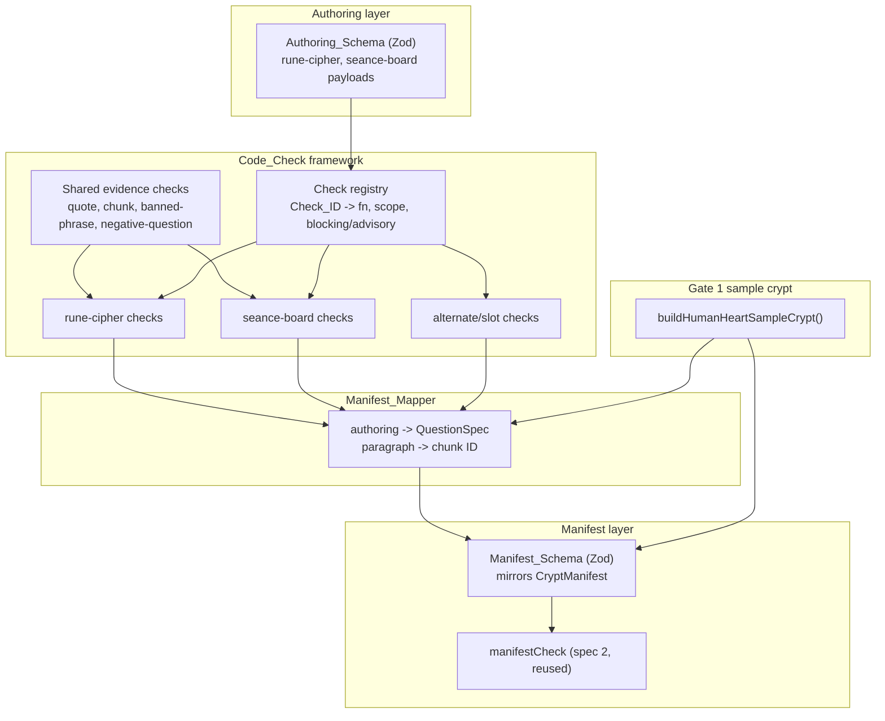
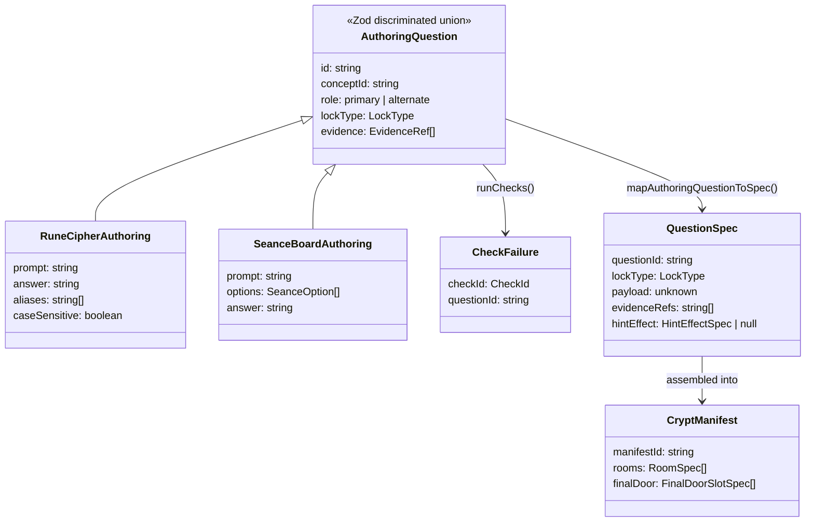

# Design Document

## Overview

This design covers Phase 1 (Gate 1) of the `generation-and-evaluation` spec: the Zod schemas for the authoring question format and the runtime `CryptManifest`, the Code_Check framework and the checks for rune cipher and séance board, the pure `Manifest_Mapper`, the Gate 1 sample crypt built from `samples/human-heart`, and the Zod migration of `parseNotesRecord`. It does not cover the provider interface, cassettes, the generation pipeline, evaluation, the remaining four lock types, or the conflict check, sufficiency and release-status work — those are later phases (P2–P6) and are out of scope for this document, which designs P1 only and names the P2+ seams it must leave in place.

Phase 1 also makes one small change outside the new modules: it adds the `reveal-first-letter` kind to `HintEffectSpec` in `packages/core/src/types.ts` (Req 2.13) and narrows which hint kinds each lock type's `QuestionSpec` may carry (Req 2.14–2.19). The adversarial set (`eval/adversarial/fixtures.json`) is not changed by this spec (Req 9.6).

Everything here lives in `packages/core`. Phase 1 adds no provider, network, database or AI SDK dependency; it imports nothing from `apps/worker` or `apps/web`. The runtime's `CryptManifest` (`packages/core/src/runtime/manifest-types.ts`) is the only manifest type this or any later phase produces — there is no separate "generation manifest."

### Sufficiency check against `samples/human-heart` (brief instruction, reported here)

`samples/questions/human-heart.json` has 12 questions across 7 concepts, but Phase 1 only builds Code_Checks for `rune-cipher` and `seance-board` (Req 9.8 and 1.2 — `lock-type-not-supported` for the rest). Filtering to those two types:

| Concept | Usable (rune/séance) questions | Unusable (other types) |
|---|---|---|
| `hh-c01` | `hh-q01` (rune, primary), `hh-q02` (séance, alternate) | — |
| `hh-c02` | `hh-q03` (séance, primary), `hh-q04` (rune, alternate) | — |
| `hh-c03` | `hh-q06` (séance, alternate) | `hh-q05` bone-ordering primary |
| `hh-c04` | `hh-q08` (rune, alternate) | `hh-q07` bound-threads primary |
| `hh-c05` | none | `hh-q09` cursed-object, `hh-q10` dial |
| `hh-c06` | none | `hh-q11` dial primary, no alternate |
| `hh-c07` | `hh-q12` (rune, primary, no alternate) | — |

So **5 of the 7 concepts** (`hh-c01`, `hh-c02`, `hh-c03`, `hh-c04`, `hh-c07`) have at least one Phase-1-usable question; `hh-c05` and `hh-c06` have none and cannot appear in the Phase 1 sample crypt at all. The sample-crypt builder (Requirement 27) therefore has exactly 5 eligible concepts and 7 eligible questions to split between room locks and the final door. With 2 concepts used as room locks (one `rune-cipher` slot from `hh-c01`, one `seance-board` slot from `hh-c02`, each with its own alternate — the only two concepts with both a primary and an alternate in the usable set), 3 concepts remain for the final door (`hh-c03`, `hh-c04`, `hh-c07`), each contributing its single usable question. That meets Requirement 19.2's "2 to 4 reserved questions where at least 2 leftover concepts exist" with exactly 3, each a full slot spec built from that concept's one available question. This is tight but sufficient — there is no spare fourth concept, so the builder cannot be configured to reserve 4. Design 27.4 (below) encodes this as a fixed, deterministic choice rather than a search, since the input is fixed sample data, not learner notes.

**Gate 1 sample room and ghosts.** The Gate 1 sample room has exactly 2 locks (one `rune-cipher`, one `seance-board`). The runtime returns a ghost only after `GHOST_DELAY` (3, `packages/core/src/runtime/ghost-queue.ts`) further judged answers have passed since it spawned. A room of 2 locks cannot produce 3 judged answers after a first miss, so in the sample crypt a ghost cannot return inside the room. Ghosts return only at the final door, where `GHOST_DELAY` is waived and every pending ghost becomes a Return slot (`final-door-slots.ts`). This is expected behaviour of the runtime, not a defect in the sample crypt. The sample-crypt test therefore asserts the manifest shape only, and does not expect an in-room ghost return. The sample crypt documents this in a comment next to the builder so a reader does not mistake it for a bug.

## Architecture



Later phases attach to this without changing it: P2's Provider sits only inside a future `Concept_Extractor`/`Generator`/`Blind_Reviewer` module that calls `AQ` to validate model output before it reaches the Code_Check framework; P3's pipeline calls the same `REG` and `MM` functions this phase builds; P5 adds four more lock-type check modules behind the same `REG` shape; P6's conflict checker and release flags sit above `MM`'s output. No P1 module imports from a module that will later hold provider code, so none of that wiring requires touching P1 files.

## Components and Interfaces

### 1. Authoring_Schema (`packages/core/src/authoring/schema.ts`, `authoring/schema.test.ts`)

Mirrors the shape already used by `eval/dev/questions/*.json` and `samples/questions/*.json` (seen directly in `samples/questions/human-heart.json`). One Zod schema per lock type's authoring payload, discriminated on `lockType`, plus a `role: 'primary' | 'alternate'` field (the file-level `role` already distinguishes primary/alternate per entry) and the `note` field some fixtures carry (free text, optional, never validated for content — it is a human aside, not evidence).

```ts
// packages/core/src/authoring/schema.ts
import { z } from 'zod';

const EvidenceRefSchema = z.strictObject({
  paragraph: z.number().int().positive(),
  quote: z.string(), // length is a Code_Check (quote-too-short/-too-long), not a schema bound,
                      // so a too-short or too-long quote still parses and then fails the check.
});

const RuneCipherAuthoringSchema = z.strictObject({
  id: z.string().min(1),
  conceptId: z.string().min(1),
  role: z.enum(['primary', 'alternate']),
  lockType: z.literal('rune-cipher'),
  prompt: z.string().min(1),
  answer: z.string().min(1), // Req 5.6: empty answer rejected here, before any Code_Check
  aliases: z.array(z.string()),
  caseSensitive: z.boolean(),
  evidence: z.array(EvidenceRefSchema).min(1), // Req 4.1: one or more quotes
  explanation: z.string(),
  hint: z
    .strictObject({ kind: z.literal('first-letter-and-length'), firstLetter: z.string().length(1), length: z.number().int().positive() })
    .optional(),
  note: z.string().optional(),
});

const SeanceOptionSchema = z.strictObject({
  id: z.string().min(1),
  text: z.string().min(1),
  label: z.enum(['supported', 'contradicted']), // Req 6.9 / evidence-and-honesty: no 'not-mentioned' value exists
  evidence: EvidenceRefSchema,
});

const SeanceBoardAuthoringSchema = z.strictObject({
  id: z.string().min(1),
  conceptId: z.string().min(1),
  role: z.enum(['primary', 'alternate']),
  lockType: z.literal('seance-board'),
  prompt: z.string().min(1),
  options: z.array(SeanceOptionSchema).min(3).max(4), // Req 6.2 pre-check; exact arity re-checked by Code_Check for a clear Check_ID
  answer: z.string().min(1),
  explanation: z.string(),
  // No hint field (Req 8.9): the Manifest_Mapper decides the séance hint in code from the option labels.
  note: z.string().optional(),
});

export const AuthoringQuestionSchema = z.discriminatedUnion('lockType', [
  RuneCipherAuthoringSchema,
  SeanceBoardAuthoringSchema,
  // P5 appends BoneOrderingAuthoringSchema, BoundThreadsAuthoringSchema,
  // CursedObjectAuthoringSchema, CombinationDialAuthoringSchema to this array.
]);

export type AuthoringQuestion = z.infer<typeof AuthoringQuestionSchema>;
```

- `z.strictObject` rejects unknown keys, so a quietly-added field (e.g. a model trying to smuggle an offset) fails the schema rather than passing through silently.
- No field anywhere accepts an offset, a character index, or a computed number from the model side (Req 1.7, 25.3). `CombinationDialAuthoringSchema` (P5) will hold `answer.value`/`answer.min`/`answer.max` as *copied* numbers the quote must still contain — code decides correctness via a Code_Check, never the schema.
- `lockType` is restricted to the six `LOCK_TYPES` values by virtue of being a Zod literal per arm of the discriminated union (Req 1.5); an unknown `lockType` fails to match any arm.
- **Parsing wrapper** (Req 1.4): a tiny wrapper around `safeParse` turns Zod's result into the project's `Result<T, E>` shape and never throws:

```ts
// packages/core/src/authoring/parse.ts
export type AuthoringParseError = { readonly kind: 'invalid-authoring-question'; readonly path: string };

export function parseAuthoringQuestion(value: unknown): Result<AuthoringQuestion, AuthoringParseError> {
  const parsed = AuthoringQuestionSchema.safeParse(value);
  if (parsed.success) return { ok: true, value: parsed.data };
  const first = parsed.error.issues[0];
  return { ok: false, error: { kind: 'invalid-authoring-question', path: first ? first.path.join('.') : '' } };
}
```

- **Round-trip property** (Req 1.6): `AuthoringQuestion` values are plain JSON (arrays and strict objects only, no `Map`/`Date`/`undefined`-bearing optional fields left implicit — Zod's `.optional()` fields are simply absent, which survives `JSON.stringify`/`JSON.parse` as absence too), so `parseAuthoringQuestion(JSON.parse(JSON.stringify(parseAuthoringQuestion(x).value)))` reproduces an equal value, including `options` array order, which nothing in the schema reorders.

### 2. Code_Check framework (`packages/core/src/checks/`)

```
packages/core/src/checks/
  types.ts          // CheckId, CheckResult, CheckRegistration, CheckScope
  registry.ts        // CHECK_VERSION, CHECK_REGISTRY, registerCheck (build-time only)
  registry.test.ts
  evidence.ts         // shared: quote-*, unknown-paragraph/chunk, banned-phrase, negative-question,
                       // missing-according-to-your-notes lives in seance.ts (séance-specific prefix)
  evidence.test.ts
  run-checks.ts       // runChecks(question, context) -> readonly CheckResult[]
  run-checks.test.ts
```

```ts
// packages/core/src/checks/types.ts
import type { LockType } from '../types';

export type CheckId =
  | 'quote-not-found' | 'quote-ambiguous' | 'quote-too-short' | 'quote-too-long'
  | 'unknown-paragraph/chunk' | 'missing-according-to-your-notes' | 'negative-question'
  | 'banned-phrase' | 'answer-not-in-quote' | 'rune-needs-one-blank'
  | 'answer-leak-in-prompt' | 'answer-leak-in-room' | 'option-count'
  | 'option-not-supported-or-contradicted' | 'option-without-evidence'
  | 'not-exactly-one-supported' | 'key-not-the-supported-option' | 'duplicate-options'
  | 'step-count' | 'duplicate-steps' | 'no-explicit-sequence-marker-in-quotes'
  | 'pair-count' | 'not-one-to-one' | 'item-count' | 'answer-not-an-item'
  | 'missing-category-rule' | 'needs-category-and-outside-quotes' | 'missing-units'
  | 'number-not-in-quote' | 'range-not-in-quote' | 'template-not-allowlisted'
  | 'template-input-not-in-quote' | 'template-value-mismatch' | 'model-written-expression'
  | 'alternate-same-lock-type' | 'max-one-alternate' | 'dial-range-prompt'
  | 'alternate-off-concept'
  | 'lock-type-not-supported'; // Req 3.8: P1's own escape hatch for the other four types

export type CheckSeverity = 'blocking' | 'advisory';

export interface CheckRegistration {
  readonly id: CheckId;
  readonly scope: readonly LockType[] | 'shared'; // 'shared' checks run for every supported Lock_Type
  readonly severity: CheckSeverity;
  readonly implemented: boolean; // true once the check function exists; P5 flips the four later lock types to true
}

/** One failure. Pure data; never thrown. */
export interface CheckFailure {
  readonly checkId: CheckId;
  readonly questionId: string;
}

export const CHECK_VERSION = '2026-11-25.1'; // Req 3.2: exact value; changed whenever the set or behaviour of Code_Checks changes
```

```ts
// packages/core/src/checks/registry.ts
export const CHECK_REGISTRY: readonly CheckRegistration[] = [
  { id: 'quote-not-found', scope: 'shared', severity: 'blocking', implemented: true },
  { id: 'quote-ambiguous', scope: 'shared', severity: 'blocking', implemented: true },
  { id: 'quote-too-short', scope: 'shared', severity: 'blocking', implemented: true },
  { id: 'quote-too-long', scope: 'shared', severity: 'blocking', implemented: true },
  { id: 'unknown-paragraph/chunk', scope: 'shared', severity: 'blocking', implemented: true },
  { id: 'banned-phrase', scope: 'shared', severity: 'blocking', implemented: true },
  { id: 'negative-question', scope: 'shared', severity: 'blocking', implemented: true },
  { id: 'rune-needs-one-blank', scope: ['rune-cipher'], severity: 'blocking', implemented: true },
  { id: 'answer-not-in-quote', scope: ['rune-cipher'], severity: 'blocking', implemented: true }, // combination-dial reuses the id in P5
  { id: 'answer-leak-in-prompt', scope: ['rune-cipher'], severity: 'blocking', implemented: true },
  { id: 'answer-leak-in-room', scope: ['rune-cipher'], severity: 'blocking', implemented: true }, // room-level, see Leak_Scan below
  { id: 'missing-according-to-your-notes', scope: ['seance-board'], severity: 'blocking', implemented: true },
  { id: 'option-count', scope: ['seance-board'], severity: 'blocking', implemented: true },
  { id: 'duplicate-options', scope: ['seance-board'], severity: 'blocking', implemented: true },
  { id: 'option-not-supported-or-contradicted', scope: ['seance-board'], severity: 'blocking', implemented: true },
  { id: 'option-without-evidence', scope: ['seance-board'], severity: 'blocking', implemented: true },
  { id: 'not-exactly-one-supported', scope: ['seance-board'], severity: 'blocking', implemented: true },
  { id: 'key-not-the-supported-option', scope: ['seance-board'], severity: 'blocking', implemented: true },
  { id: 'alternate-same-lock-type', scope: 'shared', severity: 'blocking', implemented: true },
  { id: 'max-one-alternate', scope: 'shared', severity: 'blocking', implemented: true },
  { id: 'alternate-off-concept', scope: 'shared', severity: 'advisory', implemented: true }, // Req 3.6, 7.3: the one non-blocking id
  { id: 'lock-type-not-supported', scope: 'shared', severity: 'blocking', implemented: true },
  // The P5 lock types' ids are registered now so the registry always equals the Req 3.5 list.
  // Their check functions arrive in P5; until then questions of those types fail with lock-type-not-supported.
  { id: 'step-count', scope: ['bone-ordering'], severity: 'blocking', implemented: false },
  { id: 'duplicate-steps', scope: ['bone-ordering'], severity: 'blocking', implemented: false },
  { id: 'no-explicit-sequence-marker-in-quotes', scope: ['bone-ordering'], severity: 'blocking', implemented: false },
  { id: 'pair-count', scope: ['bound-threads'], severity: 'blocking', implemented: false },
  { id: 'not-one-to-one', scope: ['bound-threads'], severity: 'blocking', implemented: false },
  { id: 'item-count', scope: ['cursed-object'], severity: 'blocking', implemented: false },
  { id: 'answer-not-an-item', scope: ['cursed-object'], severity: 'blocking', implemented: false },
  { id: 'missing-category-rule', scope: ['cursed-object'], severity: 'blocking', implemented: false },
  { id: 'needs-category-and-outside-quotes', scope: ['cursed-object'], severity: 'blocking', implemented: false },
  { id: 'missing-units', scope: ['combination-dial'], severity: 'blocking', implemented: false },
  { id: 'number-not-in-quote', scope: ['combination-dial'], severity: 'blocking', implemented: false },
  { id: 'range-not-in-quote', scope: ['combination-dial'], severity: 'blocking', implemented: false },
  { id: 'template-not-allowlisted', scope: ['combination-dial'], severity: 'blocking', implemented: false },
  { id: 'template-input-not-in-quote', scope: ['combination-dial'], severity: 'blocking', implemented: false },
  { id: 'template-value-mismatch', scope: ['combination-dial'], severity: 'blocking', implemented: false },
  { id: 'model-written-expression', scope: ['combination-dial'], severity: 'blocking', implemented: false },
  { id: 'dial-range-prompt', scope: ['combination-dial'], severity: 'blocking', implemented: false },
] as const;
```

The registry is the "list every Check_ID, its Lock_Type scope, and whether it is blocking or advisory" of Req 3.4. A unit test (`registry.test.ts`) compares the set of registry ids against the list in Req 3.5, which already includes `lock-type-not-supported` (Req 3.12), and fails on any missing or extra id. The expected list is written out in the test as a literal array copied from Req 3.5, not derived from the registry and not counted. This test fails loudly if an id is dropped or a typo creeps into a Check_ID string. A second test asserts `CHECK_VERSION === '2026-11-25.1'` (Req 3.2), and a third asserts `alternate-off-concept` is the only advisory id (Req 3.6).

**Shared evidence checks** (`evidence.ts`, Requirement 4):

```ts
// packages/core/src/checks/evidence.ts
export function checkQuote(
  chunks: ReadonlyMap<string, Chunk>,
  chunkRef: { paragraphChunkId: string; quote: string },
  questionId: string,
): CheckFailure | null {
  // unknown-paragraph/chunk first (Req 4.7) — includes heading-only chunks, since the
  // Manifest_Mapper's paragraph->chunk map (component 4) never includes a heading-only chunk ID
  if (!chunks.has(chunkRef.paragraphChunkId)) {
    return { checkId: 'unknown-paragraph/chunk', questionId };
  }
  const resolved = resolveQuote(chunks, chunkRef.paragraphChunkId, chunkRef.quote);
  if (resolved.ok) {
    return checkQuoteLength(chunkRef.quote, questionId); // still enforce the 25-word ceiling Quote_Resolver doesn't check
  }
  if (resolved.error.kind === 'too-short') return { checkId: 'quote-too-short', questionId };
  if (resolved.error.kind === 'ambiguous') return { checkId: 'quote-ambiguous', questionId };
  if (resolved.error.kind === 'unknown-chunk') return { checkId: 'unknown-paragraph/chunk', questionId };
  return { checkId: 'quote-not-found', questionId };
}
```

`resolveQuote` (existing, `packages/core/src/quote-resolver.ts`) already enforces the 4-word/20-char floor (`MIN_QUOTE_WORDS`, `MIN_QUOTE_CHARS`) and resolves to exactly one location or a typed `QuoteError`. It has no ceiling, so `quote-too-long` (Req 4.6) is a small additional word-count check layered on top, run only once `resolveQuote` has already succeeded (too-short is `resolveQuote`'s own error, too-long is this layer's). It is covered by a unit test, not by an adversarial fixture (Req 3.13, 9.6): a 26-word quote fails with exactly `quote-too-long`, and a 25-word quote does not.

```ts
export const MAX_QUOTE_WORDS = 25;
function checkQuoteLength(quote: string, questionId: string): CheckFailure | null {
  const words = quote.trim().split(/\s+/).filter(Boolean).length;
  return words > MAX_QUOTE_WORDS ? { checkId: 'quote-too-long', questionId } : null;
}
```

`banned-phrase` reuses the existing `BANNED_COPY_PHRASES` constant from `packages/core/src/copy.ts` (Req 26.2 — one constant, two consumers: this check and the existing `copy-banned-words.test.ts` repository lint) and scans `prompt`, every option's `text`, and `explanation`. `negative-question` runs a small denylist of negation markers (`not`, `never`, `except`, `incorrect`, `false`, `isn't`, `aren't`, `doesn't`) against the **prompt only** (not options or explanation — options routinely say "is not a chamber" as their *supporting* evidence text in `categoryRule`-style notes; the EARS criterion is about prompt framing) with one explicit exemption: a cursed-object prompt matching `/which (one|of these) .* not\b/i` is allowed through (Req 4.9), though no Phase 1 question is `cursed-object`, so this exemption is inert code until P5 but is written now so the Check_ID's behaviour is total across all six lock types from the start (Req 3.1 requires each check to have no I/O and be total, which includes not silently mis-handling a Lock_Type it doesn't yet validate numbers for — it still must not crash). Probed against the dev and sample rune/séance questions and the adversarial set: the deny-word regex fires on exactly one question in the whole corpus, `adv-06` ("which of these is NOT a job of T cells"), which is exactly the `code:negative-question` fixture it is meant to catch; nothing else false-positives.

### 3. Rune cipher checks (`packages/core/src/locks/rune-cipher-checks.ts`, `rune-cipher-checks.test.ts`)

Per Structure's convention that `rune-cipher.ts` holds the judge and stays small, the checks live in a sibling file next to it (Req 3.11's `<type>-checks.ts` allowance), re-exported from `rune-cipher.ts` is not needed — the Code_Check framework imports `rune-cipher-checks.ts` directly, and `rune-cipher.ts` is untouched except for one import the check file makes *of* it (the judge's `collapse`/case-fold helpers), never the reverse, so the judge module gains no new dependency.

```ts
// packages/core/src/locks/rune-cipher-checks.ts
import { judge } from './rune-cipher'; // imported only for its normalisation helpers, extracted below
```

Req 5.5 ("the rune cipher check SHALL apply the same normalisation that the rune judge applies") is satisfied by factoring `collapse` and the case-fold out of `rune-cipher.ts` into a tiny shared `normaliseRuneAnswer(value, caseSensitive)` export both the judge and the check import — a one-line change to the existing judge file (extract, don't rewrite the matching logic) so the two can never drift apart.

Checks, run in this order per Requirement 5:

1. `rune-needs-one-blank` — exactly one `______` (3+ underscores) run in the prompt; zero or more-than-one fails.
2. `answer-not-in-quote` — `normaliseRuneAnswer(answer)` must be a substring of `normaliseRuneAnswer(quote)` for at least one evidence entry (an alias not found in any quote is *not* checked here — Req 5.2 names only the answer, and the probe against the real dev/sample corpus found several legitimate aliases, e.g. `human-heart`'s `SA node` for `sinoatrial node`, that are valid synonyms not copied from the source text, so aliases are intentionally exempt from this check).
   **Resolved-quotes-only rule (Req 5.8):** `answer-not-in-quote` reads only evidence quotes that `resolveQuote` resolved uniquely (`checkAnswerInQuote(q, { chunks, paragraphChunkIds })`). If no quote of the question resolved, the check does not run; the quote failure (`quote-ambiguous`, `quote-not-found`, ...) already blocks, so one root cause is reported once. A question with at least one resolved quote that lacks the answer still fails with `answer-not-in-quote`. The same rule applies to the advisory `alternate-off-concept` (`checkAlternateOffConcept(primary, alternate, context)`): it compares only uniquely resolved quotes and does not run when either side has none. Séance checks read quote text only through `checkQuote`, so they need no change.
3. `answer-leak-in-prompt` — word-boundary match of `normaliseRuneAnswer(answer)` against the prompt text with the blank removed; a boundary-respecting regex (`(^|\W)answer(\W|$)`) avoids flagging a substring inside an unrelated longer word.
4. Room-level `answer-leak-in-room` (the Leak_Scan) is not a per-question check; see component 6 (Room assembly) below — it needs the whole room's visible text, which a single-question Code_Check never sees.

Probed against the dev and sample rune-cipher questions: zero false positives/negatives for checks 1–3 against the existing gold set, and the existing `code:quote-not-found`/`quote-ambiguous`/`quote-too-short`/`answer-not-in-quote` adversarial fixtures (`adv-01` through `adv-04`, `adv-23`) each trip only their one named Check_ID.

### 4. Séance board checks (`packages/core/src/locks/seance-board-checks.ts`, `seance-board-checks.test.ts`)

Per Requirement 6, run in this order:

1. `missing-according-to-your-notes` — prompt must start with `According to your notes` (case-sensitive match on that exact literal, since it is the one fixed phrase the brief and copy conventions use everywhere).
2. `option-count` — exactly 3 or 4 options.
3. `duplicate-options` — equal option `text` after `normaliseWithMap` (reuse the existing `packages/core/src/normalise.ts`, so "duplicate" means the same normalisation the Quote_Resolver already uses, not a second ad hoc rule).
4. `option-not-supported-or-contradicted` — every option's `label` must be `'supported'` or `'contradicted'`; since the schema's `z.enum(['supported', 'contradicted'])` already makes a third value structurally impossible, this Code_Check is reached only when the Authoring_Schema step is bypassed (e.g. this check is reused later by P3 against raw model JSON *before* it is schema-validated, when the Pipeline wants a named Check_ID rather than a generic schema failure) — written as a defensive check on the parsed `AuthoringQuestion['options'][number]['label']` type so it is total and harmless when the invariant already holds.
5. `option-without-evidence` — every option must carry its own non-empty `evidence.quote`; structurally guaranteed by the schema's `evidence: EvidenceRefSchema` being required per option, so, like check 4, this guards the same pre-schema reuse path.
6. `not-exactly-one-supported` — exactly one option labelled `supported`.
7. `key-not-the-supported-option` — `answer` must equal the `id` of the one `supported` option.

Each option's own quote is separately run through `checkQuote` (component 2) under its own `evidence` entry, and the Manifest_Mapper (component 5) preserves `options` array order into `optionIds` — verified by the round-trip property on `manifestArb` (Req 2.11) plus a direct unit test asserting `optionIds` matches `options.map(o => o.id)` for the human-heart sample questions.

Probed against the dev and sample séance-board questions (all passing; `adv-06` → `negative-question` only, since check 1 ("According to your notes...") still passes for that fixture and only the shared negative check fires; `adv-10` → `option-not-supported-or-contradicted` since its `"not-mentioned"` label is itself not a valid schema enum value, so when this fixture is fed in its *raw* pre-schema form — matching the fixture file's intent that `code:*` fixtures exercise the deterministic layer regardless of entry point — the Code_Check reports exactly that one id; `adv-25` → `not-exactly-one-supported` since it has two `supported` options).

### 5. Alternate and slot checks (`packages/core/src/checks/alternate.ts`, shared, not lock-specific)

Requirement 7's three checks apply across lock types, so they live beside the shared evidence checks rather than inside any one `locks/<type>.ts`:

- `alternate-same-lock-type` — given a concept's primary and alternate `AuthoringQuestion`s, fails if `alternate.lockType === primary.lockType`.
- `max-one-alternate` — fails if a concept's authoring data names more than one alternate (Phase 1's authoring JSON already encodes at most one `role: 'alternate'` per `conceptId`; this check guards the invariant rather than ever actually firing against the existing fixtures, since no fixture violates it — confirmed by a scan of all `eval/dev/questions/*.json` and `samples/questions/*.json`, where every `conceptId` has 0 or 1 alternate).
- `alternate-off-concept` (advisory) — fails (as a non-blocking result) if the alternate's answer-bearing quote is not among the *primary* concept's own `evidence` quotes. This never excludes a question (Req 7.3): `runChecks` returns it in the result array with `severity: 'advisory'` from the registry, and the Phase 1 acceptance test (component 7) asserts advisory failures never appear in a list of *blocking* failures used to decide pass/fail for Req 9.1–9.3.

`Generator SHALL accept null as a valid alternate` (Req 7.4) is a P3 concern (the Generator doesn't exist yet); Phase 1's only obligation is that `alternateQuestion: null` is a valid `LockSlotSpec` shape, which the existing `manifest-types.ts` and `manifest-check.ts` (spec `room-runtime`, already shipped) already allow — nothing to add here.

### 6. Room assembly: the Leak_Scan (`packages/core/src/checks/leak-scan.ts`, `leak-scan.test.ts`)

```ts
export function leakScanRoom(
  roomQuestions: readonly { readonly conceptId: string; readonly question: RuneCipherAuthoring; readonly visibleText: readonly string[] }[],
): readonly CheckFailure[] {
  // For every rune-cipher question's normalised answer, scan every OTHER concept's
  // visible text (prompt + options' text + explanation, excluding that question's own text)
  // for a word-boundary occurrence. Pure; no I/O; O(n^2) over a room's small question count.
}
```

Req 5.4's "another concept's visible text in that room" is interpreted literally: a rune answer appearing inside its *own* concept's alternate (e.g. a séance alternate option that happens to name the same fact) is not a leak — it is the same concept talking about itself — so the scan is keyed by `conceptId`, not by `questionId`. Req 24.4 (G-P3, "no rune cipher answer appears in another concept's visible text") is the property test for this function: `fast-check` generates rooms of arbitrary rune/séance questions with distinct random answer strings and asserts `leakScanRoom` finds no failure when no answer is deliberately duplicated into another concept's text, and does find one when it is (seeded mutation).

This is a room-level, not manifest-level, function: Room assembly in P3 calls it per room before publishing; Phase 1 only needs it to exist, be correct, and be exercised by the `adv-05` fixture (`answer-leak-in-room`) and by the Gate 1 sample crypt's one room, which the test suite runs it against directly.

### 7. Manifest_Schema (`packages/core/src/runtime/manifest-schema.ts`, `manifest-schema.test.ts`)

```ts
// packages/core/src/runtime/manifest-schema.ts
import { z } from 'zod';
import { LOCK_TYPES } from '../types';

const HintEffectSchema = z.discriminatedUnion('kind', [
  z.strictObject({ kind: z.literal('remove-option'), optionId: z.string() }),
  z.strictObject({ kind: z.literal('lock-first-bone'), boneId: z.string() }),
  z.strictObject({ kind: z.literal('tie-thread'), pair: z.tuple([z.string(), z.string()]) }),
  z.strictObject({ kind: z.literal('reveal-digit'), position: z.number().int().nonnegative() }),
  // Req 2.13: new kind, rune cipher only (see "Hint kind and narrowing" below).
  z.strictObject({ kind: z.literal('reveal-first-letter'), firstLetter: z.string().length(1), length: z.number().int().positive() }),
]);

const RuneCipherPayloadSchema = z.strictObject({
  answer: z.string().min(1),
  aliases: z.array(z.string()),
  caseSensitive: z.boolean(),
});
const SeanceBoardPayloadSchema = z.strictObject({
  optionIds: z.array(z.string().min(1)).min(3).max(4),
  keyOptionId: z.string().min(1),
}).refine((v) => v.optionIds.includes(v.keyOptionId), { message: 'keyOptionId must be one of optionIds' });
// P5 adds BoneOrderingPayloadSchema, BoundThreadsPayloadSchema, CursedObjectPayloadSchema,
// CombinationDialPayloadSchema here, each mirroring that lock's judge Question interface in
// packages/core/src/locks/<type>.ts exactly (so the schema and the judge can never silently diverge).

function payloadSchemaFor(lockType: string) {
  switch (lockType) {
    case 'rune-cipher': return RuneCipherPayloadSchema;
    case 'seance-board': return SeanceBoardPayloadSchema;
    default: return null; // P1: bone-ordering/bound-threads/cursed-object/combination-dial not yet validated
  }
}
```

A plain `payload: unknown` field (as declared in `manifest-types.ts`) cannot be narrowed by a single static Zod schema per `QuestionSpec`, because the right payload shape depends on the sibling `lockType` field of the *same* object. `QuestionSpecSchema` is therefore a `z.strictObject` with `payload: z.unknown()` plus a `.superRefine` that looks up `payloadSchemaFor(value.lockType)` and re-validates `value.payload` against it, attaching any Zod issues at the `payload` path — this is the standard Zod pattern for "the schema for field B depends on the value of field A" (Zod has no built-in operator for it; `superRefine` with manual issue-pushing is Zod's own documented approach, see [zod.dev](https://zod.dev) on refinements). For a Lock_Type with no payload schema yet (P5's four), `superRefine` pushes a custom issue so Phase 1's Manifest_Schema still *rejects* those payload shapes outright rather than silently accepting unknown JSON — matching Req 3.8's "reject with `lock-type-not-supported`" intent at the manifest layer too, not just the Code_Check layer.

```ts
const QuestionSpecSchema = z.strictObject({
  questionId: z.string().min(1),
  lockType: z.enum(LOCK_TYPES),
  payload: z.unknown(),
  evidenceRefs: z.array(z.string().min(1)).min(1),
  hintEffect: HintEffectSchema.nullable(),
}).superRefine((value, ctx) => {
  const schema = payloadSchemaFor(value.lockType);
  if (schema === null) {
    ctx.addIssue({ code: 'custom', path: ['payload'], message: `lock-type-not-supported: ${value.lockType}` });
    return;
  }
  const result = schema.safeParse(value.payload);
  if (!result.success) for (const issue of result.error.issues) ctx.addIssue({ ...issue, path: ['payload', ...issue.path] });
  if (result.success) narrowHint(value.lockType, result.data, value.hintEffect, ctx); // Req 2.4, 2.14–2.17
});

const LockSlotSpecSchema = z.strictObject({
  slotId: z.string().min(1),
  stationType: z.enum(LOCK_TYPES),
  conceptId: z.string().min(1),
  primaryQuestion: QuestionSpecSchema,
  alternateQuestion: QuestionSpecSchema.nullable(),
}).refine((v) => v.alternateQuestion === null || v.alternateQuestion.lockType !== v.primaryQuestion.lockType, {
  message: 'alternateQuestion must have a different lockType from primaryQuestion',
});

const RoomSpecSchema = z.strictObject({
  roomId: z.string().min(1),
  lockSlots: z.array(LockSlotSpecSchema),
}).refine((v) => new Set(v.lockSlots.map((s) => s.stationType)).size === v.lockSlots.length, {
  message: 'at most one lock slot per Lock_Type per room',
});

const FinalDoorSlotSpecSchema = z.strictObject({
  slotId: z.string().min(1),
  conceptId: z.string().min(1),
  question: QuestionSpecSchema,
});

export const CryptManifestSchema = z.strictObject({
  manifestId: z.string().min(1),
  rooms: z.array(RoomSpecSchema),
  finalDoor: z.strictObject({ slots: z.array(FinalDoorSlotSpecSchema).min(0).max(4) }),
}).superRefine((manifest, ctx) => {
  const ids = new Set<string>();
  for (const room of manifest.rooms) {
    for (const slot of room.lockSlots) {
      for (const q of [slot.primaryQuestion, slot.alternateQuestion]) {
        if (q === null) continue;
        if (ids.has(q.questionId)) ctx.addIssue({ code: 'custom', path: ['questionId'], message: `duplicate questionId: ${q.questionId}` });
        ids.add(q.questionId);
      }
    }
  }
  for (const slot of manifest.finalDoor.slots) {
    if (ids.has(slot.question.questionId)) ctx.addIssue({ code: 'custom', path: ['questionId'], message: `duplicate questionId: ${slot.question.questionId}` });
    ids.add(slot.question.questionId);
  }
});
```

**Hint kind and narrowing** (Req 2.4, 2.13–2.19). Three changes sit around the Manifest_Schema.

1. `HintEffectSpec` in `packages/core/src/types.ts` gains one member, so the schema's inferred type and the hand-written type stay equal (the compile-time check below covers it):

```ts
| { readonly kind: 'reveal-first-letter'; readonly firstLetter: string; readonly length: number }
```

`firstLetter` is one character and `length` is a positive integer; the Zod schema enforces both, the TypeScript type cannot. The rune judge is not touched. It already does `void appliedHint`, so judging is unchanged (Req 2.13). The other five judges ignore unknown kinds already (the judge-totality tests feed every hint kind to every judge). Adding a union member can break an exhaustive `switch` over `HintEffectSpec` elsewhere; `pnpm typecheck` finds any such place and the fix is a new case, not a behaviour change.

2. `narrowHint(lockType, payload, hintEffect, ctx)` is a small pure function in `manifest-schema.ts` (or `manifest-hints.ts` if the file nears the ~300-line limit). `null` is always accepted. Otherwise:

| lockType | accepted `hintEffect` | extra rules |
|---|---|---|
| `rune-cipher` | `reveal-first-letter` | none beyond the field shapes (Req 2.14) |
| `seance-board` | `remove-option` | `optionId` must be in the payload's `optionIds`, and must differ from `keyOptionId` (Req 2.15) |
| other four | not narrowed in P1 | they are already rejected by `payloadSchemaFor` returning `null`; P5 adds their rows |

Any other kind for a narrowed lock type adds a custom issue at path `['hintEffect']`, so the parser returns the typed error (Req 2.16, 2.17). The `optionIds` and `keyOptionId` rules need the parsed payload, which is why narrowing runs inside the same `superRefine` after the payload parses, and is skipped when the payload is already invalid (one issue is enough).

3. `manifestCheck` (`manifest-check.ts`) does not inspect hint kinds today (no hint logic in the file), so Req 2.18 needs no code change there. A test pins this: a manifest with a `reveal-first-letter` rune hint passes `manifestCheck`. If a later change makes `manifestCheck` validate hint kinds, `reveal-first-letter` must be accepted with the Req 2.13 rules.

Test support (Req 2.19): `question-payloads.ts` returns `{ kind: 'reveal-first-letter', firstLetter, length }` as the `hint` for `rune-cipher`, derived from the generated `answer` so the hint matches its payload. It currently returns `null` for rune cipher. `manifestArb` and `buildManifest` pick this up through `question-payloads.ts`. `anyHintSpec` in `judge-totality.ts` gains a `reveal-first-letter` arm so every judge is still tested against every hint kind. Because the fixture builder now emits the new hint, the manifest round-trip property (Property 2) covers it without a separate test. Other specs' tests that assert a rune question has `hintEffect: null` are updated; this is a fixture change only.

**Compile-time type match** (Req 2.1): a dedicated test file asserts, at the type level, that `z.infer<typeof CryptManifestSchema>` is assignable both ways to and from the hand-written `CryptManifest` interface:

```ts
// packages/core/src/runtime/manifest-schema.test.ts (excerpt)
import type { CryptManifest } from './manifest-types';
import type { z } from 'zod';
import type { CryptManifestSchema } from './manifest-schema';

type Inferred = z.infer<typeof CryptManifestSchema>;
// Two-way assignability checks: if either direction breaks, these lines fail to compile,
// and `pnpm typecheck` (Req 9.7) fails the build — this *is* the "compile-time test" of Req 2.1.
type AssertAssignable<T, U extends T> = U; // U must satisfy T
type _A = AssertAssignable<CryptManifest, Inferred>;
type _B = AssertAssignable<Inferred, CryptManifest>;
```

This pattern (two one-directional `extends`-style assignability checks compiled but never executed) is the standard no-dependency way to pin two TypeScript types together without pulling in a separate type-testing library — it fails `tsc --noEmit` the moment the schema and the hand-written type diverge, satisfying "a compile-time test SHALL fail the build" without adding any new dev dependency beyond Zod itself.

**Parsing wrapper** mirrors the Authoring one (`Result<CryptManifest, ManifestSchemaError>`, never throws — Req 2.10).

**Round-trip property** (Req 2.11): exercised directly against the existing `manifestArb`/`buildManifest` from `packages/core/src/test-support/manifest-fixture.ts` (already shipped by `room-runtime`): `CryptManifestSchema.parse(JSON.parse(JSON.stringify(manifest)))` must deep-equal `manifest` for any manifest `buildManifest` produces. Since `buildManifest`'s `question-payloads.ts` only emits `rune-cipher`/`seance-board`/`bone-ordering`/`bound-threads`/`cursed-object`/`combination-dial` payloads and Phase 1's schema only has payload shapes for the first two, this property test in Phase 1 calls `buildManifest({ lockTypes: ['rune-cipher', 'seance-board'] })` — already a supported `BuildManifestOptions.lockTypes` filter — so the round-trip is exercised on exactly the Lock_Types Phase 1 validates; P5 widens the same test to the full `manifestArb` once all six payload schemas exist.

**`manifestCheck` gate** (Req 2.12, 12 in the brief addendum): a thin `publishManifest` helper formalises "schema then structural check then publish":

```ts
// packages/core/src/runtime/publish-manifest.ts
export function validateManifestForPublish(raw: unknown): Result<CryptManifest, ManifestSchemaError | InvalidManifestError> {
  const parsed = parseManifest(raw); // the Result-wrapper around CryptManifestSchema
  if (!parsed.ok) return parsed;
  const checked = manifestCheck(parsed.value); // existing spec-2 function, reused unchanged
  if (!checked.ok) return { ok: false, error: checked.error };
  return { ok: true, value: parsed.value };
}
```

P3's Pipeline (not built yet) will call this one function before emitting `RoomPublished`/calling the runtime's `RunStarted`; Phase 1's own consumer is the sample-crypt builder (component 8), which calls it directly.

### 8. Manifest_Mapper (`packages/core/src/mapper/manifest-mapper.ts`, `mapper/manifest-mapper.test.ts`)

```ts
export type MapperError =
  | { readonly kind: 'paragraph-not-found'; readonly questionId: string; readonly paragraph: number }
  | { readonly kind: 'check-failed'; readonly questionId: string; readonly checkId: CheckId }
  | { readonly kind: 'hint-mismatch'; readonly questionId: string };

export function mapAuthoringQuestionToSpec(
  question: AuthoringQuestion,
  chunksByParagraph: ReadonlyMap<number, string>, // paragraph number -> chunk ID, built once per document
  questionId: string, // Req 8.3: caller assigns a manifest-unique ID; the authoring `id` is a hint, not guaranteed unique
): Result<QuestionSpec, MapperError> {
  // 1. Resolve every evidence.paragraph to a chunk ID via chunksByParagraph; Req 8.7 on any miss.
  // 2. Run the full Code_Check suite (component 2-5) for the question's lockType; Req 8.5/8.6 — the
  //    mapper refuses to produce a QuestionSpec for a question that would fail a blocking check, since
  //    "passed Code_Checks" is a *precondition* the pipeline (P3) enforces before calling the mapper, but
  //    the mapper re-checks defensively (never exported as "trust me" API) so Req 8.6 holds even if a
  //    future caller skips the pipeline's own check step.
  // 3. Build `payload` per lockType (answer/aliases/caseSensitive for rune; optionIds/keyOptionId,
  //    preserving `options` array order, for séance — Req 6.8).
  // 4. hintEffect: see "Hint mapping rules" below (Req 8.4, 8.8–8.11). Decided in code from the answer
  //    (rune) or the option labels (séance), never from a model-supplied marker.
  // 5. evidenceRefs: the resolved chunk IDs, de-duplicated, in evidence array order.
}
```

**Hint mapping rules** (Req 8.4, 8.8–8.11). The rune judge still ignores hints (`void appliedHint`), so hints are display-only and judging is unchanged. The hint is always decided in code.

| Authoring question | Authoring `hint` | `hintEffect` produced |
|---|---|---|
| `rune-cipher` | absent | `{ kind: 'reveal-first-letter', firstLetter, length }` computed from `answer` |
| `rune-cipher` | `first-letter-and-length`, agrees with the computed values | the same computed `reveal-first-letter` |
| `rune-cipher` | `first-letter-and-length`, disagrees | typed `hint-mismatch` error, no `QuestionSpec` (Req 8.11) |
| `seance-board` | none (the schema has no hint field) | `{ kind: 'remove-option', optionId }` for the first option with `label === 'contradicted'` in authoring order, if one exists |
| `seance-board` | none | `null` when no option is `contradicted` (Req 8.10) |

- Rune: `firstLetter` is the first character of the answer after trimming, and `length` is the answer's length in characters (counting by code point, via `Array.from`, so a non-BMP character is one). A rune question always gets this hint, whether or not the authoring question carries one (Req 8.8). When an authoring hint is present, its `firstLetter` and `length` are compared with the computed values and a mismatch returns `hint-mismatch`. An answer that trims to empty cannot reach this point (the schema rejects it, Req 5.6).
- Séance: the option is chosen by code, never by the model (Req 8.9). The Code_Checks guarantee exactly one `supported` option, so the first `contradicted` option is never the key, and the Manifest_Schema rule in Req 2.15 holds by construction. A question with no `contradicted` option fails `not-exactly-one-supported` before mapping, or maps to `null` if a caller reaches the mapper with such a question (Req 8.10).
- `MapperError` has the variant `{ kind: 'hint-mismatch'; questionId: string }`.
- The hint output feeds Property 14 and the sample crypt (Req 27.9).

**Paragraph-to-chunk map** (Req 8.2): built once per document by chunking the notes text with the existing `chunkDocument({ sourceType: 'paste', text, originalText: text })` (Phase 1's sample has no PDF/edited-text distinction, so `text === originalText`) and reading each chunk's `location.paragraphNumber` (for `sourceType: 'paste'` chunks) into a `Map<number, string>`. Because the chunker can split one paragraph into multiple chunks for a long paragraph (`MAX_CHUNK_CHARS = 1200`) but `human-heart.txt`'s longest paragraph is well under that, each paragraph maps to exactly one chunk for this sample; a paragraph that chunked into multiple pieces would need the *first* chunk at that paragraph number (since `resolveQuote` only needs quotes to land inside the chunk that contains them) — this edge case doesn't arise in Phase 1's fixed sample input, so the map build only needs "last chunk wins for a given paragraph number" or "first chunk wins" to be documented, not exhaustively handled; the implementation keeps the *first* chunk seen for a paragraph number (`if (!map.has(n)) map.set(n, chunk.id)`), and a unit test pins this choice so a future multi-chunk paragraph in a bigger phase-5 fixture doesn't silently change behaviour.

**Determinism** (Req 27.8): `chunkDocument` is already documented as deterministic (`chunker.ts`: "the same input always gives the same chunks"), `mapAuthoringQuestionToSpec` has no randomness or I/O, and the sample builder (component 9) assigns `questionId`s by a fixed, order-based scheme (`` `${question.id}` `` directly, since authoring question IDs like `hh-q01` are already unique within `human-heart.json` — verified by the probe above, all 12 ids distinct) rather than any counter seeded by wall-clock time or randomness. The whole pipeline from file read to manifest is therefore a pure function of file contents.

### 9. Gate 1 sample crypt (`packages/core/src/sample-crypt/human-heart.ts`, `sample-crypt/human-heart.test.ts`)

```ts
export type SampleCryptError = MapperError | ManifestSchemaError | InvalidManifestError;

export function buildHumanHeartSampleCrypt(notesText: string, questionsJson: HumanHeartQuestionsFile): Result<CryptManifest, SampleCryptError> {
  // Fixed, data-driven selection (not a search — see sufficiency analysis in Overview):
  //  - Room locks: hh-c01 (rune primary hh-q01, séance alternate hh-q02),
  //                hh-c02 (séance primary hh-q03, rune alternate hh-q04).
  //  - Final-door reserved slots (Req 27.2): hh-c03 (hh-q06), hh-c04 (hh-q08), hh-c07 (hh-q12) —
  //    the 3 leftover Phase-1-usable concepts, each contributing its one usable question as a
  //    full FinalDoorSlotSpec (slotId, conceptId, question).
  // Every authoring question listed above is run through mapAuthoringQuestionToSpec, then
  // assembled into one RoomSpec, then validated end-to-end with validateManifestForPublish.
}
```

The function signature takes `notesText`/`questionsJson` as parameters rather than reading files itself, so it stays a pure function usable from a test with any input and so `packages/core` (which must not do file I/O per its "pure, synchronous" convention from the `ingestion-and-evidence` design) never touches the filesystem; a thin loader — either in the test file itself or in a small `apps/worker`-side bootstrap later — reads `samples/human-heart.txt` and `samples/questions/human-heart.json` and passes their parsed contents in. Phase 1's own test does the reading (via Node's `fs`, since `vitest` tests may use Node APIs even though the library code may not) and calls `buildHumanHeartSampleCrypt` with the real file contents, satisfying Req 27.3 ("WHEN the sample crypt is built, Manifest_Schema SHALL accept it and Manifest_Check SHALL pass it") directly against the real sample files, not a synthetic stand-in.

**Export surface** (Req 27.5): `packages/core/src/index.ts` exports `buildHumanHeartSampleCrypt` so `apps/web` (later) can import it; Phase 1 does not wire it into any UI, since that is out of scope here, but the export exists so a later spec can.

**Hints in the sample crypt** (Req 27.9): the builder adds nothing of its own. Every sample question goes through the mapper's hint rules, so every rune cipher question in the manifest has `reveal-first-letter` computed from its answer (with or without an authoring hint), and every séance board question with a `contradicted` option has `remove-option` for the first such option. The sample test asserts both, and that `validateManifestForPublish` accepts the manifest.

**Ghosts in the sample crypt:** see the "Gate 1 sample room and ghosts" note in the Overview. The room has 2 locks, so a ghost returns only at the final door (`GHOST_DELAY` is 3). The builder comment and the sample test say so, and the test does not look for an in-room return.

**`Human-reviewed` label** (Req 27.6): `samples/questions/human-heart.json`'s existing `"status": "draft: needs your human review before it may carry the 'Human-reviewed' label"` field is read by the builder (or by whatever later displays the label) as the source of truth — the builder does not hardcode `Human-reviewed` anywhere, and does not need to change this file's `status` value; that edit happens only when an actual human completes the review, which is explicitly outside this spec's scope. A small helper `isHumanReviewed(file: HumanHeartQuestionsFile): boolean` reads `file.status === 'human-reviewed'` (a second literal value the file format allows but `human-heart.json` does not currently use) so the check is a data read, never an inference from question content.

**No provider/network import** (Req 27.7): verified by a dependency-boundary test — see component 10.

## Data Models



`NotesRecord`'s Zod migration (component 10) does not change `NotesRecord`'s shape (Req 10.1's "same exported name, same signature"); it is a parser rewrite, not a data model change, so no new diagram entry is needed — `Chunk`/`SourceLocation`/`NotesRecord` stay exactly as defined in `packages/core/src/types.ts`.

## Correctness Properties

*A property is a characteristic or behavior that should hold true across all valid executions of a system — essentially, a formal statement about what the system should do. Properties serve as the bridge between human-readable specifications and machine-verifiable correctness guarantees.*

### Prework summary

Acceptance criteria were screened against the PBT decision guide. Most of Phase 1's criteria are either pure-function round-trips/invariants (clear PROPERTY candidates: schema round-trips, check purity/order-independence/idempotence, leak-scan correctness, mapper determinism) or fixed-count example checks against a specific, small, named dataset (dev/sample/adversarial corpora, the human-heart sample crypt) — those are EXAMPLE/INTEGRATION, since "100 random iterations" makes no sense against a dataset whose exact size and contents are the assertion itself. A few criteria (schema rejecting unknown `lockType`, `Check_Version` bumping) are SMOKE-level single-fact checks. Full detail below.

- **1.1–1.7 (Authoring_Schema)**: 1.6 (round-trip) is PROPERTY — behavior varies with arbitrary valid `AuthoringQuestion` values, and a round-trip is exactly the "serialize/deserialize" pattern PBT excels at. 1.3/1.4/1.5/1.7 are EXAMPLE/SMOKE — "does this one known-shape value parse/fail" is a fixed fact, not a universal quantification. 1.1/1.2 are structural (no behavior to vary) — not testable as PBT, verified by the Req 2.1-style compile check and by 1.3/1.4 examples.
- **2.1–2.12 (Manifest_Schema)**: 2.11 (round-trip over `manifestArb`) is PROPERTY — this is the headline PBT case, reusing an existing arbitrary generator over a large structured input space. 2.6/2.7 (uniqueness, one-slot-per-type) are PROPERTY — they are invariants that must hold for *any* manifest shape `manifestArb` can produce, not just the one example in the brief. 2.3/2.4/2.5/2.8/2.9/2.10/2.12 are EXAMPLE/SMOKE — each names a single fixed behavior (accept this shape, reject that shape, call `manifestCheck` after accept) best shown with 1–3 concrete cases. 2.1/2.2 are structural, verified at compile time, not by PBT. 2.13 is a type change, verified at compile time and by the round-trip. 2.14/2.15 (hint narrowing per lock type) are PROPERTY: for any generated rune or séance `QuestionSpec` and any hint, acceptance must equal the narrowing rule. 2.16/2.17 are the named rejection examples inside that property, and each also gets its own example test. 2.18 is an EXAMPLE (`manifestCheck` accepts the new kind). 2.19 is covered by Property 2.
- **3.1–3.11 (Code_Check framework)**: 3.9 (order-independence, G-P2) and 3.10 (idempotence) are textbook PROPERTY candidates — explicit universal statements over "any room"/"any question." 3.2/3.4/3.5/3.6/3.7/3.8/3.11 are SMOKE/structural (a version string, a registry listing, a file layout) — nothing to vary. 3.3 ("never throws") is folded into every other check's property tests as a side-assertion rather than its own test, since every PBT run already demonstrates the function returning instead of throwing across every generated input.
- **4.1–4.11 (shared evidence checks)**: no clean universal property beyond what `resolveQuote`'s own existing property tests (`quote-resolver*.test.ts`, already shipped) cover — `checkQuote` is a thin wrapper that maps `resolveQuote`'s existing typed errors to Check_IDs, so its correctness is an EXAMPLE-level mapping check (one case per `QuoteError` kind) plus the real-corpus verification already run above (dev and sample questions, adversarial fixtures) rather than a new from-scratch PBT.
- **5.1–5.7 (rune cipher)**: 5.7 (G-P1, every accepted candidate's quotes resolve uniquely) is PROPERTY — "for any generated candidate set" is explicit in the requirement text itself. 5.5 (same normalisation as the judge) is PROPERTY — for any answer/alias string and any `caseSensitive` flag, the check's and the judge's normalised forms must be byte-identical, which is exactly a metamorphic "two implementations agree" property, cheap since both sides are pure in-memory string functions. 5.1/5.2/5.3/5.4/5.6 are EXAMPLE/EDGE_CASE, each matching one named adversarial fixture or one Req-cited rule best shown concretely.
- **6.1–6.9 (séance board)**: 6.8 (option order preserved through the mapper) is PROPERTY — for any `AuthoringQuestion` with N options in any order, mapping then reading `optionIds` must reproduce that exact order; this is a structural invariant across the whole input space of option permutations, cheap to generate. 6.1–6.7, 6.9 are EXAMPLE, each a single named rule best matched against the existing fixtures.
- **7.1–7.4**: 7.1/7.2 are EXAMPLE (one fixture each: `adv-11` for same-lock-type, no counter-fixture exists for max-one-alternate since no real data violates it, so it's a synthetic 1-case unit test). 7.3 is EXAMPLE (advisory, never excludes — a fixed behavioral fact, not a varying property). 7.4 is deferred to P3 (Generator doesn't exist yet) — not testable in Phase 1.
- **8.8–8.11 (mapper hint rules)**: PROPERTY. For any valid rune answer, with or without an authoring hint, the mapped hint equals the first letter and length computed from it, and a disagreeing authoring hint gives `hint-mismatch`. For any séance question with N options in any order, the removed option is the first `contradicted` one and is never the key, or the hint is `null` when none is `contradicted`. All are cheap pure functions over generated input.
- **8.1–8.7 (Manifest_Mapper)**: 8.1/8.2/8.3/8.4/8.5 are EXAMPLE (one concrete mapping per lock type, matched against the human-heart fixtures). 8.6 is EXAMPLE/INTEGRATION — "the whole dev set maps and manifestCheck passes" is a fixed-corpus fact, not a varying property (there's no "for all" beyond the one named dataset — Req 9.1 already covers that corpus-wide check with its own hard count). 8.7 (typed error, no partial spec) is EDGE_CASE, covered directly by the paragraph-not-found unit test.
- **9.1–9.8 (Phase 1 acceptance against datasets)**: entirely INTEGRATION/EXAMPLE by nature — every criterion names an exact, small, fixed dataset and an exact expected count. PBT is the wrong tool for "there are exactly N of these" (per the workflow's own decision guide: "Does behavior vary meaningfully with input? No → Integration test").
- **10.1–10.5 (Notes_Record_Parser Zod migration)**: 10.3 (round-trip for `makeNotesRecord` output) is PROPERTY — classic serializer round-trip over arbitrary `Chunk[]` inputs (an arbitrary for `Chunk` already exists in `packages/core/src/test-support/arbitraries.ts` from the `ingestion-and-evidence` spec, reused here rather than redefined). 10.2/10.4/10.5 are EXAMPLE/INTEGRATION — "accept what the old version accepted, reject what it rejected" is checked by running the *existing* `notes-record.test.ts` suite unchanged (Req 10.4 says exactly this) plus the differential check in Property 6 below, not a new generative property beyond that differential. 10.1 is structural/SMOKE.
- **27.9 (sample hints)**: EXAMPLE against the one sample file.
- **27.1–27.8 (Gate 1 sample crypt)**: 27.8 (determinism) is PROPERTY in spirit but over a *fixed* input (the same two files, read twice) — "for all" ranges over repeated builds, not over varying data, so it is implemented as a property test with a trivial 2-element input space (build twice, assert deep-equal), which is still a legitimate `fast-check`/direct-equality property, just not one needing 100 random variations of notes text. 27.1–27.7 are EXAMPLE/INTEGRATION against the one named sample.

### Redundancy reflection

Before finalizing, redundant candidates were merged or dropped:

- The G-P1 property (5.7, "every accepted candidate's quotes resolve uniquely") and `checkQuote`'s per-`QuoteError`-kind example tests overlap in intent but not in scope: G-P1 is about the *accepted set* after all checks run (an emergent guarantee), while the example tests pin `checkQuote`'s own mapping logic. Both are kept — one is a property over generated question sets, the other is a handful of fixed example cases for one function — but they are not double-counted as two independent properties; G-P1 is listed once below and the mapping examples live in the Testing Strategy's unit-test list, not here.
- 2.6 (unique `questionId`) and 2.7 (one slot per Lock_Type per room) both constrain "what counts as a valid manifest shape, independent of content" and could be tested in one combined property ("for all manifests `manifestArb` produces that satisfy structural well-formedness, `CryptManifestSchema` accepts them, and for all manifests with an injected duplicate id or an injected second same-type slot, it rejects them"). They are kept as two separate properties below because they test two independently-injectable mutations (duplicate-id vs duplicate-slot-type) and merging them would hide which invariant broke when a future change regresses one but not the other — the workflow's own redundancy examples merge properties only when one strictly implies the other, which isn't the case here.
- 10.3 (NotesRecord round-trip) and the differential check (10.2) are not merged: round-trip is "parse(serialize(x)) == x" (a PROPERTY), while the differential check is "new parser's accept/reject verdict == old parser's verdict" on the *old* function's own input space, which is a different relation entirely (comparing two functions, not one function's fixed point) — kept as a property (Property 6) and an INTEGRATION-style differential check respectively, not collapsed.
- 5.5 (check/judge normalisation agreement) was initially drafted as two separate properties (one for `caseSensitive: true`, one for `false`); these were merged into a single property parameterized by the boolean flag itself, since "for all strings and for all booleans" is one universal statement, not two.

### Property 1: Authoring_Question round-trip

For any valid `AuthoringQuestion` value accepted by the Authoring_Schema, serialising it to JSON and parsing the result SHALL produce an equal value with the same option order (for `seance-board` questions).

**Validates: Requirements 1.6**

### Property 2: Manifest round-trip

For any `CryptManifest` produced by `manifestArb`/`buildManifest` restricted to `rune-cipher` and `seance-board` lock types, serialising it to JSON and parsing the result with `CryptManifestSchema` SHALL produce an equal manifest with identical option order and identical hint effects, including `reveal-first-letter` hints on rune cipher questions.

**Validates: Requirements 2.11, 2.19**

### Property 3: Manifest_Schema rejects duplicate question IDs

For any manifest produced by `manifestArb` with a second question's `questionId` overwritten to equal an existing one, `CryptManifestSchema` SHALL reject the manifest.

**Validates: Requirements 2.6**

### Property 4: Manifest_Schema rejects a second slot of the same Lock_Type in one room

For any manifest produced by `manifestArb` with a room's lock slots mutated so that two slots share a `stationType`, `CryptManifestSchema` SHALL reject the manifest.

**Validates: Requirements 2.7**

### Property 5: Code_Checks are order-independent

For any room's set of questions and any permutation of that set, running the Code_Checks over the room SHALL return the same set of check failures (by `checkId` and `questionId`, ignoring array order).

**Validates: Requirements 3.9**

### Property 6: Code_Checks are idempotent

For any single question and its evidence context, running the Code_Checks on it twice SHALL return equal results both times.

**Validates: Requirements 3.10**

### Property 7: Rune cipher check and judge agree on normalisation

For any answer or alias string and any `caseSensitive` boolean, the rune-cipher Code_Check's normalisation of that string SHALL equal the rune-cipher judge's normalisation of the same string under the same `caseSensitive` flag.

**Validates: Requirements 5.5**

### Property 8: Accepted rune-cipher candidates resolve uniquely

For any set of generated rune-cipher candidate questions and their cited chunks, every candidate that the Code_Checks accept SHALL have every evidence quote resolve to exactly one location (G-P1).

**Validates: Requirements 5.7**

### Property 9: Manifest_Mapper preserves séance-board option order

For any `AuthoringQuestion` of lock type `seance-board` with its `options` array in any order, mapping it to a `QuestionSpec` and reading `payload.optionIds` SHALL reproduce that exact order.

**Validates: Requirements 6.8**

### Property 10: Leak_Scan finds no cross-concept rune leak unless one is injected

For any room of generated rune-cipher and séance-board questions with distinct concepts and distinct answers, the Leak_Scan SHALL report no `answer-leak-in-room` failure; for the same room with one concept's answer string injected into another concept's visible text, the Leak_Scan SHALL report exactly that failure (G-P3).

**Validates: Requirements 24.4**

### Property 11: NotesRecord round-trip through the migrated parser

For any `Chunk[]` produced by the existing `Chunk` arbitrary, `parseNotesRecord(JSON.parse(JSON.stringify(makeNotesRecord(chunks))))` SHALL equal `{ ok: true, value: makeNotesRecord(chunks) }`.

**Validates: Requirements 10.3**

### Property 12: Sample crypt build is deterministic

For repeated calls to `buildHumanHeartSampleCrypt` with the same `samples/human-heart.txt` and `samples/questions/human-heart.json` contents, the resulting manifests SHALL be deeply equal.

**Validates: Requirements 27.8**

### Property 13: Manifest_Schema narrows hints per lock type

For any `QuestionSpec` of lock type `rune-cipher` or `seance-board` with a valid payload and any `hintEffect` drawn from `null` and every `HintEffectSpec` kind, `CryptManifestSchema` SHALL accept it if and only if: the hint is `null`; or the lock type is `rune-cipher` and the kind is `reveal-first-letter`; or the lock type is `seance-board`, the kind is `remove-option`, the `optionId` is in the payload's `optionIds`, and the `optionId` differs from `keyOptionId`.

**Validates: Requirements 2.4, 2.14, 2.15, 2.16, 2.17**

### Property 14: Mapper hint rules

For any valid rune cipher `AuthoringQuestion`, whether or not it carries a `first-letter-and-length` hint that agrees with its answer, the mapped `hintEffect` SHALL be `reveal-first-letter` with `firstLetter` and `length` equal to the values computed from the answer. For any rune cipher `AuthoringQuestion` whose hint disagrees with the computed values, the mapper SHALL return `hint-mismatch` and no `QuestionSpec`. For any valid séance board `AuthoringQuestion` with options in any order and at least one `contradicted` option, the mapped `hintEffect` SHALL be `remove-option` naming the first `contradicted` option in authoring order, and that option SHALL NOT be the key. For any séance board question with no `contradicted` option, the mapped `hintEffect` SHALL be `null`. In every successful case the mapped `QuestionSpec` SHALL pass `CryptManifestSchema` narrowing.

**Validates: Requirements 8.4, 8.8, 8.9, 8.10, 8.11**

## Error Handling

Every function introduced in this phase returns a typed `Result<T, E>` (the project's existing shape from `packages/core/src/types.ts`) and never throws across its public boundary, matching the tech rule ("Errors are typed results, not thrown strings, in `packages/core`") and Requirements 1.4, 2.10, 3.3, 8.7:

| Function | Error union |
|---|---|
| `parseAuthoringQuestion` | `{ kind: 'invalid-authoring-question'; path: string }` |
| `parseManifest` (via `CryptManifestSchema`) | `{ kind: 'invalid-manifest-schema'; path: string }` (distinct from spec-2's `invalid-manifest` reason codes, so a schema failure and a structural-check failure are never confused) |
| `validateManifestForPublish` | union of the above and spec-2's existing `InvalidManifestError` |
| `runChecks` | never errors — returns `readonly CheckFailure[]`, empty when the question passes everything |
| `mapAuthoringQuestionToSpec` | `MapperError` (`paragraph-not-found` \| `check-failed` \| `hint-mismatch`) |
| `buildHumanHeartSampleCrypt` | union of `MapperError`, manifest-schema error, and `InvalidManifestError` — Req 27.4's "typed error that names the question" is satisfied by `MapperError.questionId` and `MapperError.check-failed.checkId` carrying exactly that |
| `parseNotesRecord` (migrated) | unchanged: `{ kind: 'invalid-record' }` |

Internals may use exceptions for truly unreachable states (an array index that a prior length check already guarantees exists), consistent with how `quote-resolver.ts` itself wraps its body in a `try`/`catch` that always converts to the typed `not-found` error rather than ever letting an exception escape to the caller — the same `try`/`catch`-at-the-boundary pattern is used in every new function that touches string indexing (`checkQuoteLength`, the rune leak scanner's regex construction from untrusted answer text).

No function in this phase logs, and none accepts a `Provider` or makes a network call, so the security rule's "Never log user content, prompts, model responses" and "no I/O at the edges only" principle hold trivially for Phase 1 — there are no edges yet.

## Testing Strategy

**Unit and example tests** (one file per component, matching Structure's one-file-per-lock-type convention, each kept under ~300 lines per the workspace rule):

- `authoring/schema.test.ts` — parses every real dev and sample rune/séance question successfully (Req 1.3), including the sample rune question that carries a hint; rejects a handful of hand-built malformed values with the expected `path` (Req 1.4); rejects an unknown `lockType` string (Req 1.5); confirms no field accepts an `offset`/`start`/`end` key (Req 1.7, via a `z.strictObject` unknown-key rejection test).
- `checks/evidence.test.ts` — one example per `QuoteError` kind mapped to its Check_ID; `quote-too-long`: a quote of 26 words fails with exactly `quote-too-long`, and a quote of 25 words does not (Req 3.13; both quotes are built in the test from a resolvable passage, no fixture file is added); `banned-phrase` against each phrase in `BANNED_COPY_PHRASES`; `negative-question` against the denylist and its cursed-object exemption regex (inert in Phase 1's two lock types but unit-tested for totality).
- `locks/rune-cipher-checks.test.ts`, `locks/seance-board-checks.test.ts` — the ordered-check-list examples above, run against every relevant dev/sample/adversarial fixture by id (not just counted — each fixture asserts its own exact expected Check_ID, matching Req 9.2's "fail each fixture with exactly its expected Check_ID and no other blocking Check_ID").
- `checks/alternate.test.ts` — `adv-11` for `alternate-same-lock-type`; one synthetic two-alternate case for `max-one-alternate`; one synthetic off-concept-quote case for the advisory `alternate-off-concept`, asserting it never appears in a blocking-only filtered list.
- `checks/leak-scan.test.ts` — `adv-05` end-to-end; the Property 10 generative test.
- `runtime/manifest-schema.test.ts` — the compile-time assignability check; accept/reject examples per Req 2.3–2.5, 2.8–2.10; Properties 2–4 and 13. Hint rejection tests (Req 2.16, 2.17): a rune cipher spec with a `remove-option` hint is rejected; a séance spec with a `remove-option` hint naming an id not in `optionIds` is rejected; a séance spec whose `remove-option` names `keyOptionId` is rejected; a séance spec with a `reveal-first-letter` hint is rejected; `reveal-first-letter` with a 2-character `firstLetter` or a non-positive `length` is rejected. Also: `manifestCheck` accepts a manifest with a `reveal-first-letter` hint (Req 2.18), and the judge-totality tests still pass with the new `anyHintSpec` arm.
- `runtime/publish-manifest.test.ts` — Req 2.12's ordering (schema then `manifestCheck`), with one case where the schema passes but `manifestCheck` would fail on a cross-cutting rule the Zod schema doesn't encode (if any remains — in practice most of `manifestCheck`'s rules are now mirrored in the schema, so this test may show the two layers agreeing, which is still worth asserting explicitly so a future schema change that silently drops a rule is caught).
- `mapper/manifest-mapper.test.ts` — one mapping example per Phase 1 lock type using the actual `human-heart.json` questions; the paragraph-not-found error case; the `hint-mismatch` case (a rune authoring hint that disagrees with the answer); a rune question with no authoring hint still maps to `reveal-first-letter`; a séance question with a `contradicted` option maps to `remove-option` for the first one, and one with none maps to `null`; an example for each row of the hint table; Properties 9 and 14.
- `sample-crypt/human-heart.test.ts` — builds the real sample crypt from the real files; asserts `validateManifestForPublish` accepts it (Req 27.3); asserts the exact room/final-door concept split documented in the Overview's sufficiency analysis; Property 12; every sample rune cipher question has `reveal-first-letter` and every sample séance board question with a `contradicted` option has `remove-option` (Req 27.9); a dependency-boundary test (see below) for Req 27.7. The test does not expect an in-room ghost return, because the room has 2 locks and `GHOST_DELAY` is 3.
- `notes-record.test.ts` — unchanged, re-run against the migrated parser (Req 10.4); one new differential test file (`notes-record-migration.test.ts`) that runs a fixed corpus of hand-built edge-case values (missing fields, wrong types, an out-of-range `schemaVersion`, a valid record) through both the pre-migration logic (temporarily kept as a private reference implementation inside the test file itself, inlined from the current `notes-record.ts` body, not exported) and the migrated Zod version, asserting identical accept/reject verdicts (Req 10.2) — this reference copy is deleted once the migration test is accepted, since its only job is proving the one-time migration, not living on as a second implementation to maintain.
- `checks/registry.test.ts` — the registry id set compared with the Req 3.5 list only (that list includes `lock-type-not-supported`), failing on any missing or extra id (Req 3.4, 3.5, 3.12); `CHECK_VERSION` equals `'2026-11-25.1'` (Req 3.2). The same file holds the implementation-status test (Req 3.14). The registry does not mark status yet, so each `CheckRegistration` gains one field, `implemented: boolean`. It is `true` for every id scoped to `rune-cipher`, `seance-board` or `'shared'`, and `false` for every id scoped to `bone-ordering`, `bound-threads`, `cursed-object` or `combination-dial` (the Phase 5 ids). P5 flips each flag to `true` when it adds that lock type's check function. The test asserts three things:
  1. Every registry entry scoped to `rune-cipher`, `seance-board` or `'shared'` has `implemented: true`, and `runChecks` calls an implementation for it. The test shows the call by running `runChecks` on a question that trips each such id (an adversarial `code:*` fixture where one exists, otherwise a synthetic question, for example for `quote-too-long`, `max-one-alternate` and `alternate-off-concept`) and asserting that id appears in the result.
  2. Every registry entry scoped to one of the four Phase 5 lock types has `implemented: false`.
  3. For a generated question of each of those four lock types, `runChecks` returns exactly one failure, `lock-type-not-supported`, and no Phase 5 Check_ID. Until P5, a question of those types can therefore fail only with `lock-type-not-supported`.
- A new Phase 1 count-guard test (co-located with the Req 9.1–9.6 acceptance suite, `phase1-acceptance.test.ts`) reads `eval/dev/questions/*.json`, `samples/questions/*.json`, and `eval/adversarial/fixtures.json` itself at test time (not hardcoding the lists), filters to `rune-cipher`/`seance-board`, and compares the numbers of questions, `code:*` fixtures and `review:*` fixtures with the expected values stated in Req 9.1 and 9.4. The expected values live in the test as named constants taken from those requirements; this document does not repeat them. The test fails with a message naming the expected and actual numbers if the corpus ever changes shape (Req 9.4). The adversarial set is read, never written, by this spec. This test, and every other Phase 1 test, reads only `eval/dev/`, `samples/` and `eval/adversarial/` — a repository-wide grep-based test (or a simple `fs` existence assertion) confirms no test file string-references `eval/holdout` (Req 9.5).
- A dependency-boundary test (e.g. `boundary.test.ts`, or folded into the sample-crypt test) statically greps the source of every Phase 1 module for `fetch`, `http`, `net`, provider/cassette/budget-ledger module paths and any `@ai-sdk`-style import, asserting none appear — a cheap, deterministic stand-in for "imports no Provider, Cassette, Budget_Ledger, network or AI SDK module" (Req 9.8/27.7) that doesn't require those modules to exist yet to test their absence.

**Adversarial set unchanged** (Req 9.6): `eval/adversarial/fixtures.json` is not edited. The existing `code:*` rune cipher and séance board fixtures are each checked for exactly their expected Check_ID (Req 9.2), and `quote-too-long` is covered only by the unit test in `checks/evidence.test.ts`.

**Property tests**: `fast-check`, per the stack. Each property test is tagged with a comment referencing its design property and run with a minimum of 100 iterations (the project's existing property test files, e.g. `runtime-candles-properties.test.ts`, already follow this convention — these new ones match it):

```ts
// Feature: generation-and-evaluation, Property 5: Code_Checks are order-independent
test.prop([roomQuestionsArb()], { numRuns: 100 })('check results are order-independent', (questions) => { ... });
```

New arbitraries needed (`packages/core/src/test-support/`, alongside the existing `arbitraries.ts`): an `authoringQuestionArb` (rune-cipher and séance-board only, Phase 1 scope) generating valid `AuthoringQuestion` values with synthetic chunk text so `resolveQuote` succeeds by construction (quotes are generated as exact substrings of the generated chunk text, 4–25 words, to stay inside the valid-input space these properties target — the adversarial fixtures, not generated arbitraries, cover the invalid-input space). These compose with the already-shipped `manifestArb`/`buildManifest` for the manifest-level properties (2–4, 13), so no second manifest generator is built from scratch.

**No real provider calls**: trivially true in Phase 1 — there is no Provider module to call. The dependency-boundary test above is the regression guard that keeps it true as P2 code lands nearby.

**CI**: all of the above run under the existing `pnpm test`, `pnpm lint`, `pnpm typecheck` (Req 9.7); no new CI job is needed, since Phase 1 adds no new workspace package, only new files inside `packages/core`. `zod` is added as a new `dependencies` entry in `packages/core/package.json` (pinned, like `@noble/hashes`) — this is Phase 1's one new third-party dependency, matching the tech rule ("Validation: Zod for every schema crossing a boundary"), and is also used by the `apps/worker`/`apps/web` boundaries this spec's later phases and other specs will need, so introducing it here in `packages/core` establishes the one shared version for the whole workspace via pnpm's hoisting.

## Open points carried forward (not solved in this document)

- Streaming a new room into a running game (Req 16.4, 22.10) — explicitly deferred past this spec per the brief addendum; Phase 1's sample crypt is a single complete one-room manifest built before any run starts, consistent with `RunStarted` taking the whole manifest.
- The other four lock types' Authoring_Schema arms, payload schemas, and checks — P5, with the exact seams named above (`payloadSchemaFor`'s `default` branch, the discriminated union's array, the registry's trailing comment block).
- The Provider interface, cassettes and budget-reservation hook — P2; no Phase 1 file imports toward them.
