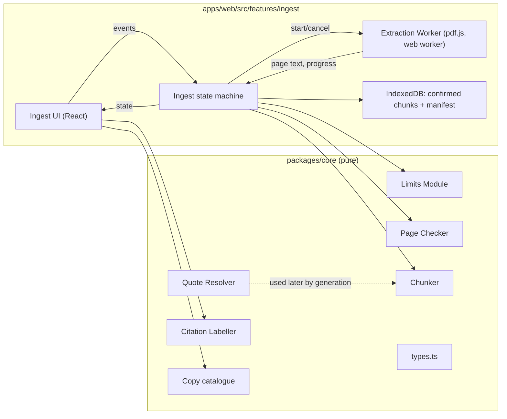
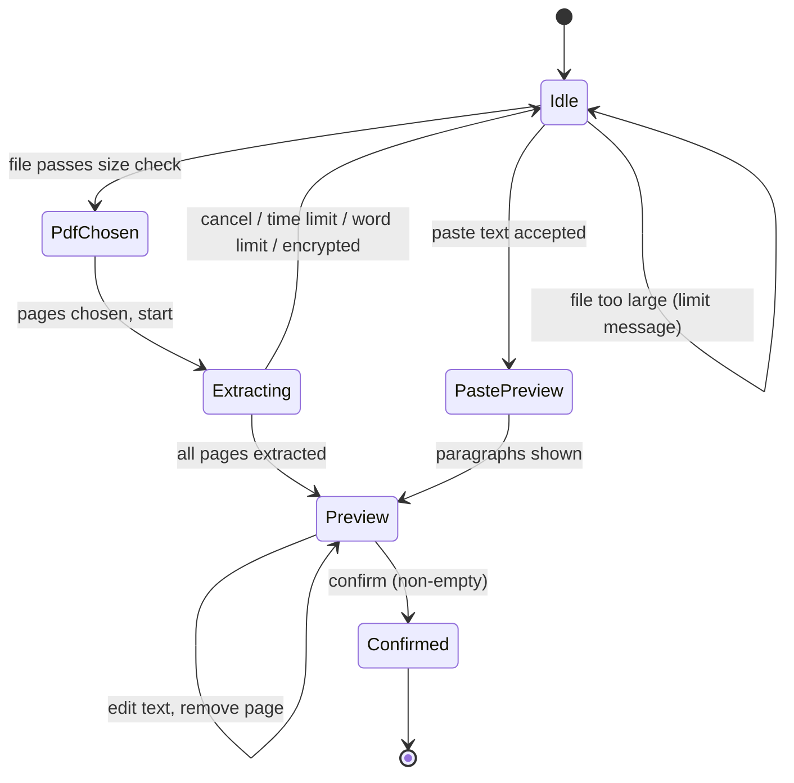

# Design Document

## Overview

This design covers how a learner's notes become immutable, citable chunks in Escape the Crypt. A learner pastes text or uploads a text-based PDF, picks pages, reviews and edits the extracted text, and confirms it. The Chunker then produces chunks with code-assigned IDs. Later features cite those chunks with an exact quote that the Quote Resolver locates. This spec ends at the chunks, the Quote Resolver and the Citation Labeller. Question generation, AI calls, gameplay and the worker service in `apps/worker` are out of scope.

The design has two halves:

- **Engine (`packages/core`)**: pure, synchronous functions: Limits Module, Page Checker, PDF Text Assembler, Chunker, Quote Resolver, Citation Labeller, plus a small copy catalogue. Its only runtime dependency is `@noble/hashes`. No React, no IndexedDB, no AI SDK, no pdf.js. Errors are typed results, never thrown strings.
- **Ingest feature (`apps/web/src/features/ingest`)**: the Ingest UI, the Extraction Worker (pdf.js in a web worker), and a small state machine that drives the flow. The UI never changes state directly. It sends events to the state machine.

### Key design decisions

| Decision | Rationale |
|---|---|
| Engine hashes with `@noble/hashes` (`sha256`) | The engine must not depend on the DOM, so it cannot call `crypto.subtle` (async). `@noble/hashes` is synchronous and has no dependencies, so `chunkDocument` stays pure, synchronous and property-testable (Requirement 6.8, 12.1). The dependency version is pinned exactly in `packages/core/package.json` and the pnpm lockfile. |
| PDF text is assembled by a pure function from pdf.js items | Paragraph splitting and line-break hyphen handling only work if line breaks and blank lines exist in the extracted text. A pure assembler fed with plain item data is testable without pdf.js. |
| Network guarantee is "no cross-origin request, no request body with file content" | pdf.js loads its worker, and optionally cMaps and fonts, over HTTP. Self-hosting those assets keeps them same-origin, and the test can still fail on anything that leaves the origin or uploads content. |
| Edited flag compares a chunk to the original chunks of its own unit | No position-based alignment is needed, so edits that change the chunk count cannot misalign the comparison (5.3, 5.4). |
| Quote normalisation builds an offset map | Requirement 7.10 needs offsets in the original text. Each normalised character records the original range it came from, so no offset is ever guessed. |
| Ambiguity counts overlapping occurrences | A quote like "aa aa aa" in "aa aa aa aa" must be treated as ambiguous. Counting only non-overlapping matches would wrongly resolve it. |
| Limits are checked at the earliest possible point | File size is checked before the worker starts (3.2). Word count is checked per page as text arrives (3.4). Time is checked against an injected clock (3.5, 14.1). |
| Chunk IDs are `chk_<digest12>_<position>` | Deterministic for identical text, distinct for duplicate paragraphs because position is part of the ID (6.8, 6.9). |
| Edited flag is computed per chunk by comparison with original extraction text | Marks only chunks that actually differ, not whole pages (5.3, 5.4). |
| Preview text is rendered only as React text children | No `dangerouslySetInnerHTML`, consistent with `security.md` (5.7). |

### Research summary

- **pdf.js in a web worker.** pdf.js runs its parsing in its own worker. The ingest feature wraps pdf.js in an Extraction Worker that owns the document object, so that terminating the worker releases all memory (2.7). Embedded JavaScript is not executed by pdf.js unless scripting is enabled. The design sets `enableScripting: false` and does not wire any form-submission or launch-action handler (2.5). The pinned version is recorded in `package.json` and the lockfile (pnpm). pdf.js normally starts its own worker, so running it inside our Extraction Worker means a nested worker or pdf.js's in-thread ("fake worker") mode. Support for nested workers differs across browsers, which is why the implementation order starts with a feasibility spike (see Architecture).
- **Text items and line breaks.** `getTextContent()` returns items with a string, a transform (the y-position is `transform[5]`), a height and a `hasEOL` flag. It does not return paragraphs, so the design assembles lines and paragraphs itself.
- **Encrypted PDFs.** pdf.js raises a `PasswordException` when a document needs a password. The Extraction Worker maps it to a typed `encrypted` error and never prompts for a password (4.4).
- **Page text and printed page labels.** `getTextContent()` returns positioned text items. `getPageLabels()` returns printed labels when the PDF defines them. When absent, the printed label is `null`.
- **Hyphenation and ligatures.** PDF extraction often yields line-end hyphens ("exam-\nple") and ligature code points (U+FB01 and similar). The normalisation in the Quote Resolver handles both. The chunk text itself is stored as the learner confirmed it.

Background: [pdf.js documentation](https://mozilla.github.io/pdf.js/).

## Architecture



### Flow



### Implementation order and feasibility spike

The first implementation task is a spike, before any other ingest work: confirm that pdf.js runs correctly inside our Extraction Worker on Chrome, Firefox and Android Chrome. Two configurations are tried:

1. **Nested worker.** The Extraction Worker lets pdf.js start its own worker (self-hosted `pdf.worker` file).
2. **In-thread mode.** pdf.js runs in the Extraction Worker's thread using its fake-worker mode.

The spike extracts a small fixture PDF on each browser and checks that text comes back, that `terminate()` stops it, and that no cross-origin request is made. If neither configuration works on all three browsers, the design uses the fallback below.

**Fallback.** Run pdf.js (with its own self-hosted worker) from the main thread. The Extraction Client then owns the `loadingTask` and implements the same contract: cancel and timeout call `loadingTask.destroy()` and `pdfDocument.destroy()`, then terminate pdf.js's worker, then drop all references to extracted buffers. The cancel button, the 20-second limit and memory release (2.2, 2.3, 2.7, 3.5) behave the same for the learner. The only difference is that parsing shares the main thread, so the client extracts one page at a time and yields between pages to keep the UI responsive. The Extraction Client interface (`start`, `cancel`, `terminate`) hides which mode is in use, so the rest of the feature does not change.

### Boundaries

- The Extraction Worker only talks to the state machine through typed messages (`progress`, `page`, `error`, `done`). It contains no code that sends file content or extracted text anywhere. The guarantee is: **no request leaves to another origin and no request body contains file content.** The pdf.js worker and any other assets are self-hosted and served from the same origin. The Playwright test allows same-origin static asset requests (GET without a body) and fails on any cross-origin request or any request that carries a body during extraction (2.4).
- Only the **confirmed text** and chunk records leave the ingest feature, and only to browser storage in this spec. Sending confirmed text for later generation is a separate spec. The privacy notice states this (10.1, 10.2).
- Files stay under 300 lines and are named in kebab-case (12.4).

### File layout

```
packages/core/src/
  types.ts                 shared types: Chunk, SourceLocation, Quote, PageFlag, IngestError, events
  limits.ts                named constants + checkFileSize, capPageSelection, checkWordCount, checkElapsed
  page-checker.ts          classifyPage
  pdf-text-assembly.ts     assemblePageText (pure: text items in, page text out)
  digest.ts                documentDigest, wraps sha256 from @noble/hashes
  chunker.ts               chunkDocument (orchestrates)
  chunker-split.ts         sentence/word splitting
  chunker-merge.ts         minimum-size merge rules
  normalise.ts             normaliseWithMap
  quote-resolver.ts        resolveQuote
  citation-labeller.ts     citationLabel
  copy.ts                  ingest message catalogue
  *.test.ts                one test file per module
apps/web/src/features/ingest/
  ingest-flow.tsx          top-level screen
  privacy-notice.tsx
  paste-input.tsx
  pdf-picker.tsx           file input + page selection
  page-list.tsx            page flags, remove page
  preview-editor.tsx       per-page / per-paragraph editing
  live-announcer.tsx       polite live region
  ingest-machine.ts        state machine (single source of truth)
  extraction-worker.ts     pdf.js wrapper, runs in a web worker
  extraction-client.ts     main-thread handle: start, cancel, terminate
  ingest.e2e.ts            Playwright paste flow
```

## Components and Interfaces

### Types (`packages/core/src/types.ts`)

```ts
export type SourceType = 'pdf' | 'paste';

export type SourceLocation =
  | { sourceType: 'pdf'; pdfPageIndex: number; printedPageLabel: string | null }
  | { sourceType: 'paste'; paragraphNumber: number };

export interface Chunk {
  readonly id: string;               // chk_<digest12>_<position>
  readonly documentDigest: string;   // sha-256 hex of confirmed text
  readonly position: number;         // 0-based position in the document
  readonly text: string;
  readonly location: SourceLocation; // exactly one location
  readonly edited: boolean;
}

export type PageFlag = 'ok' | 'low-text' | 'suspicious';

export interface ResolvedLocation {
  readonly chunkId: string;
  readonly start: number; // offset in original, unnormalised chunk text
  readonly end: number;   // exclusive
}

export type QuoteError =
  | { kind: 'not-found' }
  | { kind: 'ambiguous'; count: number }
  | { kind: 'unknown-chunk' }
  | { kind: 'too-short' };

export type Result<T, E> = { ok: true; value: T } | { ok: false; error: E };

export type LimitError =
  | { kind: 'file-size'; limitBytes: number }
  | { kind: 'page-count'; limit: number }
  | { kind: 'word-count'; limit: number }
  | { kind: 'time'; limitMs: number };

export type IngestError =
  | LimitError
  | { kind: 'encrypted' }
  | { kind: 'unreadable' }
  | { kind: 'empty' };
```

### Limits Module (`limits.ts`)

```ts
export const MAX_FILE_SIZE_BYTES = 5 * 1024 * 1024;
export const MAX_SELECTED_PAGES = 10;
export const MAX_EXTRACTED_WORDS = 6000;
export const MAX_EXTRACTION_MS = 20_000;

export function checkFileSize(bytes: number): Result<true, LimitError>;
export function capPageSelection(pageIndexes: readonly number[]): { kept: number[]; capped: boolean };
export function countWords(text: string): number;
export function checkWordCount(runningTotal: number): Result<true, LimitError>;
export function checkElapsed(startedAtMs: number, nowMs: number): Result<true, LimitError>;
```

`checkElapsed` takes both timestamps as arguments. The Extraction Worker obtains `nowMs` from an injected `Clock` (`{ now(): number }`), so the 20-second limit is tested without a slow fixture (3.5, 14.1). A value equal to the limit passes. A value greater than the limit fails. The same boundary applies to bytes, pages and words.

### Page Checker (`page-checker.ts`)

```ts
export function classifyPage(text: string): PageFlag;
```

Rules, applied in order on the extracted text of one page:

1. Count words. If fewer than `LOW_TEXT_MIN_WORDS` (named constant, default 20), return `low-text` (scanned or image-only page, 4.2).
2. Compute the ratio of "odd" characters (U+FFFD, control characters, private-use code points) to all non-space characters. If above `GARBLE_MAX_RATIO` (default 0.05), return `suspicious`.
3. Split into non-empty lines. If at least `SHORT_LINE_MIN_LINES` (default 8) lines exist and the median line length is below `SHORT_LINE_MEDIAN_CHARS` (default 12), return `suspicious` (tables or columns, 4.3).
4. Otherwise return `ok`.

The thresholds are named constants so they can be tuned against `eval/dev/` fixtures later. They are starting values, not claims of accuracy.

### Chunker (`chunker.ts`, `chunker-split.ts`, `chunker-merge.ts`)

```ts
export const MAX_CHUNK_CHARS = 1200;
export const MIN_CHUNK_CHARS = 40;

export type ChunkInput =
  | { sourceType: 'paste'; text: string; originalText: string }
  | { sourceType: 'pdf'; pages: readonly PdfPageInput[] };

export interface PdfPageInput {
  pdfPageIndex: number;
  printedPageLabel: string | null;
  text: string;           // confirmed (possibly edited) text
  originalText: string;   // original extraction text
}

export function chunkDocument(input: ChunkInput): Chunk[];
```

For `paste` the input holds one confirmed text and the original text for comparison. The Ingest UI keeps per-paragraph original text, so for paste the original paragraphs are also split with the same rule and paired with the confirmed paragraph of the same paragraph number (see Data Models). That pairing identifies the unit only. Chunks within a unit are never compared by position.

Algorithm:

1. **Units.** Paste: split on one or more consecutive blank lines into paragraphs numbered from 1. PDF: each included page is one unit. Empty units are dropped.
2. **Candidate chunks inside a unit.** Split a unit on blank lines and heading lines (a line that is short, has no terminal punctuation and is followed by a blank line or is all caps).
3. **Split.** If a candidate is longer than `MAX_CHUNK_CHARS`, split at sentence boundaries, packing sentences greedily up to the limit. If one sentence alone is longer than the limit, split it at the last word boundary at or before the limit. A single token longer than the limit with no whitespace is split at the limit (hard split, so the size bound always holds).
4. **Merge.** If a candidate is shorter than `MIN_CHUNK_CHARS` and a following candidate exists in the **same unit**, merge it into the following one. If it is the last in its unit, merge it into the preceding candidate of the same unit. If it is the only candidate in its unit, keep it unchanged (6.12, 6.14, 6.16). Merging never crosses a unit boundary (6.13). After a merge the result may exceed the maximum. The merge step re-applies the split rule in a single pass, and a merged piece is never merged again. This keeps the algorithm terminating and the size bound true.
5. **Document digest.** SHA-256 (hex) of the confirmed text, computed with `sha256` from `@noble/hashes` over the UTF-8 bytes, defined as the units' texts joined by `\n\n` in order. For PDF the unit boundary is also part of the digest input, via a `\f` separator, so two documents with the same text on different pages differ.
6. **IDs.** Each chunk gets `position` = its index in the final list and `id = "chk_" + digest.slice(0, 12) + "_" + position`. Duplicated paragraphs share a digest but have different positions (6.9).
7. **Edited flag.** Chunk the unit's `originalText` with the same algorithm to get the set of original-extraction chunk texts for that unit (the same page or paragraph). A chunk has `edited = false` only if its exact text equals one of those original chunk texts. Otherwise `edited = true`. Chunks are never matched by position or index, so an edit that changes the number of chunks in a unit needs no special case. This keeps the rule per chunk (5.3, 5.4).

### Quote Resolver (`normalise.ts`, `quote-resolver.ts`)

```ts
export const MIN_QUOTE_WORDS = 4;
export const MIN_QUOTE_CHARS = 20;

export interface NormalisedText {
  readonly text: string;
  /** originalRange[i] = [start, end) in the original text for normalised char i */
  readonly originalRange: ReadonlyArray<readonly [number, number]>;
}

export function normaliseWithMap(original: string): NormalisedText;

export function resolveQuote(
  chunks: ReadonlyMap<string, Chunk>,
  chunkId: string,
  quote: string,
): Result<ResolvedLocation, QuoteError>;
```

Normalisation, applied identically to chunk text and quote:

1. Unicode NFC, applied per code point cluster so each output character still maps to an original range.
2. Ligatures expanded by an explicit table (fi, fl, ff, ffi, ffl, ſt, st).
3. Curly quotes folded to straight (‘ ’ → `'`, “ ” → `"`).
4. Hyphen at a line break removed: a `-` followed by optional spaces/tabs, a newline, and optional spaces/tabs is dropped (7.2). A hyphen with a letter on both sides on the same line is kept.
5. Runs of whitespace collapsed to one space; leading and trailing whitespace trimmed.

**Hyphen trade-off.** Joining line-break hyphens also joins genuinely hyphenated words that were split across lines. For example, "well-" at the end of a line followed by "known" on the next line becomes "wellknown". This is accepted. The quote and the chunk text go through the same normalisation, so a quote that spans such a break still matches the chunk consistently, and offsets still map back to the original text through the offset map.

Matching is case-sensitive (7.3).

`resolveQuote` order of checks:

1. Normalise the quote. The minimum is "4 words or 20 characters, whichever is longer", so the quote must meet both thresholds: `tooShort = !(wordCount >= 4 && charCount >= 20)`. If `tooShort`, return `too-short` without looking at any chunk (7.12). This check comes first, so it wins over an unknown chunk ID.
2. Look up the chunk. Missing: `unknown-chunk`.
3. Count overlapping occurrences of the normalised quote in the normalised chunk text. Zero: `not-found`. More than one: `ambiguous` with the count.
4. One occurrence at normalised index `i`, length `n`: `start = originalRange[i][0]`, `end = originalRange[i + n - 1][1]` (7.10).

The function never throws. The model never supplies offsets. The resolver is the only producer of `ResolvedLocation` (7.8).

### Citation Labeller (`citation-labeller.ts`)

```ts
export function citationLabel(chunk: Pick<Chunk, 'location' | 'edited'>): string;
```

| Case | Output |
|---|---|
| paste, any edited | `Paragraph N of your notes` |
| pdf, not edited, no printed label or label equals page+1 | `PDF page X` |
| pdf, not edited, label differs | `PDF page X (printed page L)` |
| pdf, edited | `Your edited notes, originally extracted from PDF page X` (with ` (printed page L)` when the label differs) |

`X = pdfPageIndex + 1`. No label contains "verified", "guaranteed", "100% accurate" or "hallucination-free" (8.4). The labels come from `copy.ts` templates.

### Copy catalogue (`copy.ts`)

A single typed map from message keys to strings and functions. Every error key has `what` and `next` parts, and the renderer joins them, so no problem message can omit the next step (3.6, 11.4). Messages refer to "your notes", never "the source document". Examples:

- `file-size`: "This file is larger than 5 MB, so we can't open it. Try a smaller PDF, or paste the text instead."
- `page-count`: "You can include up to 10 pages. We kept the first 10. Remove one to choose a different page."
- `word-count`: "Your notes are over 6,000 words. Remove some pages or paste a shorter part."
- `time`: "Reading this file took longer than 20 seconds, so we stopped. Try fewer pages or paste the text instead."
- `encrypted`: "This PDF is protected with a password, so we can't read it. Save an unprotected copy or paste the text instead."
- `low-text`: "Low text. This page looks like a scan, so we can't read its text. Remove it or paste the text instead."
- `privacy`: "Your file stays on this device while we read it. Only the notes text you confirm will be sent later to build questions."

Copy follows `tone.md` (short, kind, no shaming) and `evidence-and-honesty.md` (none of the banned words).

### Extraction Worker (`extraction-worker.ts`, `extraction-client.ts`)

Messages from the client to the worker: `start { fileBuffer, pageIndexes, startedAtMs }`, `cancel`. Messages back: `progress { page, total }`, `page { pdfPageIndex, printedPageLabel, text, flag }`, `error { error: IngestError }`, `done`.

#### PDF text assembly (`pdf-text-assembly.ts`)

pdf.js gives a flat list of text items, not lines or paragraphs. The step that turns them into page text is a pure function in `packages/core`, so it can be tested with plain item data and no pdf.js:

```ts
export interface TextItemData {
  str: string;
  y: number;        // vertical position, transform[5]
  height: number;   // item height
  hasEOL: boolean;
}

export const PARAGRAPH_GAP_FACTOR = 1.5;

export function assemblePageText(items: readonly TextItemData[]): string;
```

The Extraction Worker maps each pdf.js item to `TextItemData` and calls `assemblePageText`. Items are taken in the order pdf.js returns them (reading order). The function:

1. Builds lines. An item starts a new line when the previous item had `hasEOL`, or when its `y` differs from the previous item's `y` by more than a small tolerance (a named constant, a fraction of the item height). Within a line, item strings are concatenated.
2. Joins lines with `"\n"`.
3. Computes the median line height on the page (the median of each line's tallest item height; items with empty strings are ignored). When the vertical gap between two consecutive lines is greater than `PARAGRAPH_GAP_FACTOR` (1.5) times that median, the join between them is `"\n\n"` (a blank line) instead of `"\n"`.
4. Returns the text with no trailing newlines. Pages with no items return the empty string.

This assembly is what makes the later steps work. Without `"\n\n"` between paragraphs the Chunker has no paragraph boundaries to split on. Without `"\n"` at line ends the Quote Resolver cannot see line-break hyphens ("exam-\nple"), so hyphen handling would never apply. `classifyPage` also relies on line structure for its short-line rule.

#### Behaviour

- Opens the document with pdf.js through the pdf.js worker configuration chosen by the spike (`enableScripting: false`, no password callback). The pdf.js worker file is self-hosted. cMap and standard-font fetching is disabled, unless the cMap and font files are self-hosted on the same origin, in which case they may be enabled. The worker never requests an asset from another origin.
- For each chosen page in order: checks `checkElapsed` using the injected clock before and after the page, extracts text items, builds the page text with `assemblePageText`, adds to the running word total, calls `checkWordCount`, runs `classifyPage`, posts the `page` message.
- Stops at the first limit error and posts `error`.
- Checks a `cancelled` flag between pages. The client also calls `worker.terminate()` on cancel, timeout or error, which releases memory (2.2, 2.7).
- The client enforces a wall-clock timeout with the same clock as a second guard, in case a single page hangs inside pdf.js.
- If the spike selects the main-thread fallback, the client performs the same steps itself and, on cancel, timeout or error, calls `loadingTask.destroy()`, destroys the document and terminates pdf.js's worker (see Implementation order and feasibility spike).

### Ingest state machine (`ingest-machine.ts`)

A reducer `(state, event) => state` with typed events: `PASTE_CHANGED`, `FILE_SELECTED`, `PAGES_CHOSEN`, `EXTRACTION_PAGE`, `EXTRACTION_ERROR`, `CANCEL`, `PAGE_REMOVED`, `TEXT_EDITED`, `CONFIRM`. State holds the unit list (original text, current text, flag), the included set, the status and the latest announcement string. `canConfirm(state)` is true only when at least one included unit has non-whitespace text (5.6). On `CONFIRM` it calls `chunkDocument`. The UI renders state and dispatches events. It never mutates state.

### Ingest UI components

- **Privacy notice** at the top of the upload screen (10.1, 10.2).
- **Paste input**: a native `textarea` with a label. A word counter shows words used out of 6,000.
- **PDF picker**: native `input type=file`. After the size check, a page list shows page checkboxes. Selection stops at 10 and says so (3.3).
- **Page list**: each page shows its flag as an icon plus a text label (ok, low-text, suspicious) and a "Remove page" button on flagged pages (4.5, 4.6, 9.5).
- **Preview editor**: one native `textarea` per page or paragraph, plain text only (5.1, 5.2, 5.7).
- **Confirm and Stop buttons**. Confirm is disabled with an adjacent explanation text when nothing can be confirmed (5.6). Stop is visible while extracting (2.3).
- **Live announcer**: a visually hidden polite live region. Announces "Page 3 removed", "Page 3 marked low text", "Text edited", "Notes confirmed" (9.3).

Accessibility details follow `accessibility.md`. Every action is a native button, input or textarea, so Tab, Shift+Tab, Enter and Space work. There is no drag anywhere (9.7). Buttons and checkboxes have a hit area of at least 44×44px. Focus uses a 2px `--spectre-300` outline with offset. Flag state uses an icon plus text, never colour alone. This screen sits outside the atmosphere overlay, so the always-lit rule holds trivially (`design-system.md`).

## Data Models

### Chunk record

| Field | Type | Notes |
|---|---|---|
| `id` | string | `chk_<12 hex of digest>_<position>` |
| `documentDigest` | string | 64 hex chars, SHA-256 of confirmed text |
| `position` | number | 0-based index among all chunks |
| `text` | string | confirmed text of the chunk, unmodified |
| `location` | `SourceLocation` | exactly one of pdf page or paste paragraph |
| `edited` | boolean | chunk text differs from original extraction |

A chunk is immutable. Code uses `readonly` fields and `Object.freeze` at creation. Published manifests that later contain chunks are immutable too (`evidence-and-honesty.md`).

### Ingest unit (UI state)

| Field | Type | Notes |
|---|---|---|
| `key` | string | stable key for React lists |
| `source` | `SourceLocation` | page or paragraph |
| `originalText` | string | extraction output, never changed |
| `currentText` | string | editable |
| `flag` | `PageFlag` or null | null for paste paragraphs |
| `included` | boolean | false after "Remove page" |

### Storage

Confirmed chunks are stored in IndexedDB (`tech.md`). The record holds the chunk list and the document digest. It holds no file bytes. The original PDF is never stored. No ingest content is written to logs or to `.kiro/`.

### Digest definition

`documentText = units.filter(included).map(u => u.currentText).join(sep)` where `sep` is `\n\n` for paste and `\f` for PDF pages. `documentDigest` is the lowercase hex of `sha256` (from `@noble/hashes`) over the UTF-8 bytes of `documentText`.

## Correctness Properties

*A property is a characteristic or behavior that should hold true across all valid executions of a system-essentially, a formal statement about what the system should do. Properties serve as the bridge between human-readable specifications and machine-verifiable correctness guarantees.*

**Property reflection.** The prework produced many testable criteria. Criteria that overlap were merged: paragraph splitting (1.2, 6.1) became one property. Word-limit checks for paste and PDF (1.3, 3.4) share one function and one property. Size-bound, minimum-size and merge rules (6.11 to 6.16, 13.8) became one chunk-size property. Single-location, boundary and metadata rules (6.4 to 6.7, 6.13, 13.2, 13.9) became one property. Determinism and distinct-ID rules stay separate because they test different inputs. Quote-resolver rules for unique match, offsets and round trip (7.4, 7.10, 13.5) became one property. Banned words in labels and in copy (8.4, 11.2) became one property over all generated strings. Criteria about layout, focus, pdf.js wiring, network and architecture are covered by example, integration or smoke tests in the Testing Strategy.

### Property 1: Paste paragraphs split at blank lines

For any pasted text, splitting into paragraphs yields non-empty paragraphs numbered consecutively from 1, none of which contains a run of two or more consecutive line breaks separated only by whitespace, and joining the paragraphs with a blank line preserves all non-whitespace characters in order.

**Validates: Requirements 1.2, 6.1**

### Property 2: Word-count limit boundary

For any text or running word total, the word-count check passes when the count is at most the maximum extracted words and returns a `word-count` limit error naming that limit when it is greater.

**Validates: Requirements 1.3, 3.4**

### Property 3: File size and page selection limits

For any file size in bytes, the file-size check fails exactly when the size exceeds the maximum file size. For any list of page indexes, capping the selection returns the first maximum-selected-pages entries, reports `capped` exactly when the list was longer, and never returns more than the maximum.

**Validates: Requirements 3.2, 3.3**

### Property 4: Elapsed-time limit with injected clock

For any start time and current time, the elapsed check passes when the difference is at most the maximum extraction time and returns a `time` limit error when it is greater.

**Validates: Requirements 3.5, 14.1**

### Property 5: Problem messages name the limit and a next step

For any ingest error value (every limit kind, encrypted, unreadable, empty), the rendered message is non-empty, contains a "what happened" part and a "what to do" part, names the specific limit value for limit errors, and refers to "your notes" rather than "the source document".

**Validates: Requirements 3.6, 4.4, 11.3, 11.4**

### Property 6: Page classification

For any generated page text, `classifyPage` returns exactly one of `ok`, `low-text` or `suspicious`. Text with fewer words than the low-text minimum is `low-text`. Text with enough words and a garbled-character ratio above the threshold, or many very short lines, is `suspicious`. Well-formed prose with enough words is `ok`.

**Validates: Requirements 4.1, 4.2, 4.3**

### Property 7: Confirm is disabled for empty content

For any ingest state, `canConfirm` is false when no unit is included or every included unit's text is empty or only whitespace, and true when at least one included unit has non-whitespace text.

**Validates: Requirements 5.6**

### Property 8: Edited flag reflects a per-chunk difference

For any document and any set of edits, a chunk's edited flag is false exactly when the chunk's text equals one of the original-extraction chunk texts of the same unit (the same page or paragraph), and true otherwise. Chunking unedited text yields no edited chunks. An edit to one chunk leaves unchanged chunks in the same unit unflagged, including when the edit changes the number of chunks in that unit.

**Validates: Requirements 5.3, 5.4, 6.7**

### Property 9: Chunking is deterministic

For any confirmed text, chunking it twice produces identical chunk IDs, digests and texts in identical positions.

**Validates: Requirements 6.8, 13.1**

### Property 10: Chunk IDs are distinct and carry the document digest

For any document, including documents that contain identical paragraphs, all chunk IDs are distinct, and every chunk records the same document digest, which equals the SHA-256 of the confirmed text.

**Validates: Requirements 6.2, 6.3, 6.9, 13.7**

### Property 11: Every chunk has exactly one source location

For any paste or PDF document, every chunk records its source type and exactly one location, a paragraph number (paste) or a PDF page index with a separate printed page label (pdf). The location matches the unit its text came from, so no chunk text spans a page or paragraph boundary.

**Validates: Requirements 6.4, 6.5, 6.6, 6.13, 13.2, 13.9**

### Property 12: Chunk size bounds

For any document, no chunk exceeds the maximum chunk size. No chunk is shorter than the minimum chunk size unless it is the only chunk within its page or paragraph. Short chunks are merged only within their own page or paragraph, into the following chunk when one exists and into the preceding chunk otherwise.

**Validates: Requirements 6.11, 6.12, 6.14, 6.15, 6.16, 13.8**

### Property 13: Unique quotes resolve to correct offsets

For any chunk and any substring of its text that meets the minimum quote length and occurs exactly once after normalisation, the Quote Resolver returns a resolved location whose offsets, applied to the original unnormalised chunk text, select text that normalises to the same value as the quote.

**Validates: Requirements 7.4, 7.10, 13.5**

### Property 14: Absent quotes never resolve

For any chunk and any quote of sufficient length that does not occur in the normalised chunk text, the Quote Resolver returns a `not-found` error and never a resolved location.

**Validates: Requirements 7.5, 13.3**

### Property 15: Repeated quotes are ambiguous

For any chunk and any quote of sufficient length that occurs more than once in the normalised chunk text, including overlapping occurrences, the Quote Resolver returns an `ambiguous` error.

**Validates: Requirements 7.6, 13.4**

### Property 16: Short quotes are rejected without searching

For any quote shorter than the minimum quote length (fewer than 4 words or fewer than 20 characters after normalisation), the Quote Resolver returns `too-short` and never a resolved location, whatever the chunk ID.

**Validates: Requirements 7.12, 13.6**

### Property 17: Normalisation equivalences

For any chunk text, a quote copied from it still resolves when whitespace runs, curly versus straight quotation marks, ligatures or Unicode composition are changed, and when a line-break hyphen is inserted inside a word. A quote that differs only in letter case does not resolve, and an in-word hyphen is preserved, so removing it makes the quote fail to resolve.

**Validates: Requirements 7.1, 7.2, 7.3**

### Property 18: The Quote Resolver returns typed errors and never throws

For any chunk map, chunk ID string and quote string, including empty, very long and Unicode-heavy inputs, the Quote Resolver returns either a resolved location or an error whose kind is one of `not-found`, `ambiguous`, `unknown-chunk` or `too-short`.

**Validates: Requirements 7.7, 7.9**

### Property 19: Citation labels follow the chunk metadata

For any chunk location and edited flag, the label equals the form required by the rules: "PDF page X" with X = index + 1 for unedited PDF chunks, "PDF page X (printed page L)" when the printed label differs from X, "Paragraph N of your notes" for paste chunks regardless of the edited flag, and "Your edited notes, originally extracted from PDF page X" for edited PDF chunks.

**Validates: Requirements 8.1, 8.2, 8.3, 8.5, 8.6**

### Property 20: Banned words never appear in labels or copy

For any chunk location and edited flag, and for every entry in the copy catalogue, the produced text contains none of "verified", "guaranteed", "100% accurate", "hallucination-free", "mastered" or "exam-ready".

**Validates: Requirements 8.4, 11.2**

## Error Handling

| Situation | Detection | Result | Learner sees |
|---|---|---|---|
| File over 5 MB | `checkFileSize` on `File.size` before the worker starts | `file-size` error, no worker created | Size message with next step |
| More than 10 pages selected | `capPageSelection` | Selection stops at 10 | Page limit message |
| More than 6,000 words (paste or PDF) | `checkWordCount` on paste confirm or per extracted page | `word-count` error, worker terminated | Word limit message |
| Extraction over 20 seconds | `checkElapsed` with injected clock, plus client wall-clock guard | `time` error, worker terminated | Time limit message |
| Cross-origin request or request body during extraction | Playwright network guard (test only). The product code has no such request by design, and assets are self-hosted | Test fails. Not a runtime learner-facing error | Nothing. A failing test blocks the build |
| pdf.js cannot start its worker in the chosen mode | Worker start failure in the Extraction Client | `unreadable` error, worker or loading task destroyed. The spike decides the mode up front so this is a safety net | "We couldn't read this file. Try another copy or paste the text." |
| Encrypted or password-protected PDF | pdf.js password exception | `encrypted` error, worker terminated | Explanation and next step |
| Corrupt or unreadable PDF | pdf.js parse exception | `unreadable` error | "We couldn't read this file. Try another copy or paste the text." |
| Low-text or suspicious page | `classifyPage` | Page flagged, not blocked | Icon plus text label, "Remove page" button |
| Learner cancels | Stop button | Worker terminated, partial results discarded | "Stopped. Nothing from this file was kept." |
| Nothing to confirm | `canConfirm` false | Confirm disabled | Explanation beside the button |
| Unknown chunk ID, quote absent, repeated or short | Quote Resolver | Typed `QuoteError` | Not shown to the learner here; later generation sets the question aside |

Rules that apply to all errors:

- Errors in `packages/core` are returned as typed results. UI code maps them to copy keys.
- No error message includes the learner's text or file name. Nothing is logged except error kinds, counts and timings.
- When an error occurs mid-extraction, the worker is terminated and its memory is released (2.7). Already-confirmed chunks are untouched.
- When unsure, the design sets content aside rather than relaxing a check: an ambiguous or short quote is rejected, never "best-guess" resolved.

## Testing Strategy

### Why property-based testing applies here

The engine is pure, with clear inputs and outputs (text in, chunks out; chunk and quote in, location or error out). That suits property-based testing. The UI, the pdf.js wiring, the worker lifecycle, the network guarantee and the accessibility rules are not pure logic. They use example, integration and Playwright tests instead.

### Property-based tests (fast-check, Vitest)

- Library: `fast-check`, run through Vitest. No property-testing code is written from scratch.
- Each property is implemented as a **single** property test with at least **100 runs** (`numRuns: 100`, higher for the Quote Resolver).
- Each test carries a comment tag in the form **Feature: ingestion-and-evidence, Property N: <property title>**.
- Generators in `packages/core/src/test-support/arbitraries.ts`: pasted text with random blank-line runs, words and Unicode; PDF page lists with printed labels or `null`; duplicated paragraphs; very long sentences and single tokens above the chunk limit; chunk texts with line-break hyphens, in-word hyphens, ligatures, curly quotes and decomposed accents; quotes cut from a chunk text at random offsets.
- `assemblePageText` also gets a property test inside `pdf-text-assembly.test.ts`: for any item list, the output contains every item's non-whitespace characters in order and never contains three consecutive line breaks. This is an extra check, not tied to a numbered property.
- Tests live beside modules: `chunker.test.ts` (Properties 1, 8 to 12), `limits.test.ts` (2 to 4), `page-checker.test.ts` (6), `quote-resolver.test.ts` (13 to 18), `citation-labeller.test.ts` (19), `copy.test.ts` (5, 20), `ingest-machine.test.ts` (7).
- Tests never call an AI provider (`tech.md`). The engine has no provider.

### Unit and example tests (Vitest)

- **Limits with fixture PDFs.** Small fixtures in `apps/web/src/features/ingest/fixtures/`: a PDF just over 5 MB (generated at test time by padding), a PDF with 11 pages, a PDF whose text exceeds 6,000 words. Each checks the matching limit error. The maximum extraction time is tested with an **injected clock** that jumps past 20 seconds, so no slow fixture is needed (14.1).
- **Page flags with fixture PDFs.** One fixture each for `ok` (prose), `low-text` (image-only page) and `suspicious` (garbled text and a table-like layout) (14.2).
- **PDF text assembly unit tests.** Pure-function tests for `assemblePageText` with hand-written item lists: `hasEOL` produces `"\n"`; a y-position change produces `"\n"`; a vertical gap above 1.5 times the median line height produces `"\n\n"`; a gap of exactly 1.5 times produces `"\n"`; an empty page produces `""`.
- **Multi-paragraph PDF fixture.** A small fixture PDF with three paragraphs, one of them ending a line with a hyphenated word break ("exam-" then "ple"). The test extracts it through the real pdf.js path, then checks that the assembled page text has blank lines between the paragraphs, that the Chunker produces three chunks, and that a quote spanning the hyphen break resolves in the Quote Resolver.
- **Encrypted PDF fixture.** Confirms the `encrypted` error and that the worker is terminated.
- **Worker lifecycle.** With a mocked worker: Stop terminates it, a time-out terminates it, an error terminates it (2.2, 2.3, 2.7). The page choice happens before `start` is sent (2.6).
- **Constants.** One test asserts the named constants (5 MB, 10 pages, 6,000 words, 20,000 ms, 1,200, 40, 4 words and 20 characters) (3.1, 6.10, 7.11).
- **Plain-text rendering.** A preview unit containing `` renders as visible text, with no element created (5.7). A lint rule or test rejects `dangerouslySetInnerHTML` in `features/ingest`.
- **Labels and privacy copy.** The upload screen contains both privacy statements and the words "your notes" (10.1 to 10.3).
- **Edge cases.** Unknown chunk ID (7.7); lone heading that is the only chunk in its page (6.16); last short chunk merges backward (6.14); a single sentence over 1,200 characters (6.15).

### Accessibility checks

- axe runs in Playwright over the upload, page-list and preview screens.
- Component tests check that each page flag shows an icon and text, that a live-region announcement appears after page removal, edit and confirm, that buttons and checkboxes measure at least 44×44px, and that no action requires drag (4.6, 9.3 to 9.7).
- Manual checks before the milestone, per `accessibility.md`: keyboard-only run, touch on a mid-range Android phone, 200% zoom and one screen reader. Focus visibility (9.2) is confirmed in this manual pass, with axe as a supplement.

### Integration and smoke tests

- **Worker feasibility spike (2.1, 2.2, 2.7).** The first implementation task. Runs a fixture extraction with the nested-worker and in-thread configurations on Chrome, Firefox and Android Chrome, and records which one works. Cancel via `terminate()` must stop work in each.
- **Network guarantee (2.4).** A Playwright test observes every request during a fixture PDF extraction. It allows same-origin static asset requests without a body (the self-hosted pdf.js worker and any self-hosted cMap or font files). It fails on any cross-origin request, and on any request that carries a body, during extraction. It also asserts that the extracted text does not appear in any request.
- **PDF actions disabled (2.5).** A smoke test asserts the pdf.js options object has scripting disabled, and a fixture PDF with embedded JavaScript produces no side effect.
- **Architecture (12.x).** Lint and CI checks: `packages/core` has no imports from React, `pdfjs-dist` or the DOM; no file exceeds 300 lines; file names are kebab-case; shared types live in `types.ts`.

### End-to-end test (Playwright)

One test, `ingest.e2e.ts`, runs the paste flow (15.1):

1. Paste three paragraphs, each at least 40 characters.
2. Open the preview and check that three paragraphs appear as plain text.
3. Edit the second paragraph.
4. Confirm.
5. Read the stored chunks and check that only the second chunk has `edited: true`, and that the citation labels read "Paragraph 1 of your notes", "Paragraph 2 of your notes" and "Paragraph 3 of your notes".
6. Check that Confirm was disabled and explained while the text area was empty.

The paste flow runs with the keyboard only, as a second pass, to cover Requirement 9.1 for the paste path.

### Traceability

| Requirement | Covered by |
|---|---|
| 1 | Property 1, 2; e2e; unit test for the word-limit message |
| 2 | Worker feasibility spike; worker lifecycle tests; network and actions smoke tests; PDF text assembly tests |
| 3 | Properties 2 to 5; fixture PDF tests; injected clock |
| 4 | Property 5, 6; fixtures; component tests for flags and removal |
| 5 | Property 7, 8; plain-text rendering test; e2e |
| 6 | Properties 8 to 12; constants test; multi-paragraph PDF fixture |
| 7 | Properties 13 to 18; constants test |
| 8 | Properties 19, 20 |
| 9 | axe, component tests, manual pass |
| 10, 11 | Property 5, 20; copy tests |
| 12 | Lint and CI checks |
| 13 | Properties 9 to 16 |
| 14 | Fixture PDF tests, injected clock |
| 15 | Playwright e2e |
