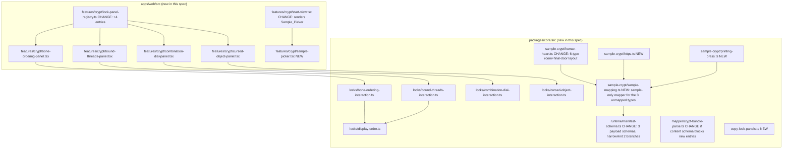

# Design Document

## Overview

This spec makes `bone-ordering`, `bound-threads`, `combination-dial` and `cursed-object` playable end to end: a pure Interaction_Model per type in `packages/core/src/locks/`, a React panel per type in `apps/web/src/features/crypt/`, registration in `lock-panel-registry.ts`, a widened Manifest_Schema, and three sample crypts (human-heart, https, printing-press) that each exercise all six lock types across rooms and the final door.

Nothing here touches live generation. The four judges (`locks/bone-ordering.ts`, `bound-threads.ts`, `cursed-object.ts`, `combination-dial.ts`) are read-only; this spec adds new files beside them (`*-interaction.ts`) and extends the manifest schema that already imports their payload shapes by name.

## Coordination gate

Before any file is touched:
1. Confirm with the user that the Other_Machine's push (multi-room play, rune letter count) landed.
2. `git pull --rebase`. Stop and report on conflict.
3. Re-run `git pull --rebase` immediately before every commit.

The six shared files (`room-screen.tsx`, `art-room.ts`, `question-controls.tsx`, `rune-cipher-panel.tsx`, `room-panel.tsx`, `lock-panel-context.ts`) are read fresh after the pull. Design assumption, to be re-checked after the pull: `room-panel.tsx`'s `RoomPanel` and `question-panel.tsx`'s `PanelShell` stay generic over `questionType`/`LOCK_PANELS[type]`, so registering four more entries in `LOCK_PANELS` requires **no edit** to `room-panel.tsx` or `question-panel.tsx` — the existing `createElement(LockPanel, { slotId, questionId, questionType })` call already works for any registered type. `lock-panel-context.ts` is unchanged (its `LockPanelContextValue` is already generic: `dispatch`, `rejection`, `content`, `appliedHintFor`). `question-controls.tsx` is unchanged (Hint/Skip/Challenge are type-agnostic). `room-screen.tsx` and `art-room.ts` need no change for lock art, because today's Scene_Files already list all six lock types per room (confirmed by reading `scene.json` for all three Art_Rooms) and `room-screen.tsx` already draws any lock present in `State.rooms[...].lockSlots` — the gap is only that the sample manifests never created slots of the four missing types. If the pull reveals either file now depends on a hardcoded two-lock assumption, the task list's first step re-reads it and reports the delta before continuing.

## Architecture



`packages/core` gains no React, database or AI SDK dependency. The four Interaction_Models and `display-order.ts` are pure, side-effect-free TypeScript consumed by both `packages/core` property tests and the `apps/web` panels.

## Components and Interfaces

### `locks/display-order.ts` (shared)

```ts
/** A small, seedable, non-cryptographic shuffle. Deterministic for a given seed and length. */
export function displayOrder<T>(items: readonly T[], seed: string): readonly T[] {
  const hash = seed.split('').reduce((h, c) => (h * 31 + c.codePointAt(0)!) >>> 0, 7);
  const arr = [...items];
  let state = hash || 1;
  for (let i = arr.length - 1; i > 0; i--) {
    state = (state * 1103515245 + 12345) >>> 0;
    const j = state % (i + 1);
    [arr[i], arr[j]] = [arr[j]!, arr[i]!];
  }
  return arr;
}
```

Used for the initial bone-ordering draft (seeded with `questionId`) and the bound-threads right-column order (seeded with `questionId + ':right'`). A seeded Fisher-Yates is deterministic and needs no random source per Requirement 3.2. Both call sites re-shuffle and discard any result that equals the identity or key order outright (a `while` loop with a different seed suffix, capped at 5 tries, then an explicit rotate-by-one fallback) so Requirements 3.3 and 3.5 hold even for very short lists (3 items) where a shuffle has a non-trivial chance of landing on the key order.

### `locks/bone-ordering-interaction.ts`

```ts
export interface BoneOrderingDraft {
  readonly order: readonly string[]; // current displayed order of itemIds
  readonly pinned: string | null;    // Pinned_Bone id, or null
}

export function initBoneOrderingDraft(payload: BoneOrderingQuestion, hint: HintEffectSpec | null): BoneOrderingDraft;
export function moveBoneUp(draft: BoneOrderingDraft, boneId: string): BoneOrderingDraft;
export function moveBoneDown(draft: BoneOrderingDraft, boneId: string): BoneOrderingDraft;
export function boneOrderingSubmission(draft: BoneOrderingDraft): BoneOrderingSubmission;
```

`initBoneOrderingDraft` calls `displayOrder(payload.itemIds, questionId-derived seed)` — the seed is threaded in via a `questionId` parameter so the same question always starts the same way. If a `lock-first-bone` hint is applied, the pinned bone is spliced to its `keyOrder` index after shuffling and `pinned` is set; `moveBoneUp`/`moveBoneDown` are no-ops when `boneId === pinned` or at an array bound (Requirement 4.8, 3.8). `boneOrderingSubmission` returns `{ order: draft.order }` unconditionally — bone ordering is always "ready" since a full permutation exists from the start, matching how `RuneCipherPanel` treats an always-ready draft. Never throws; `moveBoneUp`/`moveBoneDown` return the input draft unchanged on the boundary cases.

### `locks/bound-threads-interaction.ts`

```ts
export interface BoundThreadsDraft {
  readonly rightOrder: readonly string[];       // Display_Order of rightIds
  readonly pairs: ReadonlyMap<string, string>;   // leftId -> rightId, includes the hinted pair
  readonly hintedPair: ThreadPair | null;
  readonly selectedLeft: string | null;
}
export type ThreadRefusal = { readonly kind: 'already-tied'; readonly side: 'left' | 'right'; readonly id: string };

export function initBoundThreadsDraft(payload: BoundThreadsQuestion, hint: HintEffectSpec | null): BoundThreadsDraft;
export function selectLeft(draft: BoundThreadsDraft, leftId: string): BoundThreadsDraft;
export function tieRight(draft: BoundThreadsDraft, rightId: string): { draft: BoundThreadsDraft; refusal: ThreadRefusal | null };
export function undoThread(draft: BoundThreadsDraft, leftId: string): BoundThreadsDraft;
export function boundThreadsSubmission(draft: BoundThreadsDraft): BoundThreadsSubmission | { ready: false };
```

```ts
export type ThreadRefusal =
  | { readonly kind: 'already-tied'; readonly side: 'left' | 'right'; readonly id: string }
  | { readonly kind: 'no-left-selected' };
```

`pairs` is seeded with the hinted pair pre-tied when a `tie-thread` hint is applied; `undoThread` refuses (returns the draft unchanged) when `leftId` is the hinted pair's left ID (Requirement 5.7, 3.11). `selectLeft` toggles: selecting an already-selected left clears the selection (Requirement 5.5); selecting an already-tied left is a no-op returning the same draft (checked by the panel before calling, and defensively inside the function). `tieRight` returns `{ draft, refusal: { kind: 'no-left-selected' } }` when `selectedLeft === null` (the panel shows the "choose a left item first" message for this case, Requirement 5.4), and `{ draft, refusal: { kind: 'already-tied', side, id } }` when the chosen right (or, defensively, the already-selected left) is already tied. `boundThreadsSubmission` returns `{ ready: false }` while any left ID in `payload.leftIds` has no entry in `pairs` (Requirement 3.16); otherwise `{ pairs: [...draft.pairs.entries()] }`. Invariant (Requirement 5.15, property test): after any sequence of `selectLeft`/`tieRight`/`undoThread`, `pairs` has no duplicate value and every key/value pair is unique — enforced structurally because `pairs` is a `Map` keyed by `leftId` and `tieRight` checks `![...pairs.values()].includes(rightId)` before inserting.

### `locks/combination-dial-interaction.ts`

```ts
export interface CombinationDialDraft {
  readonly text: string;       // the Typed_Entry value, source of truth
  readonly wheelCount: number; // integer-digit wheels; a tenths wheel is wheelCount+1 when hasTenths
  readonly hasTenths: boolean;
}

export function initCombinationDialDraft(payload: CombinationDialQuestion): CombinationDialDraft;
export function wheelsOf(draft: CombinationDialDraft): readonly number[]; // digits derived from text, left to right, 0 for blank
export function stepWheel(draft: CombinationDialDraft, wheelIndex: number, delta: 1 | -1): CombinationDialDraft;
export function setTypedEntry(draft: CombinationDialDraft, text: string): CombinationDialDraft;
export function combinationDialSubmission(draft: CombinationDialDraft): CombinationDialSubmission | { ready: false };
```

`text` is the single source of truth (Requirement 3.12, 6.5): `wheelsOf` derives displayed digits from `text` by parsing it with the same tolerant pattern `combination-dial.ts`'s `parseTenths` uses, so the Wheels and the Typed_Entry can never disagree (`setTypedEntry` is just `{ ...draft, text }`; the panel calls `wheelsOf` on every render to redraw the dial, never storing digits separately — this is the "round trip" of Requirement 6.16: `wheelsOf(setTypedEntry(draft, text))` reconstructs the same digits `text` encodes, because both read through the same parser). `stepWheel` increments/decrements the digit at `wheelIndex` (counting from the most significant integer digit, with a tenths digit, if `hasTenths`, as the last index), re-renders `text` from the new digit array, wrapping 9→0 or 0→9 at that position only (Requirement 3.14) and leaving a leading `-` sign untouched. `wheelCount` is `max(3, integerDigitsOf(largestStatedNumber))`, computed once in `initCombinationDialDraft` by inspecting `question.kind`'s numeric fields (Requirement 3.13); `hasTenths` is true only when a stated number has a non-zero tenths part. `combinationDialSubmission` returns `{ ready: false }` when `text.trim() === ''`, else `{ rawInput: draft.text }`.

### `locks/cursed-object-interaction.ts`

```ts
export interface CursedObjectDraft {
  readonly selected: string | null;
  readonly removed: string | null; // Removed_Item id from an applied remove-option hint
}
export function initCursedObjectDraft(hint: HintEffectSpec | null): CursedObjectDraft;
export function chooseItem(draft: CursedObjectDraft, optionId: string): CursedObjectDraft; // no-op if optionId === removed
export function clearChoice(draft: CursedObjectDraft): CursedObjectDraft;
export function cursedObjectSubmission(draft: CursedObjectDraft): CursedObjectSubmission | { ready: false };
```

`chooseItem` is a no-op (returns the same draft) when `optionId === draft.removed` (Requirement 3.15, 7.10). `cursedObjectSubmission` returns `{ ready: false }` while `selected === null`.

All four modules export only the draft type, the init/operation functions and the submission builder — never a function that returns `keyOrder`, `keyPairs`, `oddOneOutId` or any payload numeric field (Requirement 3.6). Each has a sibling `.test.ts` with unit tests for the boundary cases and a property test (fast-check) that drives a random sequence of operations and checks the Judge's verdict matches expectation, satisfying Requirements 4.13, 5.14, 5.15, 6.15, 6.16, 7.9, 7.10.

## Manifest widening (`runtime/manifest-schema.ts`)

Three new payload schemas, each mirroring the Judge's own `*Question` interface exactly (Requirement 2.12):

```ts
export const BoundThreadsPayloadSchema = z
  .strictObject({
    leftIds: z.array(z.string().min(1)).min(3).max(4),
    rightIds: z.array(z.string().min(1)).min(3).max(4),
    keyPairs: z.array(z.tuple([z.string().min(1), z.string().min(1)])),
  })
  .refine(
    (v) =>
      v.leftIds.length === v.rightIds.length &&
      new Set(v.leftIds).size === v.leftIds.length &&
      new Set(v.rightIds).size === v.rightIds.length &&
      v.keyPairs.length === v.leftIds.length &&
      new Set(v.keyPairs.map((p) => p[0])).size === v.leftIds.length &&
      new Set(v.keyPairs.map((p) => p[1])).size === v.rightIds.length &&
      v.keyPairs.every(([l, r]) => v.leftIds.includes(l) && v.rightIds.includes(r)),
    { message: 'keyPairs must be a one-to-one matching of leftIds and rightIds' },
  );

export const CursedObjectPayloadSchema = z
  .strictObject({
    optionIds: z.array(z.string().min(1)).length(4),
    oddOneOutId: z.string().min(1),
  })
  .refine((v) => new Set(v.optionIds).size === 4 && v.optionIds.includes(v.oddOneOutId), {
    message: 'optionIds must hold 4 unique IDs including oddOneOutId',
  });

export const CombinationDialPayloadSchema = z
  .discriminatedUnion('kind', [
    z.strictObject({ kind: z.literal('exact'), exactValue: z.number().finite(), unit: z.string().min(1) }),
    z.strictObject({ kind: z.literal('range'), min: z.number().finite(), max: z.number().finite(), unit: z.string().min(1) })
      .refine((v) => v.min <= v.max, { message: 'min must not exceed max' }),
    z.strictObject({ kind: z.literal('tolerance'), value: z.number().finite(), tolerance: z.number().finite().nonnegative(), unit: z.string().min(1) }),
  ]);
```

`payloadSchemaFor` gains three cases; its return type widens to include the three new schema types. `narrowHint` gains two new `if (lockType === ...)` blocks mirroring the existing `seance-board`/`bone-ordering` ones:

```ts
if (lockType === 'bound-threads') {
  if (hintEffect.kind !== 'tie-thread') { fail(`hint-kind-not-allowed: bound-threads accepts only tie-thread, got ${hintEffect.kind}`); return; }
  const { keyPairs } = payload as { readonly keyPairs: readonly ThreadPair[] };
  const matches = keyPairs.some(([l, r]) => l === hintEffect.pair[0] && r === hintEffect.pair[1]);
  if (!matches) fail('hint-pair-unknown: tie-thread pair is not one of keyPairs');
  return;
}
if (lockType === 'cursed-object') {
  if (hintEffect.kind !== 'remove-option') { fail(`hint-kind-not-allowed: cursed-object accepts only remove-option, got ${hintEffect.kind}`); return; }
  const { optionIds, oddOneOutId } = payload as { readonly optionIds: readonly string[]; readonly oddOneOutId: string };
  if (!optionIds.includes(hintEffect.optionId)) fail('hint-option-unknown: remove-option optionId is not in optionIds');
  else if (hintEffect.optionId === oddOneOutId) fail('hint-option-is-odd: remove-option must not remove oddOneOutId');
  return;
}
```

`combination-dial` needs no branch: `narrowHint` already falls through (returns with no issue) for any lock type it does not special-case, so a `null` hint passes and any non-`null` hint is currently *accepted* — this is a gap against Requirement 2.6 ("only `null`"). The design closes it with one more explicit block:

```ts
if (lockType === 'combination-dial') {
  fail(`hint-kind-not-allowed: combination-dial accepts no hint, got ${hintEffect.kind}`);
}
```

This runs only when `hintEffect !== null` (the function's top guard already returns early for `null`), so a `null` hint is unaffected.

### `CryptBundleError`/`CryptContentSchema` check (Requirement 2.7)

`CryptContentEntrySchema.options` is `z.record(z.string(), z.string().min(1)).optional()` — already generic over any string-keyed option map, so bound-threads (`leftIds` + `rightIds` keys) and cursed-object (`optionIds` keys) content entries need **no schema change**. Combination-dial entries have no `options` at all (Requirement 11.3), which the existing `.optional()` already permits. Design conclusion: Requirement 2.7's conditional change is **not needed** — `crypt-content.ts` and `crypt-bundle-parse.ts` already accept the new shapes unmodified. This is confirmed by a unit test (task 2) rather than assumed, and if that test fails, the fallback is the smallest compatible widening (a `.max()` removed or a comment relaxed), reported to the user per Requirement 2.7's "report the change."

## Sample mapping (`sample-crypt/sample-mapping.ts`, new)

The authoring mapper (`mapper/manifest-mapper.ts`) only has arms for `rune-cipher`, `seance-board` and `bone-ordering` (confirmed by reading `authoring/schema.ts`'s `AuthoringQuestionSchema` discriminated union — bound-threads, cursed-object and combination-dial are not members). This spec must not add arms there (owned by the Other_Machine). Instead, `sample-crypt/sample-mapping.ts` is a **sample-only**, read-only-input adapter that reads the three new question shapes directly from the parsed Sample_Questions_File JSON (`unknown` until here, like `AuthoringQuestion` is today) and builds `{ spec, content, concept }` triples the same shape `MappedQuestion` already has:

```ts
// sample-crypt/sample-mapping.ts
interface RawBoundThreadsQuestion { id: string; conceptId: string; lockType: 'bound-threads'; prompt: string;
  pairs: readonly { left: string; right: string; evidence: { paragraph: number; quote: string } }[]; explanation: string }
interface RawCursedObjectQuestion { id: string; conceptId: string; lockType: 'cursed-object'; prompt: string;
  items: readonly string[]; answer: string; evidence: readonly { paragraph: number; quote: string }[]; explanation: string }
interface RawCombinationDialQuestion { id: string; conceptId: string; lockType: 'combination-dial'; prompt: string;
  answer: { kind: 'exact'; value: number } | { kind: 'range'; min: number; max: number }; units: string;
  evidence: readonly { paragraph: number; quote: string }[]; explanation: string }

export type SampleMappingError =
  | { readonly kind: 'sample-mapping-quote-unresolved'; readonly questionId: string; readonly paragraph: number }
  | { readonly kind: 'sample-mapping-shape-invalid'; readonly questionId: string };

export function mapSampleBoundThreads(raw: RawBoundThreadsQuestion, maps: DocumentChunkMaps): Result<MappedQuestion, SampleMappingError>;
export function mapSampleCursedObject(raw: RawCursedObjectQuestion, maps: DocumentChunkMaps): Result<MappedQuestion, SampleMappingError>;
export function mapSampleCombinationDial(raw: RawCombinationDialQuestion, maps: DocumentChunkMaps): Result<MappedQuestion, SampleMappingError>;
```

Each function: (1) resolves every cited paragraph through `maps.chunksByParagraph` exactly as `build-content.ts` does today, returning `sample-mapping-quote-unresolved` on a miss; (2) builds the payload with the fixed ID conventions of Requirement 11.2 (`-l`/`-r`/`-o`/`-step-` suffixes, matching `mapBoneOrderingPayload`'s own pattern so all four generated-ID types look alike); (3) calls `parseCryptContentEntry` to validate the content entry before returning, exactly as the real mapper does. `mapSampleBoundThreads`'s hint is always `{ kind: 'tie-thread', pair: keyPairs[0] }` (hints the first pair, mirroring `mapBoneOrderingPayload`'s "pin the first" convention); `mapSampleCursedObject`'s hint removes the first non-odd item; `mapSampleCombinationDial`'s `hintEffect` is always `null` (Requirement 2.6, 3's dial has no hint). These three sample-only functions are intentionally not exported from `packages/core`'s public `index.ts` — they are an internal implementation detail of `sample-crypt/`, used only by the three builder files, so they carry no risk of being mistaken for the real (Other_Machine-owned) generation mapper.

## The three sample crypts

### `sample-crypt/human-heart.ts` (changed)

The existing `ROOM_SELECTION`/`FINAL_DOOR_SELECTION` tables are widened from 2 Lock_Slots/3 final-door questions to a layout that places all six types. Using the already-tagged `hh-q01`..`hh-q12` (see requirements Introduction's finding table):

| Room | Slot | Primary | Alternate |
|---|---|---|---|
| `hh-room-1` | `hh-slot-1` rune-cipher | `hh-q01` | `hh-q02` (seance) |
| `hh-room-1` | `hh-slot-2` seance-board | `hh-q03` | `hh-q04` (rune) |
| `hh-room-2` | `hh-slot-3` bone-ordering | `hh-q05` | `hh-q06` (seance) |
| `hh-room-2` | `hh-slot-4` bound-threads | `hh-q07` | `hh-q08` (rune) |

Final door: `hh-q09` (cursed-object), `hh-q10` (combination-dial, alternate of `hh-c05` — used here as a *primary* final-door question since the final door has no Alternate slot type; `hh-q10`'s own `role: 'alternate'` tag in the authoring file is about the room layout, not the final door, so the builder reads its text and payload the same way regardless of that tag), `hh-q11` (combination-dial, `hh-c06`). This covers cursed-object and combination-dial at the final door and keeps the room layout at the 4-lock-slot, 2-room shape the table above shows, satisfying "all six types, at least two rooms, at least one final-door question, at most 3 rooms" (Requirement 12.2, 12.4). `hh-q12` (rune-cipher, `hh-c07`) is dropped from the fixed selection to keep the final door at 3 slots as before — its concept `hh-c07` is simply unused by the sample, matching the existing file's own note that `hh-c05`/`hh-c06` already have no alternate-less leftover. Builder structure otherwise unchanged: two rooms now instead of one, `loadMappedQuestion` for the rune/seance/bone-ordering questions, and the three new `mapSample*` functions for `hh-q07` (bound-threads), `hh-q09` (cursed-object), `hh-q10`/`hh-q11` (combination-dial).

### `sample-crypt/https.ts` (new)

`samples/questions/https.json` has no rune-cipher question (confirmed above). Requirement 12.7 adds one, quoted from `samples/https.txt`, as a new question `hs-q10` (`lockType: rune-cipher`, `role: primary`) under its own new concept `hs-c07`, so the existing `hs-c01`-`hs-c06` concepts and their question roles stay exactly as authored. The implementer picks the exact quoted term and paragraph while writing the file (the design fixes only the ID, concept and lock type, not the wording), and checks that the quote resolves before using it.

Layout, using the existing concepts unchanged plus the new `hs-c07`:

| Room | Slot | Primary | Alternate |
|---|---|---|---|
| `hs-room-1` | `hs-slot-1` bone-ordering | `hs-q01` (`hs-c01`) | `hs-q02` (seance, `hs-c01`) |
| `hs-room-1` | `hs-slot-2` cursed-object | `hs-q03` (`hs-c02`) | `hs-q04` (bound-threads, `hs-c02`) |
| `hs-room-2` | `hs-slot-3` bound-threads | `hs-q05` (`hs-c03`) | `hs-q06` (seance, `hs-c03`) |
| `hs-room-2` | `hs-slot-4` rune-cipher | `hs-q10` (new, `hs-c07`) | — |

Final door: `hs-q07` (combination-dial, `hs-c04`), `hs-q08` (combination-dial, `hs-c05`), `hs-q09` (seance-board, `hs-c06`) — three reserved questions, all of the sample's remaining concepts. Every one of the file's 9 original questions plus the 1 new one is used; no leftover. Builder reads `hs-q01`, `hs-q02`, `hs-q06`, `hs-q09`, `hs-q10` through the existing mapper (rune-cipher, séance-board, bone-ordering) and `hs-q03`, `hs-q04`, `hs-q05`, `hs-q07`, `hs-q08` through the sample mapping (cursed-object, bound-threads, combination-dial).

### `sample-crypt/printing-press.ts` (new)

Same pattern, using `pp-q01`..`pp-q10`:

| Room | Slot | Primary | Alternate |
|---|---|---|---|
| `pp-room-1` | `pp-slot-1` bone-ordering | `pp-q01` | `pp-q02` (seance) |
| `pp-room-1` | `pp-slot-2` cursed-object | `pp-q03` | — |
| `pp-room-2` | `pp-slot-3` bound-threads | `pp-q04` | — |
| `pp-room-2` | `pp-slot-4` rune-cipher | `pp-q09` | — |

Final door: `pp-q05` (bound-threads, `pp-c03`), `pp-q06` (combination-dial, `pp-c03`'s alternate, used here as a second final-door question since the final door has no Alternate slot type — the same precedent as `hh-q10` in the human-heart table above), `pp-q07` (combination-dial, `pp-c04`), `pp-q10` (seance-board, `pp-c07`) — four reserved questions, at the `MAX_RESERVED_FINAL_DOOR_QUESTIONS` limit. `pp-q08` (combination-dial, `pp-c05`) is the sample's one leftover question, matching `hh-q12`'s and `hs-q06`'s precedent of occasionally leaving one question unused — acceptable since the requirement only needs "every type appears at least once," not "every question is used." Each builder exposes its own `SAMPLE_CONCEPT_TITLES`-style fixed table (`HTTPS_CONCEPT_TITLES`, `PRINTING_PRESS_CONCEPT_TITLES`) matching the pattern `human-heart.ts` already uses, and its own `is*SampleId` / fixed selection constants, never a search.

Each builder's final shape and error type match `SampleCryptResult`/`SampleCryptError` exactly, so a single `SampleId` union in `apps/web/src/state/sample-crypt-source.ts`-adjacent code (see below) can hold all three without changing that file's public contract.

## Web layer

### `lock-panel-registry.ts` (changed)

```ts
export const LOCK_PANELS: LockPanelRegistry = {
  'rune-cipher': RuneCipherPanel,
  'seance-board': SeanceBoardPanel,
  'bone-ordering': BoneOrderingPanel,
  'bound-threads': BoundThreadsPanel,
  'combination-dial': CombinationDialPanel,
  'cursed-object': CursedObjectPanel,
};
```

A unit test asserts `Object.keys(LOCK_PANELS).sort()` equals `[...LOCK_TYPES].sort()` (Requirement 9.6), which is the mechanism that keeps `UnplayablePanel`'s branch reachable only for a genuinely unknown string (Requirement 9.1-9.4) — no code change to `question-panel.tsx`'s `LOCK_PANELS[questionType] === undefined` check is needed; it simply never trips for any of the six real types any more.

### `bone-ordering-panel.tsx`

```tsx
export function BoneOrderingPanel({ slotId, questionId }: LockPanelProps): ReactNode {
  const context = useLockPanelContext();
  const [draft, setDraft] = useState(() => initBoneOrderingDraft(payload, hint)); // payload/hint read from context via a small accessor
  // Move up / Move down per item, each a <button> inside an <ol>; Alt+ArrowUp/Down also move,
  // plain ArrowUp/Down move focus between <li> buttons (roving tabindex pattern, like SeanceBoardPanel's radiogroup).
}
```

Mirrors `RuneCipherPanel`'s shape: one `useState` draft seeded on mount, re-seeded via the `key={slotId:questionId}` remount `QuestionPanel` already does on an Alternate swap (Requirement 8.8 — no new remount logic needed, the existing `PanelShell`'s `key` prop already forces this). The panel needs the raw `payload` (`itemIds`), which is not on `LockPanelContextValue` today; the panel reads it from the manifest via a small new read-only accessor `payloadFor(slotId, questionId)` added to the context value — this is the one addition `lock-panel-context.ts` needs (confirmed necessary: rune cipher and séance board panels never needed the payload because `content.questions[...]` already gave them everything; the four new panels need payload-only fields `itemIds`/`leftIds`/`rightIds`/`unit` that are deliberately absent from Crypt_Content so the browser never ships enough to reconstruct a key — `itemIds` is not a key, it is the generated-ID list in authoring, not answer order, so exposing it is safe). `RoomPanel`'s `value` memo (in `room-panel.tsx`) gains one more field:

```ts
payloadFor: (slotId, questionId) => findQuestionById-like lookup, returning `question.payload` (already in the manifest, already public — `State.manifest` is already passed around; this is a read, not new data)
```

This is the smallest possible touch to `room-panel.tsx` the design can find; it is called out explicitly for the task list to implement under Requirement 1.9's "smallest change" rule, and is re-verified against the Other_Machine's actual edit once pulled (if `room-panel.tsx`'s shape changed meaningfully, the task re-derives the equivalent minimal addition instead of assuming this snippet verbatim).

Rendering: an ordered list of buttons, each item's accessible name built by a small pure helper `boneMoveName(action, text, position, total)` in `accessible-names.ts`-adjacent code — but `accessible-names.ts` is not in the off-limits list and already holds `lockName`/`ghostName`/etc., so this spec adds to it directly rather than creating a parallel file (keeps the "one place for accessible names" convention). `Hint`/`Skip`/`Challenge` render exactly as `RuneCipherPanel` does not render them — they are already lifted one level up into `RoomPanel`'s `<QuestionControls>` sibling, not inside the Lock_Panel itself (confirmed by reading `room-panel.tsx`: `QuestionControls` is a sibling `children` of `QuestionPanel`, not nested in `RuneCipherPanel`). So Requirement 4.12/5.13/6.14/7.8 ("the panel shows Hint/Skip/Challenge") is satisfied by the existing `RoomPanel` wiring with zero new code — true for all four new panels automatically, exactly as it already is for rune cipher and séance board.

### `bound-threads-panel.tsx`

Two columns rendered as two `<ul>`s inside one `<div role="group">`. Left buttons toggle selection (`aria-pressed`); right buttons call `tieRight`. Each tied pair additionally renders one line of text plus an "Undo" button, in a `<ul>` below the columns, matching Requirement 5.6. A `showMessage` state (string | null) mirrors `SeanceBoardPanel`'s pattern for the "choose a left item first" and "tie every item" messages.

### `combination-dial-panel.tsx`

A row of per-wheel `<button>` pairs (Increase/Decrease) above a labelled `<input type="text" inputMode="decimal">` for Typed_Entry — `type="text"` rather than `type="number"` because the value can be a range-accepting free decimal and negative sign, and a native number input's spinner conflicts with the custom Wheel buttons (same reasoning `RuneCipherPanel` already uses `type="text"` for its own typed field, i.e. following existing convention, not inventing one). The unit text renders as a fixed `<span>` beside the dial, read from `payloadFor(...).unit`. Enter in the input and the wheel buttons call the same `submit()` closure `RuneCipherPanel` uses for its own Enter-key pattern.

### `cursed-object-panel.tsx`

A `role="radiogroup"` identical in shape to `SeanceBoardPanel`'s, with `disabled` on the Removed_Item's `<input>` exactly like `SeanceBoardPanel`'s `removedId` handling — this panel is close enough to `SeanceBoardPanel` that it is written by copying that file's structure and substituting the submission shape (`{ selectedId }` instead of `{ selectedOptionId }`) and the source of its option list (`content.questions[questionId].options` keyed by `optionIds` instead of the séance `options` map — same field, same code path, since both are `Record<string, string>`).

### `sample-picker.tsx` (new) and `start-view.tsx` (changed)

```tsx
export type SampleId = 'human-heart' | 'https' | 'printing-press';
export interface SamplePickerProps {
  readonly value: SampleId;
  readonly onChange: (id: SampleId) => void;
}
export function SamplePicker({ value, onChange }: SamplePickerProps): ReactNode; // role="radiogroup", 3 labelled options
```

`start-view.tsx` gains one new optional prop `samplePicker?: { value: SampleId; onChange: (id: SampleId) => void }` (so existing callers/tests that do not pass it keep the human-heart-only behaviour) and renders `<SamplePicker>` above the "Enter the crypt" button when present. `crypt-flow.tsx` (in `apps/web/src/features/crypt/`, **not** `apps/web/src/state/`, so in-scope) holds the `SampleId` state and builds a `buildCrypt` function that switches on it:

```ts
const [sampleId, setSampleId] = useState<SampleId>('human-heart');
const buildCrypt = useCallback<BuildCrypt>(() => {
  if (playRef.current !== null) return { ok: true, value: playRef.current };
  switch (sampleId) {
    case 'human-heart': return buildSampleCrypt(); // unchanged import from state/sample-crypt-source
    case 'https': return buildHttpsSampleCrypt();
    case 'printing-press': return buildPrintingPressSampleCrypt();
  }
}, [sampleId]);
```

`buildHttpsSampleCrypt`/`buildPrintingPressSampleCrypt` are new thin wrappers in `crypt-flow.tsx`'s own module or a tiny new `apps/web/src/features/crypt/sample-crypt-sources.ts` file (a sibling of `state/sample-crypt-source.ts` but under `features/crypt/`, so it stays out of the off-limits `state/` directory) that import the two new `?raw`/JSON sample files the same way `state/sample-crypt-source.ts` already imports the human-heart ones, and call the two new `packages/core` builders. This is the mechanism Requirement 12.11 asks for: the existing `buildCrypt` parameter of `useRoomBinding` (in `state/room-binding.ts`, unedited) already accepts any function of that shape, so swapping which builder it calls happens entirely from `features/crypt/`.

### `copy-lock-panels.ts` (new, `packages/core/src/`)

Holds every new string: move-up/down labels, tie/undo/select messages, "choose an item first," "tie every item," "type a number," wheel accessible-name templates, the "Fixed by hint"/"Tied by hint"/"Removed by hint" labels (the last already exists as `removedByHint` in `ROOM_PLAY_LABELS`, reused rather than duplicated). Covered by the existing banned-words test by following the same `export const X_LABELS = {...}` pattern `copy-room-play.ts` uses, which that test already walks via `Object.values` reflection over every exported `*_LABELS`/`*_COPY` object in `copy.ts`'s barrel — confirmed by reading the banned-words test's import list before assuming this; if it imports a fixed list of modules rather than globbing, the task adds `copy-lock-panels.ts` to that list explicitly.

## Data Models

The Judge-facing payload and submission types are unchanged — they already exist in `packages/core/src/locks/<type>.ts` and are read-only in this spec. The new types this spec introduces are the four Interaction_Model draft shapes and the three new Manifest_Schema payload shapes, both shown in full above. Summary:

| Type | Draft (new, `locks/*-interaction.ts`) | Payload (schema-widened, mirrors existing Judge input) | Submission (unchanged, from the Judge file) |
|---|---|---|---|
| bone-ordering | `{ order: readonly string[]; pinned: string \| null }` | `{ itemIds, keyOrder }` (existing) | `{ order: readonly string[] }` |
| bound-threads | `{ rightOrder, pairs: ReadonlyMap<string,string>, hintedPair, selectedLeft }` | `{ leftIds, rightIds, keyPairs }` (new schema) | `{ pairs: readonly ThreadPair[] }` |
| combination-dial | `{ text: string; wheelCount: number; hasTenths: boolean }` | `{ kind, exactValue? / min? / max? / value? / tolerance?, unit }` (new schema) | `{ rawInput: string }` |
| cursed-object | `{ selected: string \| null; removed: string \| null }` | `{ optionIds, oddOneOutId }` (new schema) | `{ selectedId: string \| null }` |

`CryptContentEntry` (`mapper/crypt-content.ts`) is unchanged by this spec: its `options?: Record<string, string>` field already accepts the `leftIds`/`rightIds`/`optionIds`-keyed text maps the three new sample mappings produce, and combination-dial entries simply omit `options`, which the field's `.optional()` already allows.

`SampleId = 'human-heart' | 'https' | 'printing-press'` (new, `features/crypt/`) selects which of the three `SampleCryptResult`-shaped builders `buildCrypt` calls; `SampleCryptResult`/`SampleCryptError` themselves are unchanged.

## Error Handling

- **Manifest_Schema**: an invalid payload of any of the three new types returns the existing `ManifestSchemaError` (`kind: 'manifest-schema-invalid'`) with a path into `payload`; an invalid hint returns the same `narrowHint`-raised issue shape the existing four branches already use. No new error kind is introduced at this layer.
- **Sample_Mapping**: `mapSampleBoundThreads`/`mapSampleCursedObject`/`mapSampleCombinationDial` return the new `SampleMappingError` (`sample-mapping-quote-unresolved` naming the question and paragraph, or `sample-mapping-shape-invalid` naming the question) instead of throwing, for a malformed Sample_Questions_File entry or an unresolvable quote. The three sample builders fold this error into their existing `SampleCryptError` union (widened to include `SampleMappingError`) and return it without publishing a partial manifest, exactly as `buildHumanHeartSampleCrypt` already does for `SampleQuestionError`.
- **Interaction_Models**: every operation is total and returns a draft; there is no thrown exception path. "Not ready to submit" is represented as a typed `{ ready: false }` return from each `*Submission` function rather than `null` or a thrown error, so a panel can `if (!result) return` style check with no `try/catch` anywhere in `apps/web`.
- **Panels**: an incomplete or empty draft at submit time shows the panel's own inline message (Requirements 4-7's "ask the learner to ..." criteria) and dispatches no Event, mirroring `RuneCipherPanel`'s existing `askForAnswer` pattern. A `rejection.kind === 'invalid-submission'` from the Room_Binding (e.g. unparsable `rawInput`) is read from `LockPanelContext` exactly as `RuneCipherPanel` already reads it for its own type.
- **Missing art**: unchanged existing `ArtFailureLog` path (Requirement 10.6) — a failed lock-layer or close-up image load is logged once by filename and error type, never by learner content, and the panel stays usable.

## Correctness Properties

### Property 1: Judge agreement

For every New_Lock_Type, for all valid payloads (and, where applicable, all hints `narrowHint` accepts for that type), the Submission that the Interaction_Model's operations build when driven to the key answer is judged `correct`; the Submission built for any other complete, well-formed answer is judged `wrong`; an incomplete draft never reaches `judge` (the panel withholds submission). **Validates: Requirements 4.13, 5.14, 6.15, 7.9**

### Property 2: Bound-threads one-to-one invariant

For any sequence of `selectLeft`/`tieRight`/`undoThread` operations (including operations attempted on already-tied or hinted items), `pairs` never holds two entries with the same value, and `undoThread` never removes the hinted pair. **Validates: Requirements 5.15, 3.11**

### Property 3: Display_Order is a permutation that avoids the key order for the shapes this spec ships

For bone-ordering's initial draft and bound-threads' right column, `displayOrder` returns a rearrangement of its input (same multiset of IDs) and, for the specific `itemIds`-equals-`keyOrder` / `rightIds`-aligned-with-`leftIds` shapes the mappers produce, differs from the identity/key order. **Validates: Requirements 3.2, 3.3, 3.4, 3.5**

### Property 4: Combination-dial round trip

For any draft, `wheelsOf(setTypedEntry(draft, text))` reconstructs the same digit sequence that `text` encodes, for every `text` the panel can produce by typing or by wheel stepping. **Validates: Requirements 6.16**

### Property 5: No early answer leak

Before an answer is submitted, no rendered DOM node of a Lock_Panel contains `keyOrder`, `keyPairs`, `oddOneOutId`, or a dial's `exactValue`/`min`/`max`/`value`/`tolerance` as text or as a data attribute. **Validates: Requirements 13.9**

### Property 6: Manifest round trip for the three new payloads

For all valid `bound-threads`, `cursed-object` and `combination-dial` payloads embedded in an otherwise-valid manifest, `parseManifest(JSON.parse(JSON.stringify(manifest)))` returns an equal manifest. **Validates: Requirements 2.10**

### Property 7: Sample crypts are complete and escapable

For each of the three Sample_Crypt_Entries, the built manifest passes `validateManifestForPublish` and `parseCryptBundle`, contains all six lock types, and a play-through that skips or challenges every question reaches status `"escaped"`. **Validates: Requirements 12.2, 12.3, 12.15**

## Testing strategy

- **Interaction_Model property tests** (`packages/core`, fast-check): for each type, generate a random valid payload and a random sequence of panel operations that is guaranteed to end at the key answer; assert `judge(...) === 'correct'`. A second property generates operations ending at a different, still-valid, complete answer and asserts `judge(...) !== 'invalid'` and, when it is not the key, `=== 'wrong'`. Display_Order gets its own permutation + determinism property.
- **Component tests** (`apps/web`, Vitest + Testing Library, keyboard-only: `userEvent` with `{ pointerEventsCheck: 0 }` disabled and no `.click()`): one file per panel, reusing `RuneCipherPanel.test.tsx`'s harness pattern (a minimal `LockPanelContext.Provider` wrapper).
- **Playwright**: one spec per New_Lock_Type under `apps/web/e2e/`, parametrised or duplicated per the existing `crypt-*.e2e.ts` convention, run across `chromium`, `firefox`, `pixel` per the project list in `playwright.config.ts` (already configured; no config change needed). A phone-tap variant checks 44×44 targets using the same geometry helper `crypt-hotspots.e2e.ts` already has.
- **axe**: extends `crypt-axe.e2e.ts`'s existing per-panel-open pattern with four more cases.
- **Sample crypt escape tests**: one Playwright test per sample that answers every lock correctly (reading the key from the manifest fixture in test code, never the DOM) and one that skips/challenges everything, reusing `crypt-all-correct.e2e.ts`/`crypt-all-wrong.e2e.ts`'s structure.
- **Manifest schema tests**: extend `manifest-schema.test.ts` and `manifest-schema-hints.test.ts` with the three new payload shapes' accept/reject cases and the round-trip property.
- **No-leak test**: a Testing Library test per panel that renders the Lock_Panel before any submission and asserts `screen.queryByText(/keyOrder-like value/)` style checks are unnecessary — simpler: assert the rendered DOM's `textContent` does not include any of the key's own generated IDs' *text* value in a position that reveals the answer (e.g., for bone-ordering, that no element carries a "correct order" affordance beyond the neutral Display_Order); implemented concretely as a snapshot-free assertion that the panel's initial rendered order (from the DOM) differs from `keyOrder`/`keyPairs` taken from the test's own payload fixture.

## CPU / checkpoint discipline

Each task group runs its own new/changed test files only (`vitest run <pattern>`, `playwright test <file> --project=chromium`). Checkpoints (end of core groundwork, end of panels, end of sample crypts, end of e2e) run `pnpm test` (which is `pnpm -r test --run`, already using Vitest's default worker pool — the design adds `--maxWorkers=50%` at the checkpoint invocation specifically) and `pnpm e2e -- --workers=2`, then append one row per checkpoint to `docs/build-log.md` matching the existing table format.
