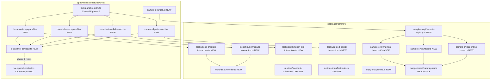

# Design Document

## Overview

This spec makes `bone-ordering`, `bound-threads`, `combination-dial` and `cursed-object` playable end to end. It adds:

- a pure Interaction_Model per type in `packages/core/src/locks/` and a shared Display_Order function,
- a React panel per type in `apps/web/src/features/crypt/`,
- registration of the four panels in `lock-panel-registry.ts`,
- a widened Manifest_Schema (three payload schemas, two hint branches, one hint rejection),
- three sample builders (human-heart, https, printing-press) that place all six lock types, and a Sample_Registry that the front-of-house hub uses to start and restore them.

Nothing here touches live generation. The four judges in `packages/core/src/locks/` are read-only. This spec adds new files beside them (`*-interaction.ts`).

The sample builders call the Core_Mapper (`packages/core/src/mapper/manifest-mapper.ts`) for every question of every lock type. The Core_Mapper belongs to the Other_Machine and is read-only here. This spec has no sample-only mapper and no workaround for a missing mapper arm. If an arm is missing when Phase 3 begins, work stops and the missing types are reported (Requirement 1.16).

The hub (`features/desk/sample-shelf.tsx`, fed by `features/desk/sample-list.ts`) already lists the three samples and reports the chosen ID. This spec adds no picker, no start-view control and no crypt-flow wiring (Requirement 12.11). It exports a Sample_Registry keyed by the same IDs, which the hub integration calls.

## Delivery phases

The order of work is part of the design because two machines edit the same repository.

| Phase | Starts when | Work | Shared_Panel_Files |
|---|---|---|---|
| Gate | First task | `git pull --rebase`, re-read the six files, report the differences to the user | read only |
| 1 | Gate done | Display_Order, accessible names, `copy-lock-panels.ts`, four Interaction_Models, four panel files with tests, manifest widening | not edited |
| 2 | User gives the Push_Go_Ahead | `git pull --rebase`, re-read, registry registration, `payloadFor` accessor, removal of the unplayable path for the four types, registry-dependent tests | edited, smallest change |
| 3 | `git pull --rebase` has brought all four mapper arms | sample builders, Sample_Registry, `https.json` rune question, manifest limit change if a sample needs one | not edited |
| 4 | Phase 3 done | sample end-to-end tests, per-type end-to-end and axe tests, final Checkpoint | not edited |

Rules that apply in every phase:

1. `git pull --rebase` runs before the first edit of a task and immediately before every commit. A conflict stops the work and is reported.
2. The paths `packages/core/src/pipeline/`, `checks/`, `mapper/`, `apps/worker/`, `eval/` and `apps/web/src/state/` are not edited. The one exception is the narrow change to `mapper/crypt-bundle-parse.ts` or `mapper/crypt-content.ts` that Requirement 2.7 allows, and it is reported.
3. Existing files in `packages/core/src/locks/` are not edited.
4. Phase 1 panel tests do not import `lock-panel-registry.ts`.
5. If the Core_Mapper output for a new type differs from the shape in "Item texts" below, work stops and the difference is reported (Requirement 11.4).

## Architecture



`packages/core` gains no React, database or AI SDK dependency. The Interaction_Models, Display_Order, builders and registry are pure. Raw notes and question files are imported only in `apps/web` (`sample-sources.ts`) and passed into the core builders as arguments, as `state/sample-crypt-source.ts` does today for human-heart.

The existing `PanelShell` and `RoomPanel` render `LOCK_PANELS[type]` generically. Registering four more entries needs no change to `question-panel.tsx`, `question-controls.tsx` or `art-room.ts`. This is an assumption that the Phase 2 re-read must confirm. Hint, Skip and Challenge controls are siblings of the Lock_Panel in `RoomPanel`, so the four panels get them without new code. Scene files already list all six lock types per room, so lock art needs no change.

## Components and Interfaces

### Display_Order (`locks/display-order.ts`)

```ts
export function displayOrder<T>(items: readonly T[], seed: string): readonly T[];
export function displayOrderAvoiding<T>(
  items: readonly T[],
  seed: string,
  avoid: (candidate: readonly T[]) => boolean,
): readonly T[];
```

`displayOrder` is a seeded Fisher-Yates shuffle driven by a small integer hash of the seed. It uses no random source, returns a permutation of the input and returns the same result for the same input and seed. `displayOrderAvoiding` retries with the suffixes `:1` to `:5` while `avoid(candidate)` is true, then falls back to rotating the list by one. It guarantees a result that `avoid` rejects for lists of two or more distinct items where a rotation avoids the predicate. This covers the 3-item lists where a shuffle has a real chance of reproducing the key order (Requirements 3.3 to 3.5).

### Payload access (`features/crypt/lock-panel-payload.ts`)

Panels need payload fields that Crypt_Content does not carry (`itemIds`, `leftIds`, `rightIds`, `unit`, and the inputs of the Interaction_Model initialisers). They get them through one narrow typed hook, so that Phase 1 does not depend on `lock-panel-context.ts`.

```ts
export interface LockPayloadByType {
  readonly 'bone-ordering': BoneOrderingQuestion;
  readonly 'bound-threads': BoundThreadsQuestion;
  readonly 'combination-dial': CombinationDialQuestion;
  readonly 'cursed-object': CursedObjectQuestion;
}
export type LockPayloadSource = <T extends keyof LockPayloadByType>(
  slotId: string,
  questionId: string,
  type: T,
) => LockPayloadByType[T] | null;

export const LockPayloadContext: React.Context<LockPayloadSource | null>;
export function useLockPayload<T extends keyof LockPayloadByType>(
  slotId: string,
  questionId: string,
  type: T,
): LockPayloadByType[T] | null;
```

- **Phase 1.** `useLockPayload` reads `LockPayloadContext`. Panel tests supply it with a test-local provider, together with a test-local value for the existing `LockPanelContext` (dispatch, rejection, content, `appliedHintFor`). Neither provider imports the registry.
- **Phase 2.** `lock-panel-context.ts` gains one read-only accessor `payloadFor(slotId, questionId)` on `LockPanelContextValue`, and `RoomPanel` supplies it from the manifest it already holds. `useLockPayload` then reads that accessor and `LockPayloadContext` is removed. Panel files do not change, because they only call the hook. The Phase 2 task re-reads `room-panel.tsx` and `lock-panel-context.ts` after the pull and makes the smallest equivalent edit if their shape changed.

A `null` result means the payload is missing or of another type. The panel then shows the `payloadMissing` string from `copy-lock-panels.ts` and leaves the Skip control working. It dispatches no answer. The payload is public manifest data, and the panels never render `keyOrder`, `keyPairs`, `oddOneOutId` or numeric dial fields (Property 5).

### Item texts

Panels read every item text from `content.questions[questionId].options` through the existing `LockPanelContext`. Panels do not parse item IDs and do not depend on how the mapper names them (Requirement 11.2). The expected shape of Core_Mapper output, to be confirmed against the mapper at the start of Phase 3 and against the panel tests earlier:

| Type | Keys of `options` |
|---|---|
| bone-ordering | the step IDs in `itemIds` |
| bound-threads | every ID in `leftIds` and in `rightIds` |
| cursed-object | the IDs in `optionIds` |
| combination-dial | no `options` entry; the unit comes from the payload |

If an ID has no text in `options`, the panel shows `itemTextMissing` for that item and stays usable. A sample test (Requirement 11.5) checks that the sample content has no such gap.

### Interaction_Models

Each model is a module in `packages/core/src/locks/` with no React, timers, randomness or I/O. Every function is total and returns a typed value. None returns `keyOrder`, `keyPairs`, `oddOneOutId` or a dial number to the caller (Requirement 3.6). Initialisers take the full payload because they must avoid the key order and size the wheels; the draft they return holds no key.

#### `bone-ordering-interaction.ts`

```ts
export interface BoneOrderingDraft {
  readonly order: readonly string[];
  readonly pinned: string | null;
}
export function initBoneOrderingDraft(
  payload: BoneOrderingQuestion,
  hint: HintEffectSpec | null,
  seed: string, // the questionId
): BoneOrderingDraft;
export function moveBone(draft: BoneOrderingDraft, boneId: string, direction: 'up' | 'down'): BoneOrderingDraft;
export function boneOrderingSubmission(draft: BoneOrderingDraft): { readonly order: readonly string[] };
```

The initial order comes from `displayOrderAvoiding(itemIds, seed, c => equals(c, keyOrder))`. With a `lock-first-bone` hint, the pinned bone is placed at its key index and the other bones are shuffled among the remaining positions with the same avoid rule applied to those positions. `moveBone` returns the draft unchanged at the first or last position, for an unknown ID and for the pinned bone. A bone that moves past the pinned bone swaps with its neighbour only if the neighbour is not pinned, so the pinned bone never leaves its index. The submission is always ready, since a full permutation exists from the start.

#### `bound-threads-interaction.ts`

```ts
export interface BoundThreadsDraft {
  readonly rightOrder: readonly string[];
  readonly threads: readonly ThreadPair[]; // [leftId, rightId], includes the hinted pair
  readonly hintedPair: ThreadPair | null;
  readonly selectedLeft: string | null;
}
export type ThreadRefusal =
  | { readonly kind: 'already-tied'; readonly side: 'left' | 'right'; readonly id: string }
  | { readonly kind: 'no-left-selected' };
export type TieResult = { readonly draft: BoundThreadsDraft; readonly refusal: ThreadRefusal | null };

export function initBoundThreadsDraft(
  payload: BoundThreadsQuestion,
  hint: HintEffectSpec | null,
  seed: string,
): BoundThreadsDraft;
export function selectLeft(draft: BoundThreadsDraft, leftId: string): TieResult;
export function tieRight(draft: BoundThreadsDraft, rightId: string): TieResult;
export function undoThread(draft: BoundThreadsDraft, leftId: string): BoundThreadsDraft;
export function boundThreadsSubmission(
  draft: BoundThreadsDraft,
  leftIds: readonly string[],
): { readonly pairs: readonly ThreadPair[] } | { readonly ready: false };
```

`rightOrder` comes from `displayOrderAvoiding(rightIds, seed + ':right', c => c.some((id, i) => keyPartnerOf(leftIds[i]) === id))`, so no right item stands on the row of its key partner. Threads are held as a list and checked for uniqueness on both sides before every insertion, so the draft stays one-to-one (Requirement 5.15). `selectLeft` toggles the selection and refuses an already tied left item. `tieRight` refuses when no left item is selected or when the right item is already tied. `undoThread` returns the draft unchanged for the hinted pair. The submission is `{ ready: false }` while any ID in `leftIds` has no thread.

#### `combination-dial-interaction.ts`

```ts
export interface CombinationDialDraft {
  readonly text: string;       // source of truth
  readonly integerWheels: number;
  readonly hasTenths: boolean;
}
export function initCombinationDialDraft(payload: CombinationDialQuestion): CombinationDialDraft;
export function wheelsOf(draft: CombinationDialDraft): readonly number[];
export function stepWheel(draft: CombinationDialDraft, wheelIndex: number, delta: 1 | -1): CombinationDialDraft;
export function setTypedEntry(draft: CombinationDialDraft, text: string): CombinationDialDraft;
export function combinationDialSubmission(
  draft: CombinationDialDraft,
): { readonly rawInput: string } | { readonly ready: false };
```

The text is the only stored value. `wheelsOf` derives the digits from the text with the same tolerant number reading that `locks/combination-dial.ts` uses, so Wheels and text cannot disagree (Requirements 3.12, 6.16). `integerWheels` is at least 3 and at least the integer digits of the largest number the payload states. `hasTenths` is true only when a stated number has a decimal place. `stepWheel` changes one digit, wraps at 9 and 0 for that Wheel only, keeps a leading minus sign and rewrites the text. The initial text is empty; the Wheels show zeros. A step on an empty text starts from zeros. The submission is `{ ready: false }` when the trimmed text is empty. The model returns no number taken from the payload; it reads the payload only to size the wheel row.

#### `cursed-object-interaction.ts`

```ts
export interface CursedObjectDraft {
  readonly selected: string | null;
  readonly removed: string | null;
}
export function initCursedObjectDraft(hint: HintEffectSpec | null): CursedObjectDraft;
export function chooseItem(draft: CursedObjectDraft, optionId: string): CursedObjectDraft;
export function clearChoice(draft: CursedObjectDraft): CursedObjectDraft;
export function cursedObjectSubmission(
  draft: CursedObjectDraft,
): { readonly selectedId: string } | { readonly ready: false };
```

`chooseItem` returns the draft unchanged for the removed item. The submission is `{ ready: false }` while nothing is chosen.

### Panels

Each panel is a file `<type>-panel.tsx` of about 300 lines or fewer under `apps/web/src/features/crypt/`. Each follows the shape of `RuneCipherPanel` and `SeanceBoardPanel`: it reads `LockPanelContext` for `dispatch`, `rejection`, `content`, `appliedHintFor` and the announcer, reads the payload through `useLockPayload`, and keeps its draft in `useState` seeded on mount. The existing `key` on `PanelShell` remounts the panel when an Alternate replaces the question, which gives an empty draft (Requirement 8.8). Drafts are never put in the Event_Log or in State.

| Panel | Structure | Submit |
|---|---|---|
| Bone ordering | `<ol>` of items, each with "Move up" and "Move down" buttons. Alt+Arrow moves the focused bone, plain Arrow moves focus (roving tabindex). A visible line names the shortcut. A pinned bone shows "Fixed by hint" and has both buttons disabled. | `{ order }` |
| Bound threads | Left column in manifest order, right column in `rightOrder`. Left buttons use `aria-pressed`. Each item shows a text state: untied, selected or tied to a named partner. A list of tied threads with "Undo" buttons. A hinted thread shows "Tied by hint" and no Undo. A message line for refusals. | `{ pairs }`, or a message when a left item is untied |
| Combination dial | A row of Wheels with Increase and Decrease buttons, a visible unit, and a labelled `<input type="text" inputMode="decimal">`. Up and Down arrows step a Wheel, Left and Right move focus. Enter in the input submits. A message for empty input and for the `invalid-submission` rejection. A line that this lock has no hint when the hint had no effect. | `{ rawInput }`, or a message when the text is empty |
| Cursed object | A `role="radiogroup"` of radio inputs with a visible group label, arrow keys move to the next enabled item. The removed item shows its text label and is disabled. | `{ selectedId }`, or a message when nothing is chosen |

Accessible names come from new helpers added to `accessible-names.ts` (for example `boneMoveName(action, text, position, total)` and `wheelName(action, place, digit)`), which keeps one place for names. States that a control shows (selected, tied, fixed, removed, position) are also in its accessible name or description. Every control is at least 44 by 44 px, uses the 2 px `--spectre-300` focus outline and has no drag handler. All colours come from `tokens.css`. Texts render as plain React text, never as HTML.

Draft changes announce through the existing Live_Announcer; no panel creates a live region.

### Registry and the unplayable path (Phase 2)

```ts
export const LOCK_PANELS: LockPanelRegistry = {
  'rune-cipher': RuneCipherPanel,
  'seance-board': SeanceBoardPanel,
  'bone-ordering': BoneOrderingPanel,
  'bound-threads': BoundThreadsPanel,
  'combination-dial': CombinationDialPanel,
  'cursed-object': CursedObjectPanel,
};
```

`UnplayablePanel`, `ROOM_PLAY_LABELS.unplayableType` and the fallback branches in `question-panel.tsx` and `final-door.tsx` stay. They are reached only for a type string that is not a key of the registry. Existing tests that expected an unplayable message for one of the four types are changed to expect the panel (Requirement 9.7).

### Manifest widening

`runtime/manifest-schema.ts` gains three payload schemas that mirror the Judge input types exactly (Requirement 2.12). They are defined in this order of constraint:

- `BoundThreadsPayloadSchema`: strict object `{ leftIds, rightIds, keyPairs }`. `leftIds` and `rightIds` hold 3 to 4 unique non-empty IDs, have equal length, and `keyPairs` is a one-to-one matching that uses every left and right ID once.
- `CursedObjectPayloadSchema`: strict object `{ optionIds, oddOneOutId }` with exactly 4 unique non-empty IDs and `oddOneOutId` among them.
- `CombinationDialPayloadSchema`: discriminated union on `kind` for `exact`, `range` and `tolerance`, with finite numbers, a non-empty `unit`, `min <= max` for `range` and `tolerance >= 0`.

`payloadSchemaFor` returns these schemas instead of `null` for the three types. `narrowHint` in `runtime/manifest-hints.ts` gains:

- `bound-threads`: accepts only `tie-thread` whose pair is one of `keyPairs`.
- `cursed-object`: accepts only `remove-option` whose option ID is in `optionIds` and is not `oddOneOutId`.
- `combination-dial`: rejects every non-null hint, because the Judge ignores hints for that type. This closes a gap in the current fall-through, which would accept any hint.

These hint shapes match the mapper plan (`tie-thread`, `remove-option`, `null`), so both machines produce one manifest shape. Limits stay as they are: at most one Lock_Slot per type per room, at most 4 final-door questions, and an Alternate of a different type.

Before editing `manifest-schema.ts`, `manifest-hints.ts` or `crypt-bundle-parse.ts`, the implementer pulls and checks that the Other_Machine has not changed the same lines (Requirement 2.13).

`CryptContentEntry.options` is already `Record<string, string>` and optional, so bound-threads, cursed-object and combination-dial entries should parse without a schema change. A unit test in Phase 1 confirms this. If it fails, the smallest change to `mapper/crypt-bundle-parse.ts` or `mapper/crypt-content.ts` is made and reported (Requirement 2.7).

### Sample builders and Sample_Registry (Phase 3)

Each builder returns the existing `SampleCryptResult` or `SampleCryptError` and builds every question through the Core_Mapper. A builder holds a fixed selection table (question ID per slot, Alternate and final-door position) and a fixed concept-title table in code. It never searches or reorders. A quote that does not resolve returns a typed error that names the question ID, and nothing is published (Requirement 15.5). Sample question files keep a draft `status`, so `isHumanReviewed` is false and no review label appears.

```ts
export type SampleId = 'human-heart' | 'https' | 'printing-press';
export interface SampleSources {
  readonly notesText: string;
  readonly questionsFile: unknown; // validated by the builder
}
export type SampleBuilder = (sources: SampleSources) => Result<SampleCryptResult, SampleCryptError>;
export type UnknownSampleError = { readonly kind: 'unknown-sample'; readonly id: string };

export const SAMPLE_IDS: readonly SampleId[];
export function getSampleBuilder(id: string): Result<SampleBuilder, UnknownSampleError>;
```

`getSampleBuilder` returns a builder for each ID in `SAMPLE_LIST` and a typed error for any other string. A test checks that `SAMPLE_IDS` equals the IDs in `SAMPLE_LIST`.

In `apps/web/src/features/crypt/sample-sources.ts` (not under `state/`), the raw notes and question files of all three samples are imported at build time, and one function connects the registry to the run:

```ts
export function buildCryptForSample(id: string): BuildCrypt;
```

It returns a function of the shape that `useRoomBinding` already accepts as `buildCrypt`. The hub integration passes the chosen ID to it. No edit to `apps/web/src/state/` or to `crypt-flow.tsx` is needed. Nothing leaves the origin, because all sources are bundled.

Restore is a known limit. `restoreRun` in `state/storage/restore-run.ts` rebuilds only the human-heart sample through its `buildSample` dependency. A saved run on another sample fails with the existing typed error `record-unreadable`. This is reported to the user and left alone (Requirement 12.12).

#### Layouts

All three samples have two rooms with two Lock_Slots each and a final door of 3 or 4 questions, which meets "at least two rooms, at most three, at least one final-door question". Across each sample, all six types appear at least once among slot primaries and final-door questions (Requirement 12.2). The question IDs are fixed in the builder after the Phase 3 task has read each questions file. The table gives the shape that the selection must have, not the IDs.

| Sample | Room 1 slots | Room 2 slots | Final door |
|---|---|---|---|
| human-heart | rune-cipher, séance-board | bone-ordering, bound-threads | cursed-object, combination-dial, one more |
| https | bone-ordering, cursed-object | bound-threads, rune-cipher | combination-dial, combination-dial, séance-board |
| printing-press | bone-ordering, cursed-object | bound-threads, rune-cipher | bound-threads or combination-dial, combination-dial, séance-board |

Each slot may carry an Alternate of a different type, taken from the questions that the file already holds. The current human-heart layout (one room, two Lock_Slots, three final-door questions) changes, so its builder and every test, fixture and end-to-end test that depends on the old shape are updated (Requirement 12.13).

`samples/questions/https.json` has no rune cipher question. Phase 3 adds one with `draft` status, quoted from `samples/https.txt`, with its own concept, so the existing concepts and roles stay as authored. The implementer chooses the quoted term and paragraph and checks that the quote resolves before using it.

### Copy

`packages/core/src/copy-lock-panels.ts` holds every new learner-facing string, as an exported `*_LABELS` object like `copy-room-play.ts`: move labels, shortcut line, refusal messages, "Fixed by hint", "Tied by hint", "no hint to give", `payloadMissing`, `itemTextMissing`, wheel name templates. The existing "Removed by hint" label is reused. Copy follows `.kiro/steering/tone.md`. Phase 1 checks whether the banned-phrases test finds the new file by reflection or by a fixed import list, and adds the file to the list if needed.

## Data Models

Judge payload and submission types are unchanged. The new types are the four draft shapes above and the three payload schemas.

| Type | Draft | Payload | Submission |
|---|---|---|---|
| bone-ordering | `{ order, pinned }` | `{ itemIds, keyOrder }` (existing schema) | `{ order }` |
| bound-threads | `{ rightOrder, threads, hintedPair, selectedLeft }` | `{ leftIds, rightIds, keyPairs }` (new schema) | `{ pairs }` |
| combination-dial | `{ text, integerWheels, hasTenths }` | `{ kind, ... , unit }` (new schema) | `{ rawInput }` |
| cursed-object | `{ selected, removed }` | `{ optionIds, oddOneOutId }` (new schema) | `{ selectedId }` |

`CryptContentEntry` is unchanged. `SampleId`, `SampleSources`, `SampleBuilder` and `UnknownSampleError` are new and live in `packages/core/src/sample-crypt/`.

## Correctness Properties

*A property is a characteristic or behavior that should hold true across all valid executions of a system-essentially, a formal statement about what the system should do. Properties serve as the bridge between human-readable specifications and machine-verifiable correctness guarantees.*

### Property 1: Judge agreement

For any valid payload of a New_Lock_Type and any hint that `narrowHint` accepts for it, the Submission built by driving the Interaction_Model to the key answer is judged `correct` by the core Judge, and the Submission built for any other complete answer the model can produce is judged `wrong`. An incomplete draft yields `{ ready: false }` and never reaches the Judge.

**Validates: Requirements 3.16, 4.13, 5.14, 6.15, 7.9**

### Property 2: Bound threads stay one-to-one

For any sequence of select, tie and undo operations, including operations on tied, refused and hinted items, no left item and no right item appears in more than one thread, and the hinted pair is never removed.

**Validates: Requirements 3.9, 3.10, 3.11, 5.15**

### Property 3: Display_Order is a deterministic permutation that avoids the key

For any list of IDs and seed, `displayOrder` returns a permutation of the list and returns the same result on every call. For any bone ordering payload with `itemIds` equal to `keyOrder`, the initial draft differs from `keyOrder`, and with a `lock-first-bone` hint it holds the pinned bone at its key index and differs from `keyOrder` elsewhere. For any bound threads payload with `rightIds` aligned with `leftIds`, no right item stands on the row of its key partner.

**Validates: Requirements 3.2, 3.3, 3.4, 3.5**

### Property 4: Bone moves are bounded and keep the pin

For any bone ordering draft and any sequence of move operations, the order stays a permutation of `itemIds`, a move past the first or last position leaves the draft unchanged, and the pinned bone stays at its index.

**Validates: Requirements 3.7, 3.8**

### Property 5: Dial text and Wheels agree

For any dial draft and any text, `wheelsOf(setTypedEntry(draft, text))` gives the digits that the text encodes, and for any draft, stepping a Wheel up and then down returns the same text. A step wraps only the Wheel it acts on.

**Validates: Requirements 3.12, 3.14, 6.16**

### Property 6: Cursed object never submits the removed item

For any cursed object payload and hint, `chooseItem` on the removed item leaves the draft unchanged, so no submission ever holds the removed item.

**Validates: Requirements 3.15, 7.10**

### Property 7: Interaction models are total

For any draft and any input to any operation of an Interaction_Model, the call returns a typed value and does not throw.

**Validates: Requirements 3.17**

### Property 8: Panels do not show the key before judging

For any valid payload, the DOM of a freshly rendered Lock_Panel shows the items in the Display_Order, not `keyOrder` or key row order, and contains no `oddOneOutId` marker, no pair marker and no dial number taken from the payload (the unit excepted).

**Validates: Requirements 4.1, 5.1, 6.11, 13.9**

### Property 9: Manifest round trip for the three new payloads

For any manifest that holds valid `bound-threads`, `cursed-object` and `combination-dial` payloads, parsing the JSON of the manifest with the Manifest_Schema gives an equal manifest.

**Validates: Requirements 2.10**

### Property 10: Hint narrowing

For any valid payload of any of the six lock types, the Manifest_Schema accepts a QuestionSpec with a hint that `narrowHint` allows for that type, and rejects a hint of any other kind, a hint that names an unknown pair or option, and a `remove-option` that names `oddOneOutId`.

**Validates: Requirements 2.4, 2.5, 2.6, 2.11**

### Property 11: Sample crypts are complete, resolvable and escapable

For each Sample_Crypt_Entry, the built manifest passes `validateManifestForPublish` and `parseCryptBundle`, contains all six lock types, has every `evidenceRefs` ID among its excerpts' chunk IDs, resolves every quote against its chunk, has an `options` entry for every payload item ID that has display text and none for an ID the payload lacks, and a play-through that skips or challenges every question reaches `escaped`.

**Validates: Requirements 11.5, 12.2, 12.3, 12.14, 12.15**

## Error Handling

- **Manifest_Schema.** An invalid payload or hint returns the existing `manifest-schema-invalid` error with the payload path and no payload content (Requirement 2.9). No new error kind is added.
- **Interaction_Models.** Every operation is total. A refusal is a typed `ThreadRefusal`. An incomplete draft is `{ ready: false }`. There is no `try/catch` in `apps/web` for them.
- **Panels.** An incomplete draft at submit shows the panel's own message and dispatches no Event. A `rejection` of kind `invalid-submission` from the binding shows the dial's message, keeps the draft and keeps the slot open. A `null` payload or a missing item text shows the matching string from `copy-lock-panels.ts` and leaves Skip and Challenge working.
- **Unknown question type.** `UnplayablePanel` with its Skip button, unchanged (Requirement 9.3).
- **Sample builders.** A shape error, a missing mapper arm result or an unresolved quote returns a typed `SampleCryptError` that names the question ID. No partial manifest is published. A missing mapper arm found before Phase 3 stops the work instead (Requirement 1.16).
- **Sample_Registry.** An unknown ID returns `unknown-sample`, never a default sample.
- **Art.** A failed lock layer or close-up is logged once with the file name and error type only, and the panel stays usable. No new art is added.
- **Restore.** A saved run on https or printing-press fails with the existing `record-unreadable` error (Requirement 12.12).

## Testing Strategy

Property-based testing applies to the Interaction_Models, Display_Order, the manifest schemas and the sample builders, because these are pure functions with large input spaces. It does not apply to panel layout, styling or art, which use example-based component tests, Playwright and axe.

**Library and configuration.** fast-check with Vitest. Each property is one property-based test that runs at least 100 iterations and carries the comment `Feature: lock-types, Property N: <title>`. Arbitraries for the new payloads go in `packages/core/src/test-support/arbitraries.ts` next to the existing ones. Fixtures shared with other specs go in `packages/core/src/test-support/`.

**Unit tests (example-based).**
- One `<type>-interaction.test.ts` per model for boundary cases, plus `display-order.test.ts`.
- Manifest schema and hint tests for accept and reject cases of the three new payloads, including a corrupted payload per type.
- A test that `CryptContentEntry` accepts the content shapes of the three new types (Requirement 2.7 check).
- Component tests per panel with Testing Library and keyboard-only events (Tab, Enter, Space, arrows, Alt+arrows, no pointer events). They render the panel with a test-local `LockPayloadContext` provider and a test-local `LockPanelContext` value, and do not import the registry (Phase 1). They cover the hint states, the empty-draft messages, the `invalid-submission` message, the unit-only display of the dial and the Alternate remount.
- Phase 2: a registry test that `LOCK_PANELS` has one entry per `LOCK_TYPES` value, a test that an unknown type shows `UnplayablePanel` and its Skip button, and updated tests that expected an unplayable message.
- Art tests: for each new type the four close-up files exist, and for each Art_Room the scene file holds the lock entry with its four layers and light pass (Requirements 10.7, 10.8).
- Copy: the banned-phrases test covers `copy-lock-panels.ts`.
- Sample_Registry: a builder for each ID in `SAMPLE_LIST` and a typed error for an unknown ID.

**End-to-end (Phase 4).**
- One Playwright test per new type that opens the lock, answers by keyboard and checks the Evidence_Panel, on `chromium`, `firefox` and `pixel`.
- One phone test per new type that answers by tap and checks that each control is at least 44 by 44 px.
- One axe check per new type with its panel open.
- Per sample: one play-through with every question answered correctly (answers read from the manifest in test code, not from the screen) and one that skips every question, both ending in `escaped`.

**Constraints.** No test calls an AI provider or uses a cassette. During a task only the targeted Vitest file or a single Playwright file on one project runs. At a Checkpoint the full Vitest suite runs with `--maxWorkers=50%` and the full Playwright suite with `--workers=2`, and the counts, including failures and skips, go into `docs/build-log.md`. No dev server or watcher is started from a shell command. `pnpm lint`, `pnpm typecheck` and the structure check must pass at every Checkpoint.
