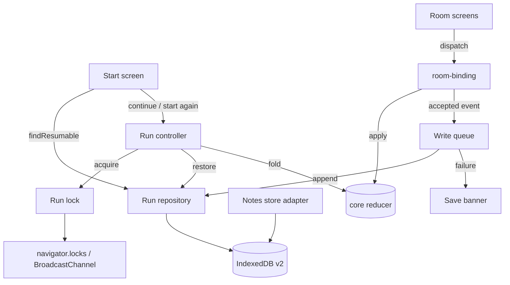
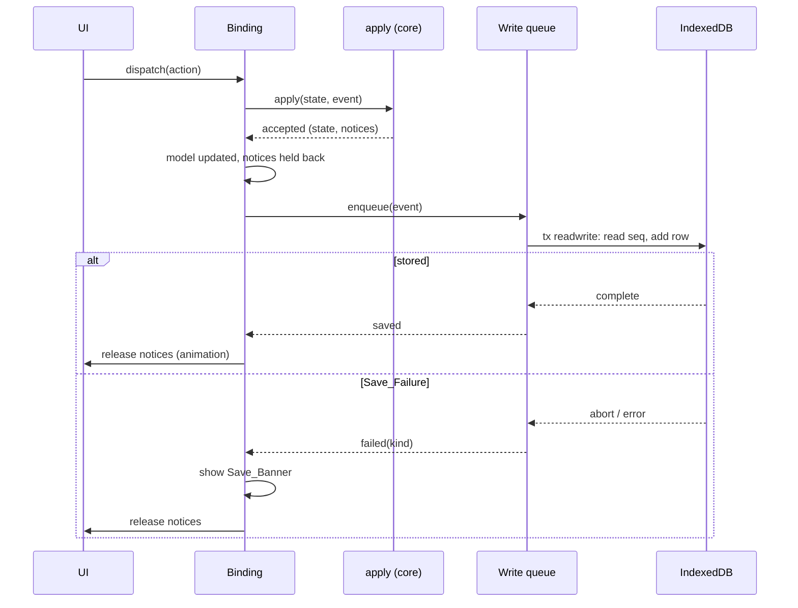

# Design Document

## Overview

This design saves a learner's run in IndexedDB on their own device and restores it by folding the stored events through the existing reducer. It stores the reducer's inputs (crypt, settings, events) and never the state the reducer computes.

Scope follows `requirements.md`: database version 2 with the `crypts`, `runs` and `events` stores, write-before-animate with a save banner, single-tab ownership through Web Locks, the "Continue your crypt" entry on the start screen, and a small Export group. Everything lives in `apps/web/src/state/` and the start screen. Nothing talks to the worker or the network.

### Key design decisions

| Decision | Choice | Reason |
|---|---|---|
| Source of truth | `events.reduce(apply, initial(manifest, settings))` | Matches room-runtime. Nothing derived is stored (Req 4.6). |
| Storage API | Thin hand-written adapter over raw IndexedDB, every function returns `Result<T, StorageError>` | The existing notes adapter does this. A library would add a dependency and hide transaction control that Req 8 needs. |
| Event append | One readwrite transaction per event. It reads the next `seq` and `add`s the row in that same transaction. | Req 8.1, 8.2. A duplicate key fails instead of overwriting (Req 4.2). |
| Write ordering | A single serial write queue per run. After a failure the queue is poisoned for that session until a retry stores the failed event. | Req 8.5, 8.6. The log never has a hole. |
| Display ordering | The binding holds the accepted model in memory at once, but holds the notices back until the append settles. | Req 6.1 and 6.5. |
| Event validation | `isEvent` from core, re-exported from `packages/core/src/index.ts` | See "Core change and timing" below. |
| Tab ownership | `navigator.locks` with `steal` on takeover. BroadcastChannel fallback. | Req 9. |
| Notes adapter | `features/ingest/notes-store-idb.ts` is changed to open through the shared v2 opener | A v1 open call against a v2 database fails with `VersionError`. |

### Core change and timing (chosen approach)

The chosen approach is a **one-line re-export of `isEvent`** from `packages/core/src/index.ts`. The function already exists in `packages/core/src/runtime/event-guard.ts`. No `EventSchema` is added to core, and no new logic is added.

**Timing constraint.** Another chat is editing `packages/core/src/index.ts` right now. This design therefore makes no change to `packages/core`. The export is added **only during the implementation task** that needs it (the event-row codec, task for Req 5.3), as the first step of that task, after re-reading the file so no concurrent edit is overwritten. Until then the codec module imports `isEvent` through a single local seam, `state/storage/event-guard.ts`, which is the only file that names the core export. The seam makes the dependency one line to change and lets earlier tasks compile without it, by typing the guard as a parameter.

Fallback if the export cannot be added: the row envelope is still validated by Zod and the payload is left to `apply`, which returns `malformed-event`. This is weaker and is not the plan.

## Architecture



Layers, from the bottom up:

1. **Database opener** (`db.ts`). Opens version 2, runs the upgrade, returns `Result<IDBDatabase, StorageError>`.
2. **Codecs** (`records.ts`). Zod schemas and parse functions for the three new record types.
3. **Repository** (`run-repository.ts`). Typed operations on the stores. It holds no game rules.
4. **Write queue** (`event-writer.ts`). Serialises appends and applies the failure rule.
5. **Run lock** (`run-lock.ts`). Wraps Web Locks and the fallback.
6. **Restore** (`restore-run.ts`). Reads, validates, folds.
7. **Binding and screens.** `room-binding.ts` gains persistence hooks. The start screen gains the Resume_Entry.

The reducer stays untouched. The binding calls `apply` through `stepBinding` exactly as it does today (Req 5.9).

### Write-before-animate sequence



A rejected event never reaches the queue (Req 6.4).

## Components and Interfaces

All files are in `apps/web/src/state/` unless stated. Each stays under about 300 lines. File names are kebab-case.

### File layout

```
state/storage/
  storage-error.ts      StorageError type, constructors, kind list
  db.ts                 DB_NAME, DB_VERSION=2, store names, openDb(factory)
  records.ts            Zod schemas + parse/serialise for Crypt, Run, Event rows
  run-settings-schema.ts  Zod schema for RunSettings
  event-guard.ts        the single seam that imports isEvent from core
  crypt-repository.ts   saveCrypt, loadCrypt, deleteCrypt
  run-repository.ts     createRun, setRunStatus, findResumable, appendEvent, loadEvents
  event-writer.ts       serial write queue with the failure rule
  restore-run.ts        restoreRun: read, validate, fold, rebuild assets
  run-lock.ts           acquireRunLock / takeOver / fallback
  export-run.ts         buildExport (Req 13)
state/
  persisted-room.ts     React hook that wires the binding to the writer, lock and banner
features/ingest/notes-store-idb.ts   changed to use openDb (see below)
features/start/         resume-entry.tsx, read-only-screen.tsx, save-banner.tsx
```

### StorageError

```ts
export type StorageErrorKind =
  | 'storage-unavailable' | 'unsupported-version' | 'crypt-invalid'
  | 'manifest-conflict' | 'record-unreadable' | 'run-not-found'
  | 'event-log-gap' | 'event-log-rejected' | 'notes-unavailable'
  | 'write-failed' | 'quota-exceeded';

export interface StorageError { readonly kind: StorageErrorKind }
export type StorageResult<T> = Result<T, StorageError>;
```

An error carries the `kind` only. No message, no underlying error text, no stored content (Req 7.7). `quota-exceeded` and `write-failed` are both Save_Failures. `Result` is the core type.

### Database opener (`db.ts`)

```ts
export const DB_NAME = 'escape-the-crypt';
export const DB_VERSION = 2;
export const STORES = { notes: 'notes', crypts: 'crypts', runs: 'runs', events: 'events' } as const;
export function openDb(factory: IDBFactory | undefined): Promise<StorageResult<IDBDatabase>>;
```

The upgrade handler is one function, `upgrade(db, oldVersion)`, with additive steps:

- `oldVersion < 1`: create `notes` (keyPath `documentDigest`).
- `oldVersion < 2`: create `crypts` (keyPath `manifestId`), `runs` (keyPath `runId`, index `by-status` on `status`), `events` (keyPath `['runId','seq']`).

Each step guards with `objectStoreNames.contains`. No step opens a cursor on or writes to `notes`, so existing notes are untouched (Req 1.3). A fresh database runs both steps (Req 1.4). A `VersionError` on open maps to `unsupported-version` and no write happens (Req 1.7). An undefined factory, a throwing `open`, `onerror` and `onblocked` map to `storage-unavailable`.

`features/ingest/notes-store-idb.ts` currently opens at version 1, which would fail against a version 2 database. It is changed to call `openDb` and to re-export `DB_NAME` and `NOTES_STORE_NAME` from `db.ts` so the existing notes tests keep their imports. Its behaviour, its error mapping and the `NotesStore` interface do not change. This edit is inside `apps/web`.

### Records and codecs (`records.ts`)

```ts
export interface CryptRecord {
  schemaVersion: 1;
  manifestId: string;
  manifest: CryptManifest;
  content: CryptContent;
  source: 'sample' | 'generated';
  documentDigest?: string;      // present when source === 'generated'
}
export interface RunRecord {
  schemaVersion: 1;
  runId: string;
  manifestId: string;
  settings: RunSettings;
  createdAt: number;            // epoch ms, supplied by the caller
  status: 'active' | 'escaped' | 'left';
}
export interface EventRow { schemaVersion: 1; runId: string; seq: number; event: Event }

export function parseCryptRecord(raw: unknown): StorageResult<CryptRecord>;
export function parseRunRecord(raw: unknown): StorageResult<RunRecord>;
export function parseEventRow(raw: unknown): StorageResult<EventRow>;
```

- Zod schemas validate the envelope. `manifest` and `content` are validated as `z.unknown()` in the envelope and then by core's `parseCryptBundle`, so core stays the owner of their shape (Req 2.8). The Zod import is `z` from `@escape-the-crypt/core`.
- `event` is checked with `isEvent` through the seam (Req 5.3).
- `RunSettings` has a Zod schema in `run-settings-schema.ts`. It is written against the core type so a compile-time assertion (`satisfies z.ZodType<RunSettings>`) fails if the type drifts.
- `schemaVersion` is a literal `1` on all three record types, so an unknown future version is `record-unreadable` instead of being guessed at (Req 4.7).
- No answer key is added to content (Req 2.9). `content` is stored as `parseCryptBundle` returned it.
- Event rows carry only the event. The event type already holds identifiers and answers, and the codec adds no text fields (Req 4.5).

### Crypt repository

```ts
saveCrypt(factory, input: { bundle: unknown; source; documentDigest?: string }): Promise<StorageResult<{ manifestId: string }>>;
loadCrypt(factory, manifestId): Promise<StorageResult<CryptRecord>>;
```

`saveCrypt` calls `parseCryptBundle` first (`crypt-invalid` on rejection, nothing written). It then runs one readwrite transaction: `get` the key. If absent, `add`. If present, compare with a canonical JSON serialisation (keys sorted, same function used on both sides). Equal returns success with no write (Req 2.6). Different returns `manifest-conflict` with no write (Req 2.7). Sample and generated crypts use this same function (Req 2.2).

### Run repository

```ts
createRun(factory, input: { manifestId; settings; createdAt; runId }): Promise<StorageResult<RunRecord>>;
setRunStatus(factory, runId, status): Promise<StorageResult<RunRecord>>;
findResumable(factory): Promise<StorageResult<RunRecord | null>>;
appendEvent(factory, runId, event): Promise<StorageResult<{ seq: number }>>;
loadEvents(factory, runId): Promise<StorageResult<readonly EventRow[]>>;
deleteCrypt(factory, manifestId): Promise<StorageResult<true>>;
```

- `createRun` opens one transaction over `crypts` and `runs`, checks the crypt exists (`crypt-invalid` otherwise is wrong, so the kind is `run-not-found`'s sibling `record-unreadable`; see Error Handling), then `add`s the run (Req 3.2).
- `setRunStatus` reads the record in a readwrite transaction, replaces only `status` and `put`s it back. Missing run gives `run-not-found` (Req 3.5, 3.6).
- `findResumable` uses the `by-status` index with `active`, parses each candidate, and returns the one with the largest `createdAt`. A parse failure on any candidate returns `record-unreadable`.
- `appendEvent` runs a single readwrite transaction on `runs` and `events`. It checks the run exists (`run-not-found`, Req 4.8). It counts rows for that run with an `IDBKeyRange` over `[runId, 0]` to `[runId, Infinity]` and uses the count as `seq`. It then calls `events.add`. The count and the add are in the same transaction (Req 8.2). There is no `put`, update or single-row delete function (Req 4.3).
- `loadEvents` reads the range ordered by key, parses each row, and checks that seqs are exactly `0..n-1` (`event-log-gap` otherwise, Req 5.4).
- `deleteCrypt` is the one deletion path. One transaction over `events`, `runs` and `crypts` removes the event rows and runs of that crypt, then the crypt (Req 4.4).

**Why count and not "last key + 1".** With strictly append-only rows and no single-row delete, count equals last seq + 1. A mismatch cannot arise from this code, and `loadEvents` would catch one as `event-log-gap`.

### Write queue (`event-writer.ts`)

```ts
export interface EventWriter {
  enqueue(event: Event): Promise<WriteOutcome>;   // resolves when this event's attempt settles
  retry(): Promise<WriteOutcome>;                  // re-attempts the oldest unsaved event
  readonly unsaved: () => readonly Event[];
}
export type WriteOutcome =
  | { status: 'saved'; seq: number }
  | { status: 'failed'; error: StorageError }
  | { status: 'skipped' };       // queued behind an earlier failure
```

Rules:

- One promise chain per run. Events are written in the order the reducer accepted them (Req 6.3).
- On a failed append for position k, the writer enters `blocked`. Later `enqueue` calls are kept in memory in order and resolve `skipped` without touching the database (Req 8.5, 8.6, 7.4).
- `retry()` re-attempts the oldest unsaved event. When it is stored, the writer drains the rest in order, stopping again at the first failure.
- When `indexedDB` is undefined, the writer starts `blocked` with `storage-unavailable` and writes nothing (Req 7.5).
- The writer never throws. Every rejection from the repository is already a `StorageResult`, and the writer wraps the call in a `try/catch` that maps anything unexpected to `write-failed` (Req 7.6).

### Binding integration (`persisted-room.ts`, small edits to `room-binding.ts`)

`bindingReducer` and `stepBinding` stay pure and unchanged in behaviour. The persistence hook wraps `useRoomBinding`:

- It observes the binding's `eventLog`. When the log grows by one, it calls `writer.enqueue(lastEvent)`. A rejected action leaves `eventLog` unchanged, so nothing is enqueued (Req 6.4).
- `useRoomBinding` gains one optional output, `heldNotices`. The screens render notices from `releasedNotices` of the hook, which equals `notices` only after the writer settles for the current event (saved or failed). The in-memory `state` is always the reducer's state and is shown immediately (Req 6.5).
- The settle callback is the only place a Notice_Animation is released, so the unit test for Req 12.9 asserts on an injected `animate` spy and a controlled promise.
- `playAgain` starts a new run: it sets the old run to `left`, creates a new run record and a new writer, and then applies the four start events as ordinary appended events. The start events are persisted like any other (Seq 0 to 3).
- When the binding reaches `escaped`, the hook calls `setRunStatus(runId, 'escaped')`. A failure of that call shows the Save_Banner and does not block play.

The hook takes its dependencies by parameter (`factory`, `now`, `newRunId`, `locks`, `channelFactory`). The defaults are the browser globals. This keeps randomness and time out of the code under test, and lets Vitest inject `fake-indexeddb`.

### Restore (`restore-run.ts`)

```ts
restoreRun(deps, runId): Promise<StorageResult<{ run: RunRecord; crypt: CryptRecord; events: readonly Event[]; model: BindingModel; assets: RoomAssets }>>;
```

Steps:

1. Read the run, then the crypt for `run.manifestId`, then the events (one read transaction each, or one transaction over all three).
2. Parse each with the codecs. Any failure returns `record-unreadable` and writes nothing (Req 5.6).
3. Check seq continuity (`event-log-gap`).
4. Fold: `state = initial(manifest, settings)`, then `apply` for each event in order. A rejection returns `event-log-rejected` with stored rows untouched (Req 5.5). The fold uses `stepBinding`-equivalent logic through `apply` only (Req 5.9).
5. Assets. For a sample crypt, the existing sample builder supplies chunks. For a generated crypt, the notes record is loaded through the Notes_Store adapter by `documentDigest` and chunked with the same chunker room-play uses. A missing or unreadable record returns `notes-unavailable` (Req 5.7, 5.8).

The fold of a stored log is the same function as the live step, so S1 compares like with like.

### Run lock (`run-lock.ts`)

```ts
export interface RunLock {
  readonly state: 'held' | 'waiting' | 'lost' | 'single-tab';
  takeOver(): Promise<void>;
  release(): void;
  subscribe(listener: (state: RunLock['state']) => void): () => void;
}
acquireRunLock(deps: { locks?: LockManager; channelFactory?: (name: string) => BroadcastChannelLike }, runId: string): RunLock;
```

- With `navigator.locks`: `request('run:<runId>', { ifAvailable: true }, cb)`. If the callback receives `null`, the state is `waiting` (another tab holds it). When granted, the callback returns a promise that stays pending until `release()`, so the lock is held for the page lifetime and freed when the tab closes (Req 9.5).
- `takeOver()` calls `request(name, { steal: true }, cb)` and then triggers a restore from the database (Req 9.3).
- A stolen lock rejects the pending holder's promise with an `AbortError`. The handler sets the state to `lost`, which stops the writer and shows the Read_Only_Screen (Req 9.4).
- Without `navigator.locks`: a `BroadcastChannel` named `run:<runId>`. On open the tab posts `hello`. A tab that hears `hello` from another tab replies `owned`, and the newcomer sets `waiting`. `takeOver()` posts `takeover`, and the old owner sets `lost`. This is best effort and its limits are listed in Error Handling.
- Without both, the state is `single-tab` and play continues (Req 9.7).
- The lock is requested before the first append. The binding does not enable `dispatch` for writes until the state is `held` or `single-tab` (Req 9.1, 9.2).

### Screens

- **Resume_Entry** (`features/start/resume-entry.tsx`). Two buttons, "Continue your crypt" and "Start again", each at least 44 by 44 px with a visible accessible name. It is rendered only when `findResumable` returns a run (Req 10.2, 10.5, 10.6). On a restore error it shows a plain sentence that the saved crypt could not be opened and offers "Start again" (Req 10.7). Notes-missing uses the specific sentence from Req 5.8.
- **Read_Only_Screen** (`read-only-screen.tsx`). Shows "This crypt is open in another tab", a "Take over here" button that receives focus on mount (Req 9.8), and a non-interactive view of the crypt at the last stored event. The lock objects have no click handlers here (Req 9.9). This view is built by restoring from the database, not by sharing the other tab's memory.
- **Save_Banner** (`save-banner.tsx`). A `role="status"` live region (`aria-live="polite"`) with the exact Req text. It is placed in normal flow above the room, not overlaying the Question_Panel or Evidence_Panel (Req 7.8). It holds the export button (Req 13.4).

Copy uses the plain, direct voice of the tone steering. None of the banned words appear in any new string.

### Export (`export-run.ts`)

```ts
buildExport(input: { crypt: CryptRecord; run: RunRecord; acceptedEvents: readonly Event[]; chunks: readonly Chunk[] | null }): ExportFile;
```

- Takes events from the in-memory accepted events, not from the database, so unsaved events are included (Req 13.5).
- Chunks are the notes chunks (Req 13.1). When `chunks` is null, the file omits them and the screen says so (Req 13.6).
- The export holds no original file, no file name and no PDF bytes. The `ExportFile` Zod schema has no field for them, and `.strict()` rejects extras (Req 13.2).
- The control is labelled to say the file contains the learner's notes (Req 13.3).
- Output is a `Blob` download. Import is not built (Req 13.8).

## Data Models

### IndexedDB schema (version 2)

| Store | keyPath | Indexes | Written by | Mutability |
|---|---|---|---|---|
| `notes` | `documentDigest` | none | existing notes adapter | replace on the same digest (unchanged) |
| `crypts` | `manifestId` | none | `saveCrypt` | immutable. Identical re-save is a no-op, a different one is `manifest-conflict`. |
| `runs` | `runId` | `by-status` on `status` | `createRun`, `setRunStatus` | `status` only |
| `events` | `[runId, seq]` | none | `appendEvent` | add only. The sole delete path is `deleteCrypt`. |

### Example rows

```json
{ "schemaVersion": 1, "runId": "run-7f3a", "manifestId": "m-ab12", "settings": { "length": "short", "difficulty": "apprentice", "hintAllowance": 2 }, "createdAt": 1764400000000, "status": "active" }
```

```json
{ "schemaVersion": 1, "runId": "run-7f3a", "seq": 4, "event": { "kind": "RoomEntered", "roomId": "r1" } }
```

### Export file

```ts
interface ExportFile {
  schemaVersion: 1;
  chunks: Chunk[] | null;
  manifest: CryptManifest;
  content: CryptContent;
  settings: RunSettings;
  events: Event[];
}
```

### Data not stored

Reducer `State`, Draft_Answer values, question text per event, derived candle counts, the original upload and file name. Draft answers reach the reducer only inside a submit event, and that event is the only form stored.

### Identity and time

`runId` and `createdAt` are produced by the caller and passed in. The repository does not call `Date.now` or a random source, so tests are deterministic.

## Correctness Properties

*A property is a characteristic or behavior that should hold true across all valid executions of a system-essentially, a formal statement about what the system should do. Properties serve as the bridge between human-readable specifications and machine-verifiable correctness guarantees.*

PBT applies. The persistence layer is a set of codecs and a log with clear input and output behavior, run against an in-memory `fake-indexeddb`. The UI components (banner, read-only screen, resume entry) use example tests and axe, not properties.

The prework above identified many testable criteria that collapse into the same underlying property once redundancy is removed: the notes-upgrade round trip, the crypt round trip (folding in schema version and "no answer key added"), the crypt conflict/idempotence pair, the run round-trip and status-change invariants, the append-only log invariant (folding in the seq-assignment, out-of-order-write and run-not-found checks), the restore round trip (folding in corrupted-record rejection, the gap check and the rejected-event check), the citation-rebuild consistency check, the write-before-animate ordering rule (folding in both the success and failure branches), the queueing/ordering rule under concurrent accepts, the state-independent-of-persistence invariant, the crash-consistency prefix rule (folding in the write-side "no write past a failure" rule, since they describe the same held invariant from two angles), the never-throws rule (folding in the no-stored-content rule, since both are about what a `StorageResult` may carry), the lock-write-gating rule, the resumable-lookup rule, the banned-words check and the export round trip (folding in the no-original-file rule and the unsaved-events rule). Each property below names which acceptance criteria it covers.

### Property 1: Notes records survive the v1-to-v2 upgrade

For any set of notes records written while the database is at version 1, opening the database through `openDb` to upgrade it to version 2 and then reading each record back by its `documentDigest` returns a value deep-equal to what was written, and no new store write touches the `notes` store.

**Validates: Requirements 1.3**

### Property 2: Crypt save-then-load round trip

For any valid manifest and content accepted by `parseCryptBundle`, for either `source` value, and with or without a `documentDigest`, saving the crypt and then loading it by `manifestId` returns a record whose `manifest`, `content`, `source`, `documentDigest` and `schemaVersion` are deep-equal to the input, with no extra field such as an answer key.

**Validates: Requirements 2.1, 2.2, 2.3, 2.9, 4.7**

### Property 3: Invalid crypts are never written

For any input that `parseCryptBundle` rejects, `saveCrypt` returns `crypt-invalid`, and a subsequent load of that `manifestId` finds no record.

**Validates: Requirements 2.4, 2.5**

### Property 4: Saving under an existing manifestId is conflict-checked

For any valid crypt already saved under a `manifestId`, saving it again with identical content leaves exactly one record and returns success, and saving a different valid crypt under the same `manifestId` returns `manifest-conflict` and leaves the original record unchanged.

**Validates: Requirements 2.6, 2.7**

### Property 5: Corrupted stored crypts are rejected on read

For any crypt record mutated after storage so that its envelope fails Zod or its manifest or content fails `parseCryptBundle`, loading that record returns `record-unreadable` and leaves the stored bytes unchanged.

**Validates: Requirements 2.8**

### Property 6: Run creation requires an existing crypt and round-trips its fields

For any `manifestId`, `RunSettings` and `createdAt`, `createRun` succeeds and loading the run returns a record deep-equal to the input with status `active` and the given `schemaVersion` exactly when a Crypt_Record for that `manifestId` already exists; otherwise it writes nothing and returns an error.

**Validates: Requirements 3.1, 3.2, 4.7**

### Property 7: Status changes touch only status

For any stored run and any valid status transition applied through `setRunStatus`, every field of the record except `status` is unchanged, and naming a `runId` with no record returns `run-not-found` and writes nothing.

**Validates: Requirements 3.5, 3.6**

### Property 8: Reaching escaped or starting again sets status without losing events

For any run driven by the reducer to the escaped state, the persisted status becomes `escaped`. For any active run on which "start again" is chosen, the previous run's status becomes `left` and its stored event rows are unchanged in count and content.

**Validates: Requirements 3.3, 3.4**

### Property 9: The event log is a gapless, race-free, append-only sequence

For any run and any sequence of events accepted by the reducer, appending them one at a time (including when appends are issued concurrently, faster than earlier ones settle) results in stored rows whose seqs are exactly `0..n-1` in the order accepted, each seq computed and written inside one transaction so no two appends can claim the same seq. Appending to a `runId` with no Run_Record writes nothing and returns `run-not-found`.

**Validates: Requirements 4.1, 4.8, 8.1, 8.2**

### Property 10: Deleting a crypt removes exactly its own rows

For any set of crypts, each with some runs and events, deleting one crypt removes its Crypt_Record, all of its runs' Run_Records and all of their Event_Rows in one transaction, and leaves every row belonging to a different crypt exactly as it was.

**Validates: Requirements 4.4**

### Property 11: Restoring a run folds its stored log to the live state

For any crypt and settings, and any sequence of events the reducer accepts when played live, writing every accepted event and then restoring the run produces a `Restored_State` deep-equal to the live in-memory state, including option order, hints used and candle count.

**Validates: Requirements 5.2**

### Property 12: Restore rejects what it cannot trust and changes nothing

For any run whose stored run, crypt or event records are corrupted so that Zod or `isEvent` rejects them, restoring returns `record-unreadable` and leaves every stored record unchanged. For any run whose stored seqs are not exactly `0..n-1` in order, restoring returns `event-log-gap` and restores nothing. For any run containing a stored event that the reducer rejects at its position in the fold, restoring stops, returns `event-log-rejected`, and leaves every stored row unchanged.

**Validates: Requirements 5.3, 5.4, 5.5, 5.6**

### Property 13: Citation chunks are rebuilt, not stored, and match the source

For any generated crypt whose notes record is present in the Notes_Store, the chunks rebuilt during restore are deep-equal to chunking that same notes text directly with the same chunker. For any generated crypt whose notes record is absent or unreadable, restoring returns `notes-unavailable`.

**Validates: Requirements 5.7, 5.8**

### Property 14: Notices never precede a settled write, and state never waits for one

For any accepted event, the Notice_Animation for that event is never released before the append for it has settled (saved or failed), and once settled it is always eventually released. Independently of whether that append succeeds or fails, the state shown to the learner equals the reducer's state for that event.

**Validates: Requirements 6.1, 6.2, 6.5, 7.3**

### Property 15: Concurrent accepts are written once, in order, only for accepted events

For any sequence of dispatched actions, each either accepted or rejected by the reducer and issued without waiting for earlier appends to settle, the set of rows ultimately stored corresponds exactly to the accepted events, in acceptance order, with no row for a rejected action.

**Validates: Requirements 6.3, 6.4**

### Property 16: A run survives a storage failure and never writes past it

For any sequence of accepted events and any point at which a failure is injected (an undefined `indexedDB`, a rejected open, an aborted transaction or a quota error), the run keeps accepting further events in memory, in order, the Save_Banner is shown, and no event with a seq greater than the failed one is written until a retry stores the failed one. Restoring at any later point produces a state equal to the fold of exactly the events that did get stored, a prefix of the accepted events.

**Validates: Requirements 7.1, 7.2, 7.4, 7.5, 8.3, 8.4, 8.5, 8.6**

### Property 17: Storage functions never throw and never carry content

For any operation and any injected throw or request rejection at the IndexedDB layer, every exported Persistence_Layer function resolves with a `StorageResult` rather than throwing or rejecting, and every `StorageError` it can produce has only a `kind` field drawn from the known set, with no message text and no stored content.

**Validates: Requirements 7.6, 7.7, 11.5**

### Property 18: Writes happen only while the run lock is held or unneeded

For any sequence of dispatched actions while the Run_Lock is held by another tab, or is stolen mid-run, no `appendEvent` call occurs for the duration the lock is not held by this tab, regardless of how many actions are dispatched.

**Validates: Requirements 9.1, 9.2, 9.4**

### Property 19: The resumable run is the most recent active one

For any set of stored Run_Records with varying statuses and creation times, `findResumable` returns the record with status `active` and the greatest `createdAt`, or `null` when no `active` record exists.

**Validates: Requirements 10.1**

### Property 20: New feature copy avoids banned wording

For every string this spec adds to the interface, including every `StorageErrorKind` and every Resume_Entry, Read_Only_Screen and Save_Banner string, the string contains none of "verified", "guaranteed", "100% accurate", "hallucination-free", "mastered" and "exam-ready", and makes no claim of learning gains.

**Validates: Requirements 10.9, 12.15**

### Property 21: Export reflects the in-memory run, not just what was saved

For any run with a crypt, settings and a list of accepted events, some trailing portion of which failed to persist, `buildExport` produces a file whose `events` field is deep-equal to the full in-memory accepted list rather than only the stored subset, whose `chunks` field is the notes chunks when available and `null` otherwise, and which parses with the strict `ExportFile` Zod schema with no field for an original file, a file name or PDF bytes.

**Validates: Requirements 13.1, 13.2, 13.5, 13.6**

## Error Handling

Every function in the Persistence_Layer returns a `StorageResult`. None throws. Each public entry point wraps its body so that an unexpected exception becomes `write-failed` (writes) or `storage-unavailable` (open). Errors carry the `kind` only and are never logged with content.

| Condition | Kind | Effect |
|---|---|---|
| `indexedDB` undefined, `open` throws, request error, blocked | `storage-unavailable` | Run starts in memory. Save_Banner shown. |
| Database at a version above 2 | `unsupported-version` | Nothing written. Treated like unavailable storage for play. |
| `parseCryptBundle` rejects | `crypt-invalid` | Nothing written. |
| Same `manifestId`, different content | `manifest-conflict` | Existing record unchanged. |
| Run named in a write is missing | `run-not-found` | Nothing written. |
| `createRun` when the crypt is missing | `record-unreadable` | Nothing written. A run with no crypt could never be restored. |
| Zod, `isEvent` or `parseCryptBundle` fails on read | `record-unreadable` | Stored rows unchanged. Start screen offers "Start again". |
| Seq values are not `0..n-1` | `event-log-gap` | Nothing restored. |
| Reducer rejects a stored event | `event-log-rejected` | Restore stops. Rows unchanged. |
| Notes record missing for a generated crypt | `notes-unavailable` | Message plus "Start again". |
| Aborted transaction, request error | `write-failed` | Save_Failure. |
| `QuotaExceededError` | `quota-exceeded` | Save_Failure. |

**Save_Failure handling.** The in-memory state continues. The banner shows. The failed event's notices are released after the failure is known (Req 7.3). Later events stay in memory and are not written until the failed event is stored by a retry (Req 8.6). The banner offers export, which includes unsaved events.

**Partial failure of the status update on escape.** The run keeps status `active`, so the Resume_Entry would still show after a reload. The restore folds to an escaped state, and the binding then retries the status write. This is an accepted edge: the learner sees the finished screen, not a half-written move.

**BroadcastChannel limits.** The fallback detects a second tab only if both tabs are open at once, and it cannot prevent a race where two tabs open at the same instant. It is best effort. Web Locks is the supported path.

**Pending write at tab close.** An append in flight when the tab closes either commits or aborts as one transaction. The next restore sees a prefix of the accepted events (Req 8.4).

**Stolen lock during a pending append.** The writer finishes the in-flight transaction (it cannot be cancelled), then stops. The new owner restores from the database and sees every event that committed.

## Testing Strategy

### Approach

Dual approach. Property tests cover the codecs, the log and the failure rules. Example tests cover the UI, the lock and wiring. The test suite never calls a real AI provider or a worker endpoint (Req 12.14).

### Property-based tests

- Library: **fast-check**, with Vitest. Storage runs on **`fake-indexeddb`**, with a fresh `IDBFactory` per run.
- Every property runs at least 100 iterations, except Property 18's lock-gating check and Property 9's deliberately-raced variant, which may use a smaller fixed set of interleavings chosen to cover the orderings that matter, documented in the test file.
- Every test carries a tag comment: `// Feature: persistence, Property N: <text>`.
- Each property is implemented by a single property test (Properties 1 through 21, as listed in Correctness Properties).
- Generators live in `packages/core/src/test-support/` only if shared across specs. Persistence-only arbitraries (event sequences that the reducer accepts, failure injection plans) live next to the tests in `apps/web/src/state/storage/`. The sequence generator builds valid events by stepping the real reducer from a generated crypt, so that every generated log is accepted by `apply`.
- No property test implements IndexedDB, or property testing, from scratch.

### Example and integration tests

- **Upgrade (Req 12.6).** Create a v1 database with generated notes records, open through `openDb`, assert every notes record is deep-equal afterwards.
- **Gap and rejection (Req 12.8).** Hand-written stored logs: one with a missing seq, one with an event the reducer rejects.
- **Write before animate (Req 12.9).** Inject an `animate` spy and an append promise that is resolved manually. Assert no call before resolution and one call after.
- **Lock (Req 12.10).** Stub `navigator.locks` with a two-tab model. The second tab shows the Read_Only_Screen. "Take over here" restores the run. Also tests for the BroadcastChannel fallback and the single-tab path.
- **Copy (Req 12.15).** Assert no banned word in any `StorageErrorKind` and in every new string, by importing the copy constants.
- **Export (Req 13.7).** The file parses with the strict Zod schema and has no file name. Its events equal the accepted events, including a case where the last events failed to save.
- **Playwright (Req 12.11, 12.12).** Play 3 events, reload, and compare the screen state. The Resume_Entry shows after a reload of an unfinished run and not after escape. These use the existing e2e build and the sample crypt, so no provider is called.
- **axe (Req 12.13).** Run on the Resume_Entry, the Read_Only_Screen and the Save_Banner. Expect no violations.

### Not property tested

UI rendering, focus handling, live-region announcement, Web Locks behavior in a real browser and BroadcastChannel timing use example tests, axe, or Playwright. Web Locks stealing is a browser feature, so the unit test uses a stub and Playwright covers one real two-tab case only if it proves stable.

### Implementation order and the core export

1. Storage error type, opener, codecs, repositories (with the guard typed as a parameter).
2. **Add the one-line `isEvent` re-export in `packages/core/src/index.ts`, after re-reading the file**, then bind the seam to it.
3. Writer, binding hook, banner.
4. Run lock and Read_Only_Screen.
5.