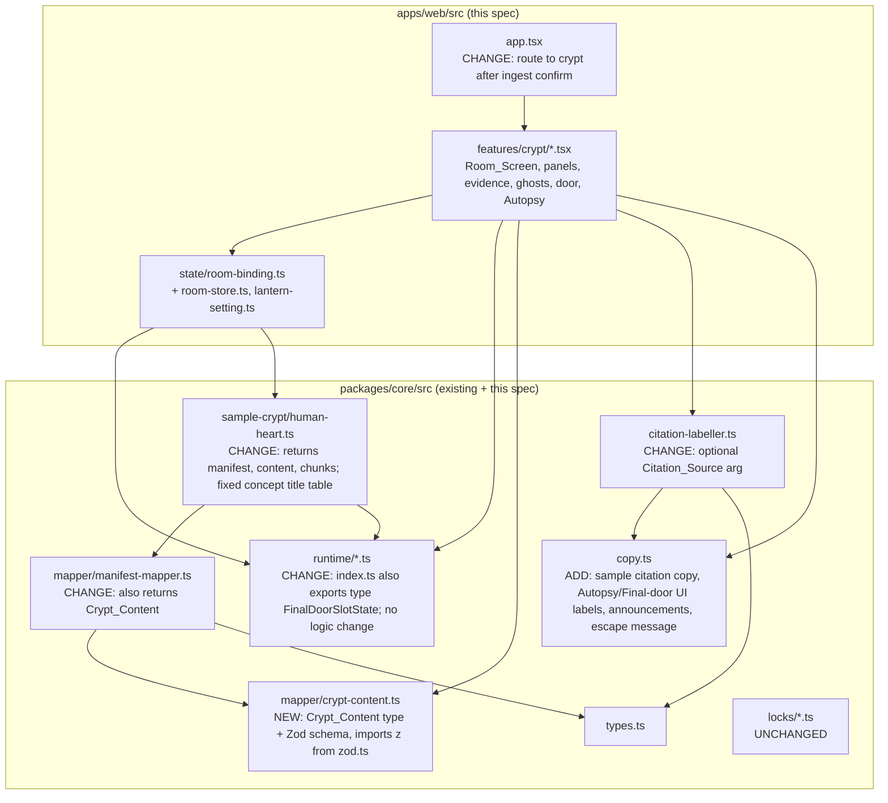

# Design Document

## Overview

Room play wires the sample crypt to the screen. It adds three things to the codebase:

1. **`Crypt_Content`** (`packages/core`): a Zod-validated, text-only companion to the manifest. The Manifest_Mapper now returns a QuestionSpec *and* a Crypt_Content entry for every question it maps, and `buildHumanHeartSampleCrypt` returns `{ manifest, content }`. The runtime and the manifest stay exactly as the room-runtime spec left them: no prompt text, no option text, no quotes, no explanations.
2. **The Room_Binding** (`apps/web/src/state/`): a small React hook that holds an `Event_Log` in memory, folds it with `initial`/`apply` from `packages/core/src/runtime/`, and exposes `State`, the latest `Outcome_Notice`s and the latest rejection. It contains no game rules — every rule decision happens inside `apply`.
3. **The Room_Screen** (`apps/web/src/features/crypt/`): the layered-art room, the rune cipher and séance board panels, the evidence panel, ghosts, the final door, the escape and the Autopsy, all driven by `State` through the selectors in `packages/core/src/runtime/selectors.ts` and by `Crypt_Content` for text.

The central design question this spec resolves (Requirement 6.9's open item) is **how a screen that only ever sees `State` and `Crypt_Content` gets from an `excerpts[].chunkId` to a `Citation_Label`**. The answer: `Crypt_Content` stores quote text directly (per Requirement 6.1's `excerpts: { chunkId, quote, optionId? }[]`) but *not* a resolved location or a chunk object, and the Room_Binding additionally exposes a small read-only **Citation_Map** (`ReadonlyMap<string, Chunk>`) built once, at crypt-build time, from the same chunk maps `buildHumanHeartSampleCrypt` already builds internally. The mapper is changed to return this map alongside `{ manifest, content }` so nothing is rebuilt from notes text in the browser and nothing is parsed twice. Full detail in "The Citation_Map" below.

## Architecture

### Module dependency graph



`packages/core` keeps importing nothing from React, a database or an AI SDK (`tech.md`). `Crypt_Content` and its schema live under `mapper/` because the mapper is the only producer; `citation-labeller.ts`, `copy.ts` and `types.ts` stay at the top level since other callers (ingestion) already use them.

### The Room_Binding's fold

```mermaid
sequenceDiagram
  participant UI as Room_Screen / panels
  participant Binding as useRoomBinding()
  participant Runtime as apply() (packages/core)

  UI->>Binding: dispatch(action)
  Binding->>Binding: build one Event from the action
  Binding->>Runtime: apply(state, event)
  alt accepted
    Runtime-->>Binding: { ok: true, state, notices }
    Binding->>Binding: eventLog = [...eventLog, event]
    Binding->>Binding: state = state; notices = notices; rejection = null
  else rejected
    Runtime-->>Binding: { ok: false, error }
    Binding->>Binding: rejection = error; state and eventLog unchanged
  end
  Binding-->>UI: { state, notices, rejection }
```

`State` in the binding is never computed by re-running `events.reduce(apply, initial(...))` on every render — that would be redundant and would make `apply` not the single point of truth for the *current* transition. Instead the binding keeps the current `State` plus the `Event_Log` in `useState`, and `state` always equals `eventLog.reduce(apply, initial(manifest, settings)).state` as an *invariant*, checked by Property 1 below, not as the literal implementation. To make that invariant testable without React, the transition lives in a pure function `stepBinding(model, action)` in `room-binding-model.ts`; `useRoomBinding` is a thin `useReducer` wrapper around it. Keeping the log is required by Requirement 4.2 (spec 4 will persist it); keeping `State` incrementally is what makes dispatch O(1) instead of O(n).

## Components and Interfaces

### Crypt_Content and the mapper (packages/core)

**File:** `packages/core/src/mapper/crypt-content.ts` (new, ~60 lines)

Schemas import `z` from `packages/core/src/zod.ts` (the jitless build), never from `'zod'` directly, as the repo lint rule requires. `crypt-content.ts` therefore starts with `import { z } from '../zod';`.

```ts
export interface CryptContentExcerpt {
  readonly chunkId: string;
  readonly quote: string;
  /** Present only on an Option_Excerpt: the séance option whose own evidence this is. */
  readonly optionId?: string;
}

export interface CryptContentEntry {
  readonly prompt: string;
  /** Present only for séance-board questions; option ID -> option text. */
  readonly options?: Record<string, string>;
  readonly excerpts: readonly CryptContentExcerpt[];
  readonly explanation: string;
}

export interface CryptContentConcept {
  /** Plain-text concept title shown in the Autopsy. */
  readonly title: string;
}

/**
 * `questions`: Question_Id -> its text. No answer key field exists anywhere in this type (Req 6.2).
 * `concepts`: conceptId -> its title. Every conceptId in the manifest has an entry.
 */
export interface CryptContent {
  readonly questions: Record<string, CryptContentEntry>;
  readonly concepts: Record<string, CryptContentConcept>;
}

export const CryptContentExcerptSchema = z.strictObject({
  chunkId: z.string().min(1),
  quote: z.string().min(1),
  optionId: z.string().min(1).optional(),
});

export const CryptContentEntrySchema = z
  .strictObject({
    prompt: z.string().min(1),
    options: z.record(z.string(), z.string().min(1)).optional(),
    excerpts: z.array(CryptContentExcerptSchema).min(1),
    explanation: z.string(),
  })
  .superRefine((entry, ctx) => {
    // Req 6.13: an optionId is accepted only when the same entry's `options` holds it.
    entry.excerpts.forEach((excerpt, i) => {
      if (excerpt.optionId !== undefined && entry.options?.[excerpt.optionId] === undefined) {
        ctx.addIssue({
          code: 'custom',
          path: ['excerpts', i, 'optionId'],
          message: 'optionId must name an option of the same entry',
        });
      }
    });
  });

export const CryptContentConceptSchema = z.strictObject({ title: z.string().trim().min(1) });

export const CryptContentSchema = z.strictObject({
  questions: z.record(z.string(), CryptContentEntrySchema),
  concepts: z.record(z.string(), CryptContentConceptSchema),
});

export interface CryptContentSchemaError {
  readonly kind: 'crypt-content-schema-invalid';
  readonly questionId: string;
  readonly issues: readonly { readonly path: readonly (string | number)[]; readonly message: string }[];
}

export function parseCryptContentEntry(
  questionId: string,
  raw: unknown,
): Result<CryptContentEntry, CryptContentSchemaError> { /* safeParse, never throws, Req 6.10 */ }
```

`options` is optional so a rune-cipher entry (Requirement 14) carries none, matching "no field for an answer key" (Requirement 6.2) — `options` maps option IDs to *text*, never to a correctness flag. The two `z.record(...)` values inside `CryptContentSchema` are dictionaries keyed by arbitrary question and concept IDs, so they take no `.strict()`; the outer object is strict. Concept titles are plain text and render as plain React text (Requirement 22.1). The schema cannot know the manifest, so "every conceptId of the manifest has a title" is checked where both are in hand: the builder (below) and Property 4.

**Change to `manifest-mapper.ts`:** `mapAuthoringQuestionToSpec` returns a question-indexed pair instead of only a `QuestionSpec`:

```ts
export interface MappedQuestion {
  readonly spec: QuestionSpec;
  readonly content: CryptContentEntry;
  /** The question's concept and its title, for `CryptContent.concepts`. */
  readonly concept: { readonly conceptId: string; readonly title: string };
}

export function mapAuthoringQuestionToSpec(
  question: AuthoringQuestion,
  maps: DocumentChunkMaps,
  questionId: string,
  /** The concept label for `spec.conceptId`: the generated concept's label, or the sample's fixed title. */
  conceptTitle: string | undefined,
): Result<MappedQuestion, MapperError>
```

The function already resolves each evidence paragraph to a `chunkId` via `maps.chunksByParagraph` before building the `QuestionSpec` (existing code, `manifest-mapper.ts` lines ~80-90). Requirement 6.8 ("Sample_Content SHALL take chunk IDs from the same chunk maps... every evidenceRefs ID appears as the chunkId of one of its excerpts") falls out of this directly: each excerpt is built in the same loop that resolves its chunk ID, and `evidenceRefs` is the de-duplicated list of those same excerpt `chunkId`s in excerpt order, so the two cannot drift. Question-level evidence becomes excerpts without `optionId` (Requirement 6.15). For séance questions, each option's **own** evidence becomes one Option_Excerpt carrying that option's `optionId` (Requirement 6.14). Option excerpts never come from the question-level evidence list or from a positional index into it.

A séance option with no evidence of its own is a typed error. For the sample crypt this is a guard only: every séance option in `samples/questions/human-heart.json` (`hh-q02`, `hh-q03` and `hh-q06`, nine options in all) already carries its own `evidence`, so `option-evidence-missing` is never returned for the shipped sample. This spec does not edit the sample questions file. The guard exists for Requirement 6.16 and for future generated crypts, and it is exercised by a mapper unit test that passes in-memory input with one option's evidence removed. `mapAuthoringQuestionToSpec` returns a `MapperError` of kind `option-evidence-missing` carrying the `questionId` and `optionId`, and no `QuestionSpec` and no content (Requirement 6.16). A `parseCryptContentEntry` call validates the built entry against the schema before the function returns it (Requirement 6.12); a schema failure returns a `MapperError` of kind `content-schema-invalid` and produces no `QuestionSpec` either, keeping the existing "no partial result" guarantee. A missing or blank `conceptTitle` returns a `MapperError` of kind `concept-label-missing` carrying the `questionId` and `conceptId`, and no `QuestionSpec` and no content. The mapper fills `concepts` from the concept label of generated crypts, so a concept never reaches the manifest without a title.

Building the rune-cipher and séance-board content entries:

```ts
// rune-cipher: one excerpt per evidence entry, no options, no optionId
{ prompt: question.prompt, excerpts: resolvedExcerpts, explanation: question.explanation }

// seance-board: question-level excerpts first (no optionId), then one Option_Excerpt per option
// built from THAT option's own evidence. Missing option evidence -> `option-evidence-missing`.
{
  prompt: question.prompt,
  options: Object.fromEntries(question.options.map((o) => [o.id, o.text])),
  excerpts: [
    ...questionLevelExcerpts, // { chunkId, quote } from the question's own evidence
    ...optionExcerpts,        // { chunkId, quote, optionId: o.id } in option order
  ],
  explanation: question.explanation,
}
```

`optionExcerpts` is built by one small helper that, for each option, resolves `o.evidence` through `maps.chunksByParagraph` (the same resolution the existing code uses for `evidenceRefs`) and returns `Result<CryptContentExcerpt, MapperError>`; the first `option-evidence-missing` or resolution failure short-circuits the whole mapping.

Because `question.options` is iterated in its authoring (= manifest `payload.optionIds`) order both when building `QuestionSpec.payload.optionIds` (existing code) and when building `content.options`'s key order, Requirement 6.7's "options in manifest order" is guaranteed by construction, not by a separate sort — `Object.fromEntries` and `Record` key order in V8 follow insertion order for string keys, but the Question_Panel renders from `payload.optionIds.map(id => content.options[id])`, never from `Object.keys(content.options)`, so option order never depends on object-key iteration order at all. This is stated explicitly in the panel section below.

**Change to `buildHumanHeartSampleCrypt`:**

```ts
export interface SampleCryptResult {
  readonly manifest: CryptManifest;
  readonly content: CryptContent;
  /** The same chunk map `buildDocumentChunkMaps` built, handed back so the UI never re-chunks notes text. */
  readonly chunks: ReadonlyMap<string, Chunk>;
}

export function buildHumanHeartSampleCrypt(
  notesText: string,
  questionsJson: HumanHeartQuestionsFile,
): Result<SampleCryptResult, SampleCryptError>
```

`loadQuestion` becomes `loadMappedQuestion`, returning `Result<MappedQuestion, SampleCryptError>`; the builder accumulates `content.questions[questionId] = mapped.content` and `content.concepts[mapped.concept.conceptId] = { title }` next to each `lockSlots.push(...)` / `slots.push(...)` call, for every primary, Alternate and reserved final-door question (Requirement 6.6). `human-heart.ts` holds a fixed `SAMPLE_CONCEPT_TITLES` table (conceptId to title) next to its fixed question selection and passes `SAMPLE_CONCEPT_TITLES[conceptId]` as `conceptTitle`; `samples/questions/human-heart.json` is not edited. Before returning, the builder checks that every conceptId in the manifest has an entry in `content.concepts`; a gap is returned as the `concept-label-missing` error, not thrown. `maps.chunks` (already built on the first line of the function) is returned verbatim as `chunks`. No new parsing, no new chunking call — this is purely returning a value the function already had in scope.

### The Citation_Map (resolving requirement 6.9's open item)

The Evidence_Panel and the Autopsy need `citationLabel(chunk, 'sample')`, which takes a `Chunk`, not a `chunkId`. Two options were considered:

| Option | How the UI gets a `Chunk` from an `excerpts[].chunkId` | Rejected because |
|---|---|---|
| A. Rebuild from notes text in the browser | Call `chunkDocument` again on `samples/human-heart.txt`'s text, client-side, to get a fresh `Chunk[]`, then index by ID | Doubles the chunking work for no reason, and risks drift if the Room_Binding ever read a *different* copy of the notes text (e.g. a future edited-notes path) than the one the crypt was built from. Chunking is pure and deterministic, so it would give the same answer today, but it duplicates a responsibility the mapper already owns. |
| **B. Builder returns the chunk map it already built** (chosen) | `buildHumanHeartSampleCrypt` returns `chunks: ReadonlyMap<string, Chunk>` (see above) alongside `manifest` and `content`; the Room_Binding stores it once, next to `content`, for the whole run | No extra computation, no second source of truth, and it generalises: when spec 3's real Manifest_Mapper runs for a learner's own notes, it will return the same three-part shape from the same `buildDocumentChunkMaps` call it already makes internally. |

The Room_Binding therefore exposes a **`RoomAssets`** value, built once per run and held unchanged for the run (Requirement 2.4):

```ts
export interface RoomAssets {
  readonly content: CryptContent;
  readonly chunks: ReadonlyMap<string, Chunk>;
  /** conceptId -> the concept's primary question (the question of its first Lock_Slot, in manifest order). */
  readonly firstQuestionByConcept: Readonly<Record<string, string>>;
}
```

`firstQuestionByConcept` is built once from the manifest by the pure function `buildFirstQuestionByConcept(manifest)` in `apps/web/src/state/room-assets.ts`, when the binding assembles `RoomAssets` at crypt-build time. It walks the manifest's primary questions (not Alternates, not reserved final-door questions) in manifest order and keeps the first question seen for each conceptId. The Autopsy excerpt link (Requirement 20.6) reads it, takes `content.questions[questionId].excerpts[0]` and passes it to `resolveExcerpt(assets, excerpt, 'sample')`. It reads no manifest and runs no search at click time.

A small pure helper, `resolveExcerpt`, is the one place that turns `{ chunkId, quote }` into what the Evidence_Panel renders:

```ts
// apps/web/src/features/crypt/evidence-text.ts
export interface ResolvedExcerpt {
  readonly quote: string;
  readonly citationLabel: string;
  readonly matched: boolean; // true iff resolveQuote succeeded against the chunk
}

export function resolveExcerpt(
  assets: RoomAssets,
  excerpt: CryptContentExcerpt,
  source: CitationSource = 'sample',
): ResolvedExcerpt {
  const chunk = assets.chunks.get(excerpt.chunkId);
  if (chunk === undefined) {
    // Content passed the schema and the mapper guarantees every chunkId exists (Req 6.8);
    // this branch exists only so the function is total (Req: typed results, no `any`/throws).
    return { quote: excerpt.quote, citationLabel: '', matched: false };
  }
  const resolved = resolveQuote(assets.chunks, excerpt.chunkId, excerpt.quote);
  return { quote: excerpt.quote, citationLabel: citationLabel(chunk, source), matched: resolved.ok };
}
```

The same file holds the pure ordering function the Evidence_Panel uses (Requirement 17.3, 17.4, 17.13-17.16):

```ts
/**
 * Orders a question's excerpts for display. Every input excerpt appears exactly once in the output.
 * - Séance (chosenOptionId and keyOptionId given): the chosen option's Option_Excerpt first,
 *   then the key option's Option_Excerpt (skipped when it is the same excerpt), then all
 *   remaining excerpts in stored order.
 * - Otherwise: stored order.
 * chosenOptionId comes from chosenOptionFor(eventLog, slotId), keyOptionId from the manifest
 * payload; neither is read from Crypt_Content and neither is read from State.
 */
export function orderExcerpts(
  excerpts: readonly CryptContentExcerpt[],
  chosenOptionId?: string,
  keyOptionId?: string,
): readonly CryptContentExcerpt[] {
  const indexOfOption = (id: string | undefined): number =>
    id === undefined ? -1 : excerpts.findIndex((e) => e.optionId === id);
  const first = indexOfOption(chosenOptionId);
  const second = indexOfOption(keyOptionId);
  const lead = [first, second].filter((i, pos, all) => i >= 0 && all.indexOf(i) === pos);
  const rest = excerpts.map((_, i) => i).filter((i) => !lead.includes(i));
  return [...lead, ...rest].map((i) => excerpts[i]!);
}
```

It works on indices, so an excerpt is never duplicated even if two excerpts share a `chunkId` or a quote. If an option ID has no Option_Excerpt (never the case for mapper output, per Requirement 6.17), that lead position is simply skipped and the remaining excerpts keep stored order.

`resolveExcerpt` and `orderExcerpts` keep `apps/web` free of judging/game-rule code (Requirement 22.6): `resolveExcerpt` calls only existing pure `packages/core` functions (`resolveQuote`, `citationLabel`) and does no chunking, no parsing and no network I/O. It lives under `features/crypt/` as a small presentation-adapter, not under `packages/core`, because it is specific to how this screen reads `RoomAssets`; `packages/core` itself gains no new runtime dependency.

### `citationLabel`'s new `Citation_Source` argument

**Change to `packages/core/src/citation-labeller.ts`:**

```ts
export type CitationSource = 'notes' | 'sample';

export function citationLabel(chunk: Chunk, source: CitationSource = 'notes'): string {
  const loc = chunk.location;
  if (loc.sourceType === 'paste') {
    return source === 'sample'
      ? CITATION_COPY.sampleParagraph(loc.paragraphNumber)
      : CITATION_COPY.pasteParagraph(loc.paragraphNumber);
  }
  const page = loc.pdfPageIndex + 1;
  return chunk.edited
    ? CITATION_COPY.editedPdf(page, loc.printedPageLabel)
    : CITATION_COPY.pdfPage(page, loc.printedPageLabel);
}
```

Only the `paste` branch changes; the `pdf` branch is untouched (Requirement 3.10 — the sample crypt is built from paste-sourced text today, so a `sample` source for a `pdf` chunk is not reachable from this spec, but the function stays total rather than narrowing its input type). **Change to `copy.ts`:** add `CITATION_COPY.sampleParagraph = (n: number) => \`Paragraph ${n} of the sample notes\`` next to the existing `pasteParagraph`, so both sample and Banned_Phrases tests reuse the same `CITATION_COPY` catalogue (Requirement 3.11).

### `apps/web/src/state/` — the Room_Binding

```
apps/web/src/state/
  room-actions.ts        # Action union the UI dispatches (not runtime Events)
  room-binding.ts         # useRoomBinding(): the hook (Req 4)
  room-binding-model.ts   # pure stepBinding(model, action) -> model; the hook wraps it (Req 4)
  room-event-mapper.ts    # one Action -> one Event, pure, ~60 lines
  room-assets.ts          # buildFirstQuestionByConcept(manifest) (Req 20.6) + room-assets.test.ts
  room-selectors.ts       # chosenOptionFor(eventLog, slotId): pure read of the Event_Log (Req 15, 17.4, 17.15)
  room-selectors.test.ts
  lantern-setting.ts      # resolveLanternMode (pure) + localStorage read/write (Req 12.3, 12.8-12.12)
  room-binding-model.test.ts
  room-binding.test.ts
  room-event-mapper.test.ts
  lantern-setting.test.ts
```

**`room-actions.ts`** — the UI-facing vocabulary is deliberately smaller than `Event` and carries submission shapes the panels build directly:

```ts
export type RoomAction =
  | { readonly type: 'startRun' }
  | { readonly type: 'enterRoom'; readonly roomId: string }      // internal, fired by the binding itself on roomCleared
  | { readonly type: 'openLock'; readonly slotId: string }
  | { readonly type: 'useHint'; readonly slotId: string }
  | { readonly type: 'submitAnswer'; readonly slotId: string; readonly submission: unknown }
  | { readonly type: 'skip'; readonly slotId: string }
  | { readonly type: 'challenge'; readonly slotId: string }
  | { readonly type: 'continueEvidence'; readonly slotId: string }
  | { readonly type: 'enterFinalDoor' }
  | { readonly type: 'playAgain' };
```

`room-event-mapper.ts` maps every `RoomAction` except `startRun`/`playAgain` 1:1 to one `Event` (Requirement 4.4); `startRun` and `playAgain` are handled specially by `room-binding.ts` because each expands to the fixed four-event start sequence of Requirement 5.2, not a single event.

**`room-binding.ts`** (~150 lines):

```ts
export interface RoomBindingState {
  readonly phase: 'not-started' | 'running' | 'start-failed';
  readonly state: State | null;
  /** Read-only view of the Event_Log for pure selectors such as `chosenOptionFor`. Empty until a run starts. */
  readonly eventLog: readonly Event[];
  readonly assets: RoomAssets | null;
  readonly notices: readonly Outcome_Notice[];
  readonly rejection: Typed_Rejection | null;
  readonly startError: SampleCryptError | PublishManifestError | Typed_Rejection | null;
}

export interface RoomBinding extends RoomBindingState {
  readonly dispatch: (action: RoomAction) => void;
}

export function useRoomBinding(buildCrypt: () => Result<SampleCryptResult, SampleCryptError> = buildSampleCrypt): RoomBinding
```

`buildCrypt` is a seam (default calls `buildHumanHeartSampleCrypt` with the bundled `samples/human-heart.txt` text and parsed `samples/questions/human-heart.json`, imported as static assets so Requirement 2.3's "no cross-origin request" holds — Vite's `?raw` / JSON import handles this with zero runtime fetch). Internals:

- `eventLog` and `state` live together in the `BindingModel` held by `useReducer` (see "Pure model and the hook" below). The log is not in a ref, because the Evidence_Panel and the séance panel read it during render through `chosenOptionFor`.
- `dispatch(action)`:
  1. `startRun` → calls `buildCrypt()`. On `{ ok: false }`, sets `phase: 'start-failed'`, `startError`, leaves everything else untouched (Requirement 2.2, 5.3) — no run starts. On success, builds `state0 = initial(manifest, SETTINGS)` (Requirement 5.1's fixed settings), then applies the four Requirement 5.2 events in order via a local `step` helper identical in shape to `test-support/escape-driver.ts`'s `step`; if any is rejected, sets `phase: 'start-failed'`, `startError: result.error`, and does not switch `phase` to `'running'` (Requirement 5.3). On full success, sets `assets = { content, chunks, firstQuestionByConcept: buildFirstQuestionByConcept(manifest) }`, `state`, `phase: 'running'`, `eventLog` = those four events.
  2. Any other action → `room-event-mapper` turns it into one `Event`; `apply(state, event)` runs once. On `{ ok: true }`: `eventLog = [...eventLog, event]`, `state = result.state`, `notices = result.notices` (replacing, not accumulating — "exposed once" per Requirement 4.5), `rejection = null`. On `{ ok: false }`: `rejection = result.error`; `state` and `eventLog` are *not* reassigned (Requirement 4.6).
  3. `playAgain` → resets `eventLog`, re-runs the `startRun` sequence against the *same* already-built `manifest`/`content`/`chunks` (Requirement 20.9 says "start a new run with an empty Event_Log", not "rebuild the crypt"; rebuilding would be wasted work and would not change anything since the sample crypt is deterministic).
- `roomCleared` and `escaped` notices never need the binding to synthesize a `RoomEntered` or further event itself in this spec: the sample crypt has exactly one room, so after `RoomEntered('hh-room-1')` there is no second room to publish or enter, and `selectWaitingForNextRoom` always returns `false` for it. The binding's `enterRoom` action exists in the type for forward-compatibility with multi-room crypts but is unused by any Room_Screen control in this spec (documented with a comment, not dead code requiring a lint suppression, since `room-event-mapper` still has a case for it and its own test).
- No effect ever touches `localStorage`, IndexedDB or the network from inside `room-binding.ts`; Lantern_Mode persistence is a separate module (`lantern-setting.ts`) used directly by the Room_Screen, keeping the binding itself free of storage side effects beyond the explicit, spec-called-out Lantern_Setting exception (Requirement 4.2, 12.12).

**Pure model and the hook.** The accept/reject logic above lives in `room-binding-model.ts`:

```ts
export interface BindingModel {
  readonly manifest: CryptManifest;
  readonly eventLog: readonly Event[];
  readonly state: State;
  readonly notices: readonly Outcome_Notice[];
  readonly rejection: Typed_Rejection | null;
}

/** One action in, one model out. Accepted: log grows by one event, state replaced, notices replaced. Rejected: log and state unchanged, rejection set. */
export function stepBinding(model: BindingModel, action: RoomAction): BindingModel
```

`useRoomBinding` holds a `BindingModel` in `useReducer` and calls `stepBinding`. React contributes nothing but storage of the model, so the fold invariant (Property 1) is tested on `stepBinding` directly.

**Lantern_Mode initial value.** `lantern-setting.ts` exposes the pure decision, separate from the storage calls:

```ts
export type StoredLantern = 'on' | 'off' | 'absent' | 'threw' | { readonly garbage: string };

/** Req 12.3, 12.9, 12.10: a stored 'on'/'off' wins; anything else falls back to reduced-motion. */
export function resolveLanternMode(stored: StoredLantern, prefersReducedMotion: boolean): boolean {
  if (stored === 'on') return true;
  if (stored === 'off') return false;
  return prefersReducedMotion;
}
```

A stored value, including an explicit 'off', beats the reduced-motion default; an absent, unreadable or unrecognised value falls back to Lantern_Mode on under `prefers-reduced-motion: reduce` and off otherwise.

**Draft answers (Requirement 4.8, 14.6, 15.5):** Draft_Answer values (typed text, selected option) live in `useState` inside the Question_Panel components themselves, keyed by `slotId` + `currentQuestionId`. They are never passed to `dispatch` until `submitAnswer` is called, and the panel resets its own draft `useState` via a `key={`${slotId}:${currentQuestionId}`}` on the panel element — remounting on a question change clears the draft for free, matching "resets ... when the slot's current question changes" without the binding ever seeing the draft value.

### `apps/web/src/features/crypt/` — the Room_Screen

```
apps/web/src/features/crypt/
  crypt-flow.tsx              # top-level: owns useRoomBinding, routes to Room_Screen/Autopsy/start-failed message
  scene-types.ts              # SceneFile Zod schema (Req 23.3) + types
  scene-loader.ts             # fetch + parse one Art_Room's scene.json, typed result
  art-room.ts                 # pure: position (1|2|3) -> Art_Room id (Req 7.1, 7.2)
  room-screen.tsx             # layered art + hotspots + ghosts + door for the current room (~180 lines)
  room-screen.css
  lock-layer.tsx              # one lock's image stack (base/hover/solved states) + Flame + Light_Pass (~120 lines)
  hotspot-button.tsx          # one Hotspot_Button, accessible name, focus ring (~70 lines)
  crop-mapping.ts             # pure Crop_Mapping function + its own test (Req 11.4, 11.5)
  hotspot-geometry.ts         # pure: hotspotBox (>= 44x44), stackOrder (depth), tabOrder (x), sealPoints (inside the door polygon) (Req 10.2, 10.4, 10.5, 11.6, 19.4)
  flame.tsx                   # code-drawn flame/flicker SVG, respects prefers-reduced-motion
  ghost-layer.tsx             # ghosts + spirit candles at Ghost_Anchors (~100 lines)
  final-door.tsx              # door button, seals, Final_Door Question_Panel wiring (~150 lines)
  question-panel.tsx          # shell: focus trap, hint/skip/challenge controls, dispatches to the right lock panel (~140 lines)
  rune-cipher-panel.tsx       # Requirement 14 (~90 lines)
  seance-board-panel.tsx      # Requirement 15 (~90 lines)
  unplayable-panel.tsx        # Requirement 19.8 fallback for lock types with no panel (~30 lines)
  evidence-panel.tsx          # Requirement 17 (~140 lines)
  live-region.tsx             # the one polite live region + announcement queue (Req 21.1)
  announcements.ts            # pure: (previous State, next State, notices) -> ordered messages (Req 21.2 to 21.5)
  lantern-toggle.tsx          # the Lantern_Mode control (~40 lines)
  autopsy-view.tsx            # Requirement 20, including Final_Door_Section (~160 lines)
  autopsy-titles.ts           # pure: withConceptTitles(entries, content) (Req 20.3) + test
  evidence-text.ts            # resolveExcerpt (see Citation_Map section) + its test
  accessible-names.ts         # pure: (lock, status) -> name; (ghost) -> name; (door slot, status) -> name (~60 lines)
  art-failure-log.ts          # the one console.error call + its guard against duplicate logging per file (Req 23)
```

Every file stays at or under ~180 lines, well inside the ~300-line budget, by giving each visual concern (lock layer, ghost layer, door, one panel per lock type) its own file, matching the pattern already used in `apps/web/src/features/ingest/`.

**`crypt-flow.tsx`** is the only file that calls `useRoomBinding`. It renders:
- a "start" view with the Requirement 1.3 sample-crypt line and the "Enter the crypt" button when `phase === 'not-started'`;
- the Requirement 2.2/5.3 error message when `phase === 'start-failed'`, built via the existing `renderError`/`ErrorCopy` shape from `copy.ts`, extended with entries for `SampleCryptError` and `PublishManifestError` kinds (new `ROOM_START_ERROR_COPY` catalogue, same `{ what, next }` shape);
- `<RoomScreen>` while `state.status === 'in progress'` and `!state.atFinalDoor`;
- `<FinalDoor>` while `state.atFinalDoor` and `state.status !== 'escaped'`;
- `<FinalDoor escaped>` (the escape view) while `state.status === 'escaped'` and the learner has not yet asked for the Autopsy (Requirement 19.9);
- `<AutopsyView>` while `state.status === 'escaped'` and the learner has activated "Open the Autopsy" (Requirements 19.9, 20.1). It is never rendered while the status is not `escaped` (Requirement 20.2).

The "Autopsy requested" flag is a `useState<boolean>` local to `crypt-flow.tsx`. It is set by the escape view's button and cleared when `playAgain` is dispatched, so a new run starts in the first room with no Autopsy showing. It holds no game state, so `State` stays the only source of truth for `status`.

This mirrors `app.tsx`'s existing route-by-condition style rather than introducing a router.

**`final-door.tsx`** (Requirement 19). All of it reads `selectFinalDoor(state)`, `State.atFinalDoor` and `State.status`. It adds no game rule.

- **Closed door (19.1).** While `selectFinalDoor(state).available` is false the door is drawn closed and no button is rendered over it.
- **Enter button (19.2, 19.3).** When `available` becomes true, one native `<button>` is drawn over the scene's `door.hotspot` (through `useCropMapping()` and `hotspotBox`). Its accessible name comes from `accessible-names.ts` (`doorButtonName()`, text in `copy.ts`) and offers to open the final door. Activating it dispatches `enterFinalDoor`, which the mapper turns into `FinalDoorEntered`.
- **Seals (19.4, 19.5).** While `atFinalDoor` is true, one seal is drawn per `State.finalDoor.slots` entry, in slot order, at the points returned by the pure function `sealPoints(polygon, count)` in `hotspot-geometry.ts`. `sealPoints` takes the door polygon in viewport pixels, intersects a horizontal scan line at the polygon's centroid height with the polygon (when the centroid falls outside a concave polygon, it uses the nearest height where the line crosses the interior), takes the widest interior interval, and returns `count` points at the fractions `(i + 1) / (count + 1)` along it. Every returned point is therefore inside the polygon, for any simple polygon and any `count >= 0`. A seal whose slot is `solved`, `settled` or `challenged` is drawn broken and carries a visible text label from `FINAL_DOOR_STATUS_LABELS`. Its accessible name states the status in words (Requirement 21.6).
- **Slot controls and panel (19.6, 19.7).** Every `open` slot gets one native button that opens its Question_Panel. The panel opens on the right side of the frame: the door has no `panelSide` entry in the scene file, so `final-door.tsx` passes `side="right"` to the shared `question-panel.tsx`. That is the same shell, Evidence_Panel, hint, skip and challenge controls and `ghost-layer.tsx` that `room-screen.tsx` uses. The door adds no second copy of any of them.
- **Unplayable type (19.8).** A slot whose `currentQuestionType` has no panel opens `unplayable-panel.tsx`, which shows the "not playable in this version" message and only the Skip button.
- **Escape view (19.9, 19.10).** With `escaped` set, the screen draws the open door (`door-open.webp`) with the additive `light-door.webp` Light_Pass, shows the escape message from `copy.ts` (`ESCAPE_COPY.message`) and one "Open the Autopsy" button. It renders no slot button, no Question_Panel and no hint, skip or challenge control, so the learner cannot send any of those once the status is `escaped`. The runtime rejects them as well.

**`art-room.ts`:**

```ts
export type ArtRoomId = 'burial-chamber' | 'library-of-bones' | 'sunken-chapel';
const ART_ROOMS: readonly ArtRoomId[] = ['burial-chamber', 'library-of-bones', 'sunken-chapel'];

/** Position is 1-based, matching Requirement 7.1's wording. Ignores roomId entirely. */
export function artRoomForPosition(position: number): ArtRoomId | null {
  return ART_ROOMS[position - 1] ?? null;
}
```

`room-screen.tsx` calls `artRoomForPosition(state.rooms.findIndex(r => r.roomId === state.currentRoomId) + 1)`, never reading `roomId` for anything but locating the index — this directly satisfies Requirement 7.2 and is checked by Property 2 below. `null` (position > 3) is unreachable for the sample crypt (one room) but kept total rather than asserted, consistent with `packages/core`'s no-throw style carried into this adapter code.

**`scene-loader.ts` / `scene-types.ts`:** `SceneFile` is validated with Zod on fetch (Requirement 23.3). On fetch failure or Zod failure, `room-screen.tsx` renders the fallback: a plain list of buttons, one per currently-open Lock_Slot in the room, each built with the *same* `accessible-name.ts` function the normal Hotspot_Button uses, so the accessible name never forks into a second implementation (Requirement 23.3's "same accessible names").

**`lock-layer.tsx`** picks images with two small pure functions in `accessible-names.ts`'s sibling module (co-located, same file acceptable at this size) or inline, matching Requirements 8.1/8.2/9.1/9.8:

```ts
export function lockImageFile(lock: LockType, status: SlotStatus, hovered: boolean): string {
  const solved = status !== 'open'; // solved | settled | challenged all use the -solved art (Req 8.2)
  const suffix = solved ? '-solved' : '';
  return hovered ? `lock-${lock}${suffix}-hover.webp` : `lock-${lock}${suffix}.webp`;
}

export function shouldDrawFlame(status: SlotStatus, candleLit: boolean): boolean {
  return status === 'open' ? candleLit : status === 'solved' && candleLit;
  // settled/challenged: candleLit is always false by runtime construction (Req 9, 8.6), so this
  // reduces to "candleLit", but is written as a pure function of both fields so its unit test
  // documents the real contract instead of relying on a runtime invariant holding forever.
}
```

Both are pure functions of small enumerable inputs, and both are called with no knowledge of *why* a transition happened — whether a flame should be instant-on (first render) or animated (triggered by a fresh `candleLit` notice) is decided one level up in `room-screen.tsx` by comparing the *previous* render's `candleLit` value for that slot to the current one (a `useRef<Record<string, boolean>>` map), which is the direct implementation of Requirement 9.8 ("drawing depends only on State" for the steady-state look, while the *animation* is a one-time transition effect keyed off the notice).

**`hotspot-button.tsx`** renders one native `<button>` per drawn lock, positioned with `clip-path: polygon(...)` sized to the hotspot's bounding box (so the button itself is always a rectangle ≥ 44×44 px per Requirement 10.2, with the visual hit area following the polygon only as a `clip-path` hint, not a hit-test boundary — native rectangular buttons keep touch/keyboard semantics simple and avoid needing a custom hit-test for an SVG shape). Z-order and tab order both come from pure sorts over the room's drawn locks, in `room-screen.tsx`:

```ts
const byDepthDesc = [...drawnLocks].sort((a, b) => b.scene.depth - a.scene.depth); // smaller depth drawn last = on top (Req 10.4)
const byXAsc = [...drawnLocks].sort((a, b) => a.scene.hotspotCenterX - b.scene.hotspotCenterX); // Req 10.5
```

`tabIndex` is left at the DOM default (0) and the buttons are emitted to the DOM in `byXAsc` order inside a single container, so native tab order follows it without manual `tabIndex` juggling.

Both sorts and the minimum button size live in `hotspot-geometry.ts` as pure functions, which `room-screen.tsx` and `hotspot-button.tsx` call instead of sorting or sizing inline:

```ts
export const MIN_HIT_PX = 44;
/** Bounding box of the polygon in viewport px, grown about its centre to at least 44x44. */
export function hotspotBox(polygon: readonly ViewportPoint[]): { x: number; y: number; width: number; height: number };
/** Smaller depth = on top (Req 10.4). Stable; does not mutate the input. */
export function stackOrder<T extends { depth: number }>(locks: readonly T[]): readonly T[];
/** Ascending hotspot-centre x (Req 10.5). Stable; does not mutate the input. */
export function tabOrder<T extends { hotspotCenterX: number }>(locks: readonly T[]): readonly T[];
```

**`crop-mapping.ts`** (Requirement 11.3-11.5):

```ts
export interface Viewport { readonly width: number; readonly height: number; }
export interface ScenePoint { readonly x: number; readonly y: number; } // fractions 0..1

/** The bounding box (in scene fractions) of every drawn lock's hotspot, union'd. */
export function hotspotUnionBounds(hotspots: readonly (readonly ScenePoint[])[]): Bounds

/**
 * Maps a scene-fraction point to viewport pixels under `object-fit: cover` centred on `bounds`.
 * Pure; total for any finite viewport and any point (no clamping failure, no NaN by construction).
 */
export function mapCropPoint(point: ScenePoint, sceneSize: Viewport, bounds: Bounds, viewport: Viewport): { x: number; y: number }
```

The Crop_Mapping is used for hotspots, candle points, ambient candle points, ghost anchors and the door hotspot alike — one function, four call sites, so Requirement 11.3 ("every hotspot, candle, ambient candle, Ghost_Anchor and door coordinate") is structural: every scene-coordinate consumer in `room-screen.tsx`, `ghost-layer.tsx` and `final-door.tsx` reads coordinates through a single `useCropMapping()` helper that wraps `mapCropPoint`, never through a raw `scene.json` field, when `cropped` is true.

**`evidence-panel.tsx`** reads `content.questions[questionId]`, passes `content.questions[questionId].excerpts` through `orderExcerpts(excerpts, chosenOptionId, keyOptionId)`, and calls `resolveExcerpt(assets, excerpt, 'sample')` on each result in that order (Requirements 3.9, 17.3). Each excerpt is therefore shown once. The order is:

1. the chosen option's Option_Excerpt;
2. the key option's Option_Excerpt (omitted when the chosen option is the key option, so it is not repeated);
3. every remaining excerpt in stored `Crypt_Content` order.

The result text and icon (Requirements 17.2, 17.7) come from `evidenceResult(slot)`, a pure helper in `evidence-text.ts`:

```ts
export type EvidenceResult = 'correct' | 'wrong' | null;

/**
 * Lock_Slot: from judgedResult ('correct' -> 'correct', 'wrong' -> 'wrong', anything else -> null).
 * Return_Slot and Final_Door slot (FinalDoorSlotState): from status, because neither type has a
 *   judgedResult. SlotStatus is 'open' | 'solved' | 'settled' | 'challenged'.
 *   solved -> 'correct', settled -> 'wrong', challenged and open -> null (no result text).
 * Skip and Challenge close the panel in the runtime (evidencePanelOpen false), so a Return_Slot or
 * Final_Door slot that is settled while its panel is open was settled by a wrong answer.
 */
// FinalDoorSlotState is exported from the core runtime index (`packages/core/src/runtime/index.ts`),
// like the other slot types, so this file imports all of them from that index.
export function evidenceResult(slot: LockSlotState | ReturnSlotState | FinalDoorSlotState): EvidenceResult {
  if ('judgedResult' in slot) {
    return slot.judgedResult === 'correct' || slot.judgedResult === 'wrong' ? slot.judgedResult : null;
  }
  return slot.status === 'solved' ? 'correct' : slot.status === 'settled' ? 'wrong' : null;
}
```

The panel shows the result text and icon only when `evidenceResult` is not `null`, and opens with the kind "Not this time" sentence only when it returns `'wrong'` (Requirement 17.7: `judgedResult` `wrong` for a Lock_Slot, status `settled` for a Return_Slot). A challenged Return_Slot shows neither.

For a non-séance question both option IDs are `undefined`, so stored order is shown unchanged (Requirement 17.14). For a séance-board question the panel also reads `content.questions[questionId].options![chosenOptionId]` and `content.questions[questionId].options![keyOptionId]` for the option texts (Requirement 17.4).

`chosenOptionId` comes from the accepted `AnswerSubmitted` Event, read through `chosenOptionFor` over the Room_Binding's `eventLog` (Requirement 17.15), and `keyOptionId` comes from the manifest payload (`QuestionSpec.payload.keyOptionId`). `State` does not record the chosen option: a `LockSlotState` keeps only `judgedResult`, and the runtime is not changed. The Room_Binding holds the log, so the panel calls the pure selector `chosenOptionFor(eventLog, slotId)` (see "Deriving the chosen option from the Event_Log" below) and passes the result to `orderExcerpts`. The panel reads neither option ID from `Crypt_Content` (Requirements 6.2, 17.15): the manifest keeps the answer key, and content never does.

#### Deriving the chosen option from the Event_Log

**File:** `apps/web/src/state/room-selectors.ts` (new, ~25 lines, with `room-selectors.test.ts`)

```ts
/**
 * The option the learner chose for the slot's most recent accepted answer, or undefined.
 * Reads the Event_Log only. The log holds accepted Events only (a rejected Event is never
 * appended, Requirement 4.6), so every AnswerSubmitted in it was accepted.
 * Total: a missing slot, a non-séance submission or a malformed submission gives undefined.
 */
export function chosenOptionFor(eventLog: readonly Event[], slotId: string): string | undefined {
  for (let i = eventLog.length - 1; i >= 0; i--) {
    const event = eventLog[i]!;
    if (event.kind !== 'AnswerSubmitted' || event.slotId !== slotId) continue;
    const submission: unknown = event.submission;
    if (typeof submission === 'object' && submission !== null && 'selectedOptionId' in submission) {
      const id = (submission as { readonly selectedOptionId: unknown }).selectedOptionId;
      return typeof id === 'string' ? id : undefined;
    }
    return undefined;
  }
  return undefined;
}
```

(The cast narrows an `unknown` submission inside this one function. If the repository's lint rules forbid the cast, replace it with a small Zod `safeParse` of `{ selectedOptionId: string }`, which the tech rules prefer for anything crossing a boundary.)

- **Which Event counts.** The last `AnswerSubmitted` for the slot is the one the open Evidence_Panel shows. The Evidence_Panel is open only between an accepted `AnswerSubmitted` and its `EvidenceContinued`, and the runtime accepts no second `AnswerSubmitted` for the slot while the panel is open (Requirement 17.11). A slot can be answered twice, or its question can change after a wrong answer, so earlier `AnswerSubmitted` events for the same slot are ignored by scanning from the end.
- **Who holds the log.** `useRoomBinding` already holds the Event_Log in its `BindingModel` (Requirement 4.2). It exposes the log to the interface as a read-only `eventLog` field next to `state`, `notices` and `rejection`. The log is kept in the model (`useReducer`), not in a ref, so a render that reads it is never stale. Requirement 4.7 lists State, notices and the rejection as what the binding exposes. A read-only `eventLog` adds a field and removes none.
- **Who calls it.** The Evidence_Panel calls `chosenOptionFor(eventLog, slotId)` to feed `orderExcerpts` and to look up the chosen option's text. The séance panel calls the same selector to show the submitted choice while the Evidence_Panel is open. Neither component reads the log in any other way, and neither touches `State` for this value.
- **No runtime change.** `State`, `LockSlotState`, `Event` and `apply` are unchanged. The selector is a pure function over the existing `Event` type in `packages/core/src/types.ts`. It holds no game rule: it does not judge, count or decide anything, it only reads back what the learner submitted.
- **Return slots and final-door slots.** `ReturnSlotState` has no `judgedResult`, and final-door slots are answered through the same `AnswerSubmitted` Event. The selector keys on `slotId` only, so it needs no per-slot-kind branch.

**Announcements (Requirement 21).** `live-region.tsx` renders the one `aria-live="polite"` region (21.1). The pure function `announcementsFor(previous: State, next: State, notices: readonly Outcome_Notice[]): readonly string[]` in `announcements.ts` returns the messages for one accepted dispatch, in this order:

1. When a slot's `evidencePanelOpen` turns true, one correct or not-correct message from `evidenceResult` (21.5).
2. For each Lock_Slot, Return_Slot or Final_Door slot whose `status` changed from `open` to `solved`, `settled` or `challenged`, one message naming the new status (21.4).
3. One message per `Outcome_Notice` kind (`candleLit`, `ghostSpawned`, `ghostLaidToRest`, `sealCracked`, `roomCleared`, `escaped`), in notice order (21.2, 21.3).

All text comes from a new `ROOM_ANNOUNCEMENT_COPY` catalogue in `copy.ts`, with one entry per notice kind, one per status and one per evidence result, checked against `BANNED_COPY_PHRASES` by the existing copy test. The binding exposes the previous `State` only inside `crypt-flow.tsx`, which keeps it in a `useRef` and calls `announcementsFor` in an effect on each accepted dispatch. A rejected dispatch changes neither `State` nor `notices`, so it announces nothing. The live region shows one message at a time from a queue, so two messages from one dispatch are not merged.

**Typography and tokens (Requirement 22.3, 22.4).** `room-screen.css` and the panel CSS refer to colours only through custom properties from `apps/web/src/styles/tokens.css`, and to fonts only through `--font-body` (Crimson Pro) and `--font-title` (Cinzel). Question, option, excerpt and explanation text uses `--font-body` at `font-size: 1.125rem` (18px) by default and `1rem` (16px) in the phone media query used for the Phone_Viewport. `--font-title` is used on headings and titles only. A CSS source test (see Testing Strategy) reads the crypt CSS files and fails on a hex or `rgb(` colour literal, an `@import` or `url(http` reference, and a `font-size` below those two values on the question-text selectors.

**`autopsy-view.tsx`** calls `selectAutopsy(state)` for the concept list. The runtime stays text-free, so `AutopsyEntry` (`conceptId`, `outcome`, `label`) and `autopsy-selector.ts` are unchanged. The view adds the title itself: each entry is shown as `{ ...entry, title: content.concepts[entry.conceptId].title }` (type `AutopsyEntryView`, built by the pure function `withConceptTitles(view.entries, content)` in `apps/web/src/features/crypt/autopsy-titles.ts`), rendered as plain text (Requirements 20.3, 22.1). If a title is missing, which the builder's check rules out, the function returns the `conceptId` as the title so the entry still shows. The concept's excerpt link (Requirement 20.6) looks up `assets.firstQuestionByConcept[entry.conceptId]`, takes the first excerpt of `content.questions[thatQuestionId]` and calls `resolveExcerpt(assets, excerpt, 'sample')`. The view reads `state.finalDoor.slots` directly for the Final_Door_Section (Requirement 20.11), looking up each slot's prompt via `content.questions[slot.currentQuestionId].prompt` and its status label via a new copy catalogue entry `FINAL_DOOR_STATUS_LABELS` (parallel to `AUTOPSY_LABELS`, keyed by `SlotStatus`), added to `copy.ts`:

```ts
export const FINAL_DOOR_STATUS_LABELS: Readonly<Record<SlotStatus, string>> = {
  open: 'Not yet answered',
  solved: 'Solved',
  settled: 'Excluded from score',
  challenged: 'Challenged: excluded from score',
};
```

Each concept outcome (Requirement 20.5) and each final status (Requirement 20.12) is drawn as an icon and its text label side by side. The icons are small inline SVG components in `autopsy-view.tsx`, one per `ConceptOutcome` and one per `SlotStatus`, marked `aria-hidden="true"` because the text label carries the meaning. A `settled` or `challenged` final-door entry also shows the "excluded from the score" text from the label (Requirement 20.13), and a concept whose outcome is `challenged` shows the same statement (Requirement 20.7). The five counts of Requirement 20.4 are read from `view.counts`, and the "Play again" button of Requirement 20.9 dispatches `playAgain`.

(`open` is unreachable at the Autopsy, since the Autopsy only shows once `status === 'escaped'` and the run cannot escape with an open final-door slot per the room-runtime termination guarantee — kept for totality, not reachability.)

## Data Models

### `Crypt_Content` (new, `packages/core/src/mapper/crypt-content.ts`)

Shown in full above. JSON-safe, no functions, no `Chunk` or `Map` values inside it — `RoomAssets.chunks` is a sibling value, never nested inside `Crypt_Content` itself, keeping the schema-validated part of the data strictly text.

### `RoomAssets` (new, `apps/web/src/state/`)

```ts
export interface RoomAssets {
  readonly content: CryptContent;
  readonly chunks: ReadonlyMap<string, Chunk>;
  readonly firstQuestionByConcept: Readonly<Record<string, string>>;
}
```

Not JSON-safe (a `Map` isn't), and intentionally so: `RoomAssets` never crosses a persistence boundary in this spec (Requirement 2's Out of Scope notes that storage is spec 4's job), so it has no need to serialise. When spec 4 adds persistence, it will persist `manifest`, `RunSettings` and the `Event_Log` (per the room-runtime design's forward note) plus, newly, `content`; `chunks` can always be rebuilt from the persisted notes text via `buildDocumentChunkMaps`, since it is pure and deterministic — spec 4 does not need to persist `chunks` itself.

### `SceneFile` (new, `apps/web/src/features/crypt/scene-types.ts`)

A Zod schema mirroring `docs/art/asset-contract.md` section 4: `room`, `version`, `desktop: { size, layers, parallax, locks: Record<LockType, LockSceneEntry>, ambientCandles, ghostAnchors, door }`, optionally `mobile` with the same shape. `LockSceneEntry` is `{ depth: number; hotspot: [number, number][]; candle: { x, y, scale }; panelSide: 'left' | 'right' }`. Validated once per Art_Room load; a validation failure is a typed `Result`, consumed by the Requirement 23.3 fallback path.

## Correctness Properties

*A property is a characteristic or behavior that should hold true across all valid executions of a system — essentially, a formal statement about what the system should do. Properties serve as the bridge between human-readable specifications and machine-verifiable correctness guarantees.*

Only pure logic gets a property. Everything that is rendering, wiring, focus, animation, storage side effects or a fixed copy string is an example test, a unit test or a Playwright check (see Testing Strategy). Each property below is a pure function or a pure state transition in `packages/core` or in a pure module under `apps/web/src`.

### Property 1: The binding's state is the fold of its accepted events

*For any* valid manifest fixture and *for any* sequence of `RoomAction`s applied with `stepBinding`, starting from the run-start model, the model's `state` equals `eventLog.reduce(apply, initial(manifest, settings))`; the `eventLog` contains exactly the events whose `apply` call was accepted, in order; and every rejected action leaves `eventLog` and `state` unchanged and sets `rejection` to the rejected kind.

**Validates: Requirements 4.3, 4.5, 4.6**

### Property 2: The Art_Room is chosen by room position only

*For any* room position from 1 to 3 and *for any* `roomId` string, `artRoomForPosition(position)` returns `burial-chamber`, `library-of-bones` or `sunken-chapel` for positions 1, 2 and 3 respectively, and the result is identical for every `roomId` the room might carry.

**Validates: Requirements 7.1, 7.2, 24.3**

### Property 3: Crypt_Content survives a JSON round trip, including `optionId`

*For any* value that passes `CryptContentSchema`, including entries whose excerpts carry an `optionId` that names an option of the same entry, and including its `concepts` record, parsing `JSON.parse(JSON.stringify(value))` with `CryptContentSchema` produces a value deeply equal to the original, and every `optionId` and every concept title is preserved.

**Validates: Requirements 6.11, 6.18**

### Property 4: The mapper gives every question complete content

*For any* non-empty list of valid authoring questions (rune cipher and séance board, each séance option carrying its own evidence) mapped with `mapAuthoringQuestionToSpec` and assembled into a manifest and a `CryptContent`, every question ID of the manifest has a content entry that passes `CryptContentEntrySchema`; every conceptId of the manifest has a non-empty title in `content.concepts`; every `evidenceRefs` chunk ID of a question appears as the `chunkId` of one of its excerpts; and every séance entry holds exactly one Option_Excerpt for each ID in its payload's `optionIds`.

**Validates: Requirements 6.4, 6.5, 6.6, 6.8, 6.14, 6.17** and the concept-title requirement of Requirement 6 (see the requirements document for its criterion number)

### Property 5: A hotspot box is never smaller than 44 by 44 px

*For any* non-empty polygon of viewport points, `hotspotBox(polygon)` has `width >= 44` and `height >= 44`, and contains the polygon's own bounding box.

**Validates: Requirements 10.2, 11.6**

### Property 6: Stacking order follows depth and tab order follows x

*For any* list of drawn locks with arbitrary `depth` and `hotspotCenterX` values, `stackOrder` and `tabOrder` each return a permutation of the input; in `stackOrder` the lock with the smaller `depth` comes out on top (never has a larger depth than the lock beneath it); in `tabOrder` the `hotspotCenterX` values are non-decreasing; and neither function mutates its input.

**Validates: Requirements 10.4, 10.5**

### Property 7: Crop_Mapping keeps hotspot-union points inside the viewport

*For any* viewport size, scene size and bounds, and *for any* point inside the union of the drawn hotspots' bounds, `mapCropPoint` returns a point whose `x` is within `[0, viewport.width]` and whose `y` is within `[0, viewport.height]`, with no `NaN` or infinite coordinate.

**Validates: Requirements 11.3, 11.5, 24.4**

### Property 8: `citationLabel` source variants

*For any* chunk, `citationLabel(chunk)` equals `citationLabel(chunk, 'notes')` and equals the wording produced before the `Citation_Source` argument existed (the unchanged `pasteParagraph`, `pdfPage` and `editedPdf` templates). *For any* paste chunk with paragraph number N, `citationLabel(chunk, 'sample')` equals `"Paragraph " + N + " of the sample notes"` and does not end with `"of your notes"`.

**Validates: Requirements 3.8, 3.9, 3.10, 3.12**

### Property 9: The Lantern setting falls back to the reduced-motion default

*For any* stored value (`'on'`, `'off'`, absent, a read that throws, or any other string) and *for any* `prefersReducedMotion` boolean, `resolveLanternMode` returns `true` for a stored `'on'`, `false` for a stored `'off'`, and `prefersReducedMotion` for every other stored value.

**Validates: Requirements 12.3, 12.9, 12.10**

### Property 10: Séance evidence ordering shows each excerpt once, chosen first, then key

*For any* excerpt list of a séance question with one Option_Excerpt per option, *for any* chosen option and *for any* key option (equal or different), `orderExcerpts` returns a permutation of the input in which every excerpt appears exactly once; the chosen option's Option_Excerpt is first; the key option's Option_Excerpt is next when it differs from the chosen one; and the remaining excerpts keep their stored relative order. *For any* excerpt list with no chosen and no key option, the output equals the input.

**Validates: Requirements 17.3, 17.4, 17.13, 17.14, 17.16**

## Property Reflection

The prework marked far more criteria as testable than are worth a generative test. The list above keeps a criterion as a property only when it is a pure function or a pure transition whose input space is large and varied. The rest are covered as follows:

- **Merged into one property.** Requirements 4.3, 4.5 and 4.6 are three views of the same `stepBinding` fold, so they share Property 1. Requirements 6.4 to 6.6, 6.8, 6.14 and 6.17 describe completeness of one mapper output, so they share Property 4. Requirements 3.8, 3.9, 3.10 and 3.12 are all `citationLabel`, so they share Property 8. Requirements 12.3, 12.9 and 12.10 are one decision function, so they share Property 9.
- **Kept apart on purpose.** Property 5 (box size) and Property 6 (ordering) are both hotspot geometry but have different generators and different failure messages, so each stays a single-assertion-family test. Property 3 (schema round trip) and Property 4 (mapper completeness) test different functions.
- **Option-excerpt ordering (Property 10) subsumes the old order-and-round-trip properties.** Requirement 17.13 (chosen is the key) and 17.14 (non-séance) are the same function with equal or absent option IDs, so they need no separate property.
- **Finite domains become table-driven unit tests, not properties.** `lockImageFile` and `shouldDrawFlame` (every `SlotStatus` x `candleLit` x hover), accessible names, seal state, `FINAL_DOOR_STATUS_LABELS`, Outcome_Notice-to-announcement mapping, and the ghost-anchor `index modulo count` rule have small enumerable inputs that a table covers completely.
- **Rendering, focus, dispatch wiring and drafts become example tests or Playwright checks.** This covers Requirements 7.3 to 7.7, 8, 9, 10.3, 10.6 to 10.10, 11.1, 11.2, 13 to 21, 22 and 23. These assert a fixed UI outcome for a fixed scenario, so 100 generated cases would find nothing that three do not.
- **Meta and static requirements are not behaviours.** Requirements 22, 24 and 25 describe lint rules, file layout and the suite itself.
- **Dropped as properties:** "starting a run never changes confirmed notes" and "assets are reference-equal across a run" (both are structural: the binding is never given the notes record, and `RoomAssets` is never reassigned between `startRun` and `playAgain`). They are covered by one example test each. "Mapper and builder never throw" is covered by malformed-input examples and by the typed-`Result` signature, not by a generated property.

## Error Handling

Every new typed-result surface follows the existing `packages/core` pattern (`Result<T, E>`, closed `kind` unions, no thrown exceptions):

| Surface | Error type | Where handled |
|---|---|---|
| `parseCryptContentEntry` | `CryptContentSchemaError` | `mapAuthoringQuestionToSpec` returns `MapperError` with a new `content-schema-invalid` kind; no partial `MappedQuestion` is returned (Requirement 6.12) |
| `mapAuthoringQuestionToSpec` | `MapperError` (extended with `content-schema-invalid`, `option-evidence-missing` and `concept-label-missing`; `option-evidence-missing` is a guard only for the sample crypt, whose séance options all carry evidence, and `concept-label-missing` is likewise a guard for the sample's fixed title table) | `buildHumanHeartSampleCrypt` propagates as `SampleCryptError`, same as today; no spec and no content on any of the three kinds (Requirements 6.12, 6.16 and the concept-title requirement) |
| `buildHumanHeartSampleCrypt` | `SampleCryptError` | `crypt-flow.tsx`'s `startRun` branch; rendered via `ROOM_START_ERROR_COPY` (new catalogue, `{ what, next }` shape matching `ErrorCopy`) |
| `apply` (unchanged) | `Typed_Rejection` | Room_Binding's `rejection` field; panels read `rejection?.kind` for the specific messages Requirements 14.4/15.3 ask for, then the binding clears it on the next successful dispatch |
| `SceneFile` fetch/parse | local `Result<SceneFile, SceneFileError>` in `scene-loader.ts` | `room-screen.tsx`'s fallback path (Requirement 23.3) |
| Art `` load failure | DOM `onError`, not a `Result` (images are not pure functions) | `art-failure-log.ts`: one `console.error({ file, errorType: 'art-load-failed' })` per distinct file path per room mount, tracked in a `Set<string>` so a flaky repeat failure never double-logs; the image is simply not rendered and every control stays interactive (Requirement 23.1, 23.2, 23.4) |
| `localStorage` read/write for Lantern_Setting | caught in `lantern-setting.ts`'s own try/catch, never a thrown error reaching React | Read failure → `false` unless reduced-motion default applies (Requirement 12.10); write failure → session value kept, no learner-visible error (Requirement 12.11) |

No new error surface introduces a thrown exception anywhere in `packages/core`; `apps/web` catches the one remaining source of a thrown error (image `onError` events and `fetch` rejections) at the lowest practical level (the `` element and `scene-loader.ts`) so nothing propagates to an unhandled rejection or an error boundary during normal play. A top-level React error boundary around `<CryptFlow>` is still added as a last-resort safety net (not exercised by the properties above, since no code path in this design is expected to throw), consistent with "no learner data in logs" by logging only `error.name` and the component stack, never props or state.

## Testing Strategy

PBT applies to the pure logic only. The ten properties above are the entire property-based suite. The rest of this feature is rendering, wiring, focus, animation and fixed copy, where example-based unit tests and Playwright checks are the right tool (snapshot-style and interaction tests, not generated inputs).

### Property-based tests (Vitest + fast-check)

- Library: fast-check. Each property is one `fc.assert(fc.property(...), { numRuns: 100 })` test (minimum 100 iterations), tagged with a comment in the form **Feature: room-play, Property {number}: {property text}**.
- `packages/core`: Properties 3, 4 and 8 reuse `test-support/authoring-arbitraries.ts` and `test-support/arbitraries.ts` (`paragraphArb`, chunk builders). Property 3 needs a `cryptContentArb` generator in `packages/core/src/test-support/` that builds `options` first, draws each `optionId` from them, and also generates a non-empty `concepts` record. Property 4's generator gives every question a concept title, and a second case removes one title to check that `concept-label-missing` is returned.
- `apps/web`: Properties 1, 2, 5, 6, 7, 9 and 10 run against pure modules (`room-binding-model.ts`, `art-room.ts`, `hotspot-geometry.ts`, `crop-mapping.ts`, `lantern-setting.ts`, `evidence-text.ts`). They use the shared manifest fixture builder from `packages/core/src/test-support/` and need no DOM. Property 1's action generator draws from the `RoomAction` union against a fixed fixture manifest, so both accepted and rejected actions occur.
- Example:

```ts
// Feature: room-play, Property 10: Séance evidence ordering shows each excerpt once, chosen first, then key
it('orders excerpts chosen, key, rest, each once', () => {
  fc.assert(fc.property(seanceExcerptsArb, (ctx) => { /* ... */ }), { numRuns: 100 });
});
```

### Unit and example tests

`packages/core` (Vitest):
- `crypt-content.test.ts`: rejects a concept with an empty or whitespace title or an extra field; the schema module imports `z` from `../zod` (the repo lint rule forbids `'zod'`); accepts a valid entry; rejects an extra `answer`/`key` field (`strictObject`); rejects empty `excerpts`; accepts an excerpt without `optionId`; rejects an `optionId` that the entry's `options` does not hold, and an `optionId` on an entry with no `options` (Requirement 6.13).
- `manifest-mapper.test.ts` (extended): returned `content` per question; question-level excerpts carry no `optionId` (6.15); a séance option with no evidence returns `option-evidence-missing` and no content (6.16); a schema failure returns `content-schema-invalid` (6.12); a missing or blank `conceptTitle` returns `concept-label-missing` and no content, and a present one fills `concept`; malformed input returns a typed error and never throws (6.10).
- `human-heart.test.ts` (extended): `content` passes `CryptContentSchema` and has an entry for every manifest Question_Id, including Alternates and the reserved final-door questions (6.5, 6.6, 25.11); each séance question has exactly one Option_Excerpt per payload option (6.17), and the test reads the unedited `samples/questions/human-heart.json` and asserts that every séance option carries its own evidence (so `option-evidence-missing` is not returned for the sample); `content.concepts` has a title for both manifest conceptIds from the fixed `SAMPLE_CONCEPT_TITLES` table, and `human-heart.json` is unchanged; the returned `chunks` map holds every `chunkId` that any excerpt cites; the sample file still has `isHumanReviewed` false.
- `citation-labeller.test.ts` (extended): explicit `'sample'` and `'notes'` examples for paste, PDF and edited-PDF chunks (25.12).
- `copy.test.ts`: the existing banned-words test is extended to the new catalogues (`CITATION_COPY.sampleParagraph` for sample N values, `ROOM_START_ERROR_COPY`, `FINAL_DOOR_STATUS_LABELS`, and the sample-crypt line), covering Requirements 3.6, 3.7 and 20.8.

`apps/web` (Vitest + Testing Library):
- `room-selectors.test.ts`: `chosenOptionFor` returns the `selectedOptionId` of the last `AnswerSubmitted` for the slot; ignores earlier answers for the same slot and answers for other slots; returns `undefined` for an empty log, an unknown slot, a rune-cipher submission and a malformed submission; reads a log produced by `stepBinding` so a rejected `AnswerSubmitted` (never appended) cannot be returned (Requirements 15.2, 17.4, 17.15). Example-based: the input space is a short list of Events, so generated cases add little.
- `room-assets.test.ts`: `buildFirstQuestionByConcept` maps each conceptId of the sample manifest to its first primary question (never an Alternate or a reserved final-door question) and the binding's `assets` carries it (20.6).
- `autopsy-titles.test.ts`: `withConceptTitles` gives every entry its `content.concepts` title as plain text, keeps entry order, and falls back to the conceptId for a missing title (20.3).
- `room-binding.test.ts`: start sequence applies the four events in order with the fixed settings (5.1, 5.2); a `buildCrypt` error and a rejected start event leave `phase` not `running` (2.2, 5.3); `playAgain` clears the log before restarting (20.9); drafts are never passed to `dispatch` (4.8); `RoomAssets` is not reassigned during a run (2.4).
- `room-event-mapper.test.ts`: each `RoomAction` maps to exactly one `Event` (4.4).
- `lantern-setting.test.ts`: example cases for the write path and the throwing `localStorage` (12.8, 12.11, 12.12, 25.13); the read decision itself is Property 9.
- `art-room.test.ts` and an art-files test: every file named by each Scene_File exists, all four Lock_Layers and the Light_Pass exist per lock (24.1, 24.2); a lock type absent from the room draws no layer, light or button (24.8, 7.6).
- `hotspot-geometry.test.ts` (extended): `sealPoints` returns exactly `count` points, each inside a convex polygon and a concave (L-shaped) polygon, for counts 0 to 8 (19.4). Example-based, because the polygon set is small and fixed.
- `announcements.test.ts`: table-driven over every notice kind, every `open` to `solved`, `settled` or `challenged` change, and an evidence panel opening with a correct and a not-correct result; a rejected dispatch gives no messages; every message is a `ROOM_ANNOUNCEMENT_COPY` entry (21.2 to 21.5).
- `room-binding-model.test.ts` (extended, Requirement 19.11): `stepBinding` is driven from the run-start model by four fixed policies (answer every open slot wrong, skip every open slot, challenge every open slot, rotate wrong, skip and challenge), re-reading open slots after each step and entering the final door when it is available. Each reaches `status === 'escaped'` within the prompt bound that the room-runtime spec states, and every action after `escaped` is rejected and leaves `State` unchanged (19.10). This reuses the loop in `packages/core/src/test-support/escape-driver.ts`.
- `crypt-css.test.ts`: reads the crypt CSS and TSX sources and fails on a colour literal outside `tokens.css`, a reference to another origin, `dangerouslySetInnerHTML`, a font family other than the two tokens, or question text below 18px (16px on phones) (22.2 to 22.4).
- `evidence-text.test.ts`: `evidenceResult` is table-driven. A Lock_Slot gives `correct`, `wrong` or `null` from `judgedResult` (`invalid` and `null` give `null`). A Return_Slot and a Final_Door slot (both `origin` values) each give `correct` for `solved`, `wrong` for `settled` and `null` for `challenged` and `open`, whatever else the slot holds (17.2, 17.7).
- `accessible-names.test.ts`, `lock-layer` helpers: table-driven over every `SlotStatus` (and `candleLit`, hover) for `lockImageFile`, `shouldDrawFlame`, lock, ghost, Return_Slot and seal names (8.1, 8.2, 8.6, 9.1, 9.8, 10.3, 18.3, 18.7, 21.6).
- Component tests for the Question_Panels, Evidence_Panel, final door and Autopsy: submissions dispatch the expected `AnswerSubmitted` shape (14.2, 15.2); empty input dispatches nothing (14.3, 15.3); `invalid-submission` keeps the draft (14.4); hints show their letter, length or removed option (14.5, 15.4); Hint disabled states and count (16.3 to 16.5); Escape closes without dispatch (13.5); the evidence panel shows the explanation, both option texts and "Source excerpt matched" or its absence (17.4 to 17.6, 3.3, 3.4), the result text from `judgedResult` for a Lock_Slot and from `status` for a Return_Slot (solved correct, settled wrong with the kind opening sentence, challenged none), and the chosen option read from `eventLog` via `chosenOptionFor` (17.2, 17.7, 17.15); unplayable lock types offer only Skip (19.8); the Autopsy lists one entry per concept with its `content.concepts` title and `AUTOPSY_LABELS`, the concept link shows the first excerpt of `firstQuestionByConcept[conceptId]` with a "Paragraph N of the sample notes" label, five counts, the final-door section with `FINAL_DOOR_STATUS_LABELS`, and the "excluded from the score" text (20.3 to 20.13); ghosts take anchors by `index % anchors.length` (18.2); each Outcome_Notice kind has a `copy.ts` announcement (21.2 to 21.5); a failing art file logs once and leaves controls usable, a failing Scene_File shows the named-button fallback, logs carry only file name and error type (23.1 to 23.4).

### End-to-end tests (Playwright)

Implemented as `apps/web/e2e/*.e2e.ts`, one test per line of Requirements 24.5 to 24.7 and 25.1 to 25.9, 25.13 and 25.14, reading correct answers from the Sample_Crypt manifest and calling no AI provider (25.10): full correct and full wrong play-throughs (19.11), keyboard-only play with hint, skip and challenge, focus into and back from each panel, axe on the four screens, reduced motion with Lantern_Mode on, no "Human-reviewed" or "Blind model review passed" text, phone viewport hit targets, no cross-origin request, Lantern_Setting across a reload, every shown Citation_Label reading "Paragraph N of the sample notes", hover and focus image swaps, Light_Pass and Flame on solve (none on settle), and a missing art file logging once. They reuse the existing `playwright.config.ts` projects.

### Traceability

| Requirements | Verified by |
|---|---|
| 1, 2, 5 | Example tests in `room-binding.test.ts`; Playwright full play-through |
| 3.1 to 3.7 | Copy unit tests (banned words); Playwright label-absence test |
| 3.8 to 3.12 | Property 8; `citation-labeller.test.ts` examples; Playwright label test |
| 4.1, 4.2, 4.4, 4.7 to 4.10 | `room-binding.test.ts`, `room-event-mapper.test.ts`; reload checked in Playwright |
| 4.3, 4.5, 4.6 | Property 1 |
| 6.1 to 6.3, 6.7, 6.9, 6.10, 6.12, 6.13, 6.15, 6.16 | Schema and mapper unit tests; component test for option order |
| 6.4 to 6.6, 6.8, 6.14, 6.17, concept titles and `concept-label-missing` | Property 4; `manifest-mapper.test.ts`; `human-heart.test.ts` for the sample |
| 6.11, 6.18 (including concept titles) | Property 3 |
| 7.1, 7.2 | Property 2 |
| 7.3 to 7.7, 8, 9, 12.1, 12.2, 12.4 to 12.7, 13.1 to 13.4 | Component tests and Playwright (rendering, animation, CSS) |
| 10.1, 10.2, 11.6 | Property 5; Playwright phone check |
| 10.3, 10.6 to 10.10 | Table-driven name tests; component and Playwright focus tests |
| 10.4, 10.5 | Property 6 |
| 11.1 to 11.5 | Property 7 (11.3, 11.5); Playwright phone framing (11.1, 11.2) |
| 12.3, 12.9, 12.10 | Property 9 |
| 12.8, 12.11, 12.12 | `lantern-setting.test.ts` examples; Playwright reload |
| 13.5, 14, 15, 16 | Component tests; Playwright keyboard play-through |
| 17.3, 17.4, 17.13, 17.14, 17.16 | Property 10 |
| 17.1, 17.5, 17.6, 17.8 to 17.12 | Evidence_Panel component tests; Playwright focus test |
| 17.2, 17.7 | `evidence-text.test.ts` (`evidenceResult`: Lock_Slot from `judgedResult`, Return_Slot and Final_Door slot from `status`); Evidence_Panel component tests |
| 4.7, 15.2, 17.15 | `room-selectors.test.ts` (`chosenOptionFor` over `eventLog`); `room-binding.test.ts` (read-only `eventLog` exposed); Evidence_Panel component tests |
| 18 | Component tests, table-driven tests, Playwright, axe |
| 19.1 to 19.10 | `final-door` component tests, `hotspot-geometry.test.ts` (`sealPoints`), `room-binding-model.test.ts`; Playwright play-throughs and axe |
| 19.11 | `room-binding-model.test.ts` policy runs against the runtime prompt bound; Playwright all-wrong play-through |
| 20.3, 20.6 | `autopsy-titles.test.ts`, `room-assets.test.ts`, Autopsy component tests |
| 20.1, 20.2, 20.4, 20.5, 20.7 to 20.13 | Autopsy component tests, `copy.test.ts`, Playwright play-throughs and axe |
| 21.1 to 21.5 | `announcements.test.ts`, live-region component test |
| 21.6, 21.7 | Table-driven name tests; component tests |
| 22.1 to 22.4 | `crypt-css.test.ts` and lint checks (`dangerouslySetInnerHTML`, colour literals, fonts) |
| 22.5, 22.6 | Lint and file-size checks |
| 23 | Component tests; Playwright missing-art test |
| 24, 25 | The suite itself, as listed above |
