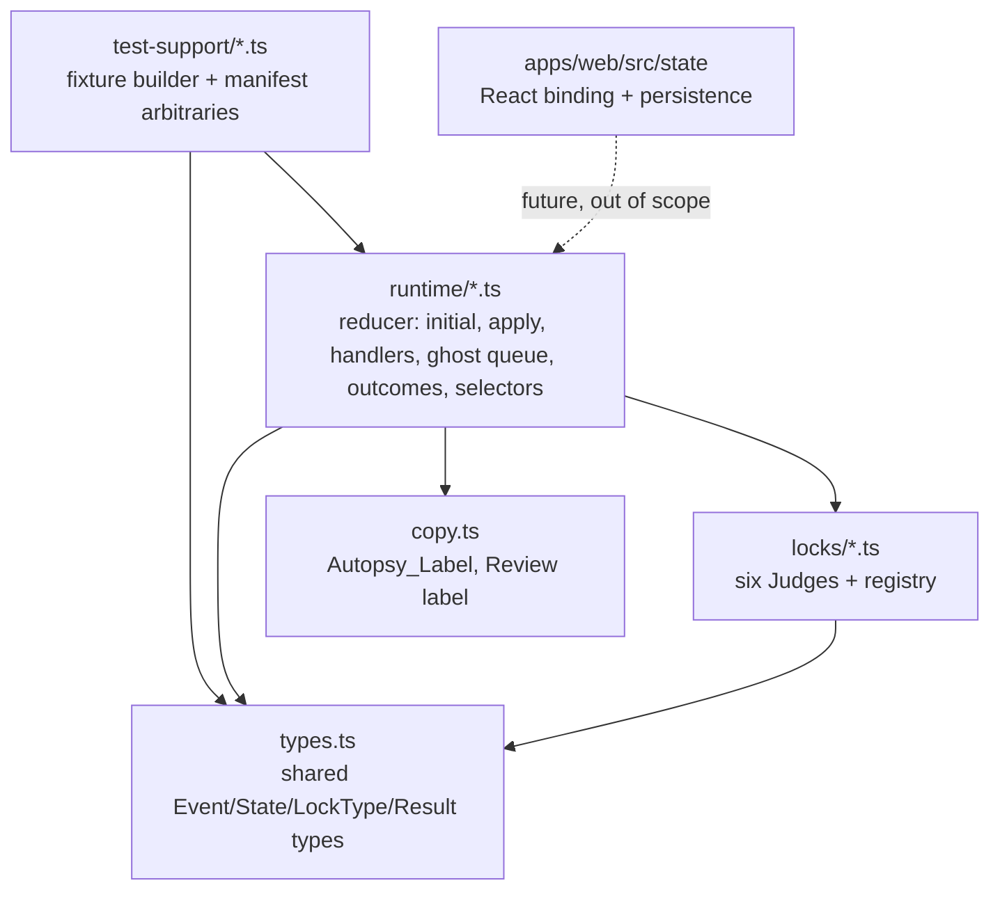
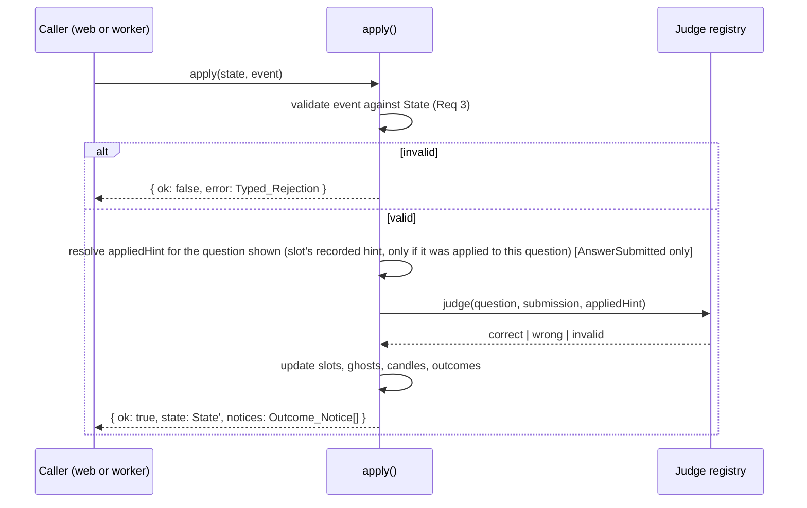

# Design Document

## Overview

The room runtime is a pure reducer over an event log: `state = events.reduce(apply, initial(manifest, settings))`. It lives in `packages/core/src/runtime/` and decides which candles light, which ghosts rise and return, when a room clears, when the final door opens, and what each concept's reported outcome is. Six pure Judge functions in `packages/core/src/locks/<type>.ts` mark a submitted answer correct, wrong or invalid. Nothing in this spec touches a model, a network call, a timer, a clock or a random number generator; ghost returns are paced by a count of judged answers, not by time.

This design covers the reducer, its typed rejections and outcome notices, the six Judges, the Manifest_Check, a manifest fixture builder and arbitraries for tests, and the model-based test harness. It does not cover storage (spec 4), visuals (spec 5), generation (spec 3) or the React binding (`apps/web/src/state/`, mentioned only in the last section as a forward note).

## Architecture

### Module dependency graph



`locks/` depends only on `types.ts`. `runtime/` depends on `types.ts`, `copy.ts` and the Judge registry in `locks/`. Neither depends on React, a database or an AI SDK, so `packages/core` stays packageable as a Kiro Power per `tech.md`.

### The fold



`initial(manifest, settings)` never throws and never runs the Manifest_Check (Req 2.7); `RunStarted` runs it once (Req 2.6, Req 28.7).

## Components and Interfaces

### File layout

```
packages/core/src/
  types.ts                        # ADD: LockType, Event union, Typed_Rejection kinds (shared, cross-cutting)
  copy.ts                         # ADD: Autopsy_Label per Concept_Outcome, Review label (existing file)

  locks/
    rune-cipher.ts                # Rune_Cipher_Judge
    rune-cipher.test.ts
    seance-board.ts                # Seance_Board_Judge
    seance-board.test.ts
    bone-ordering.ts               # Bone_Ordering_Judge
    bone-ordering.test.ts
    bound-threads.ts                # Bound_Threads_Judge
    bound-threads.test.ts
    cursed-object.ts               # Cursed_Object_Judge
    cursed-object.test.ts
    combination-dial.ts            # Combination_Dial_Judge
    combination-dial.test.ts
    judge-registry.ts              # judgeFor(lockType) dispatch table; ~30 lines
    lock-types.test.ts             # Req 27/28 cross-cutting tests (ID spelling, registry completeness)

  runtime/
    state-types.ts                 # State, LockSlotState, ReturnSlotState, GhostState, FinalDoorState shapes
    manifest-types.ts               # CryptManifest, RoomSpec, ConceptSpec, LockSlotSpec (as consumed)
    manifest-check.ts               # Manifest_Check (Req 28: station types, question IDs; Req 27.4 lock types) + manifest-check.test.ts
    manifest-check.test.ts
    initial.ts                     # initial(manifest, settings); initial.test.ts
    initial.test.ts
    apply.ts                       # apply(state, event): validates run-level guards, dispatches by event kind
    apply.test.ts
    handlers-run.ts                 # RunStarted, RunLeft (sets status 'left' only), RunResumed (sets status 'in progress' only), CryptFinalised, CryptShortened
    handlers-run.test.ts
    handlers-room.ts                # RoomPublished, RoomEntered, LockOpened
    handlers-room.test.ts
    handlers-answer.ts              # AnswerSubmitted, EvidenceContinued (judging, candles, Req 10/13)
    handlers-answer.test.ts
    handlers-skip-challenge.ts      # Skipped (deferred return / Review_Due_Flag for Lock_Slots and Return_Slots only; plain settle for Reserved_Final_Door_Questions, Req 16.7), Challenged (Req 17)
    handlers-skip-challenge.test.ts
    handlers-hint.ts                # HintUsed: reads the hintEffect of the question shown, records it as the slot's applied hint (Req 18)
    handlers-hint.test.ts
    handlers-final-door.ts          # FinalDoorEntered, final-door slot settling (Req 20)
    handlers-final-door.test.ts
    ghost-queue.ts                   # spawn/due/carry-over logic (Req 14/15/30); ghost-queue.test.ts
    ghost-queue.test.ts
    room-clearing.ts                 # Cleared check, Return_Slot insertion ordering (Req 19/30.5)
    room-clearing.test.ts
    outcomes.ts                      # deriveConceptOutcome, deriveAllOutcomes (Req 22)
    outcomes.test.ts
    notices.ts                       # Outcome_Notice construction + ordering (Req 24.8)
    notices.test.ts
    selectors.ts                     # read-only State projections for Req 31 (per-room/per-slot views)
    selectors.test.ts
    runtime-model.test.ts            # fast-check model-based test (fc.commands), Section "Correctness Properties"
    runtime-properties.test.ts       # standalone property tests not naturally commands (order fixed, paired-run challenge test)
    serialisation.test.ts            # Event JSON round-trip for every variant, State JSON-safety, replay determinism (Req 4)
    index.ts                         # re-exports: initial, apply, selectors, GHOST_DELAY

  test-support/
    arbitraries.ts                  # EXISTING file; ADD manifestArb, eventArb helpers
    manifest-fixture.ts              # Fixture_Builder: buildManifest(options) (Req 25); builds full reserved final-door slot specs; sets hintEffect per question (primary, Alternate, reserved)
    manifest-fixture.test.ts
```

Every file stays near or under 300 lines by splitting one event group per handler file, per the brief's step plan and `structure.md`. `runtime/index.ts` and `locks/judge-registry.ts` are the only files other packages import through `packages/core/src/index.ts`.

**Ownership summary**

| File | Owns |
|---|---|
| `types.ts` | `LockType`, `Event` union, `Typed_Rejection` kind union — shared across runtime and locks |
| `runtime/manifest-types.ts` | The shape of `CryptManifest` as the runtime consumes it (not the generator's internal build types — spec 3 owns those) |
| `runtime/state-types.ts` | `State` and its nested per-room/per-slot/per-ghost shapes |
| `runtime/manifest-check.ts` | Req 28: one-lock-per-type validation, then question ID presence and uniqueness; returns `{ok:false,error:{kind:'invalid-manifest',...}}` (see Manifest_Check rules below) |
| `runtime/initial.ts` | Req 2: building the zeroed `State` |
| `runtime/apply.ts` | Top-level guards shared by every event (Req 3.4, 3.5, 3.6, 3.7) then dispatch by `event.kind` |
| `runtime/handlers-*.ts` | One file per event group; each returns `Result<{state, notices}, Typed_Rejection>` |
| `runtime/ghost-queue.ts` | Req 14/15/30: spawning, due counting, carry-over, Final_Door waiver |
| `runtime/room-clearing.ts` | Req 19/30.5: Cleared check and Return_Slot-before-clearing ordering |
| `runtime/outcomes.ts` | Req 22: the one pure outcome-derivation function |
| `runtime/notices.ts` | Req 24: notice shape and the fixed emission order |
| `runtime/selectors.ts` | Req 31: everything the interface reads, derived only from State |
| `locks/<type>.ts` | One Judge each, pure, no cross-imports between lock files |
| `locks/judge-registry.ts` | `Record<LockType, Judge>` used by `handlers-answer.ts` |
| `copy.ts` | Autopsy labels and the "Review" label (existing file, extended) |
| `test-support/manifest-fixture.ts` | Req 25 Fixture_Builder |
| `test-support/arbitraries.ts` | Existing generators, extended with manifest and event arbitraries |

## Data Models

All types below are illustrative TypeScript; exact field names may be adjusted during implementation but the shapes, unions and invariants are fixed by this design.

### LockType and Judge

```ts
// types.ts
export type LockType =
  | 'rune-cipher'
  | 'seance-board'
  | 'bone-ordering'
  | 'bound-threads'
  | 'cursed-object'
  | 'combination-dial';

export type JudgeResult = 'correct' | 'wrong' | 'invalid';
```

```ts
// locks/judge-registry.ts
// Everything below (questions, submissions, hint effects) is plain JSON data:
// no Set, Map, Date, function or undefined anywhere (Req 4.1, 4.2).
export interface Judge<Q, S> {
  (question: Q, submission: S, appliedHint: HintEffectSpec | null): JudgeResult;
}

/** An ordered [leftId, rightId] tuple. */
export type ThreadPair = readonly [string, string];

// Per-type question/submission shapes (consumed from the manifest; spec 3 produces them)
export interface RuneCipherQuestion {
  readonly answer: string;
  readonly aliases: readonly string[];
  readonly caseSensitive: boolean;
}
export interface RuneCipherSubmission { readonly text: string }

export interface SeanceBoardQuestion {
  readonly optionIds: readonly string[];
  readonly keyOptionId: string;
}
export interface SeanceBoardSubmission { readonly selectedOptionId: string | null }

export interface BoneOrderingQuestion {
  readonly itemIds: readonly string[];
  readonly keyOrder: readonly string[];
}
export interface BoneOrderingSubmission { readonly order: readonly string[] }

export interface BoundThreadsQuestion {
  readonly leftIds: readonly string[];
  readonly rightIds: readonly string[];
  readonly keyPairs: readonly ThreadPair[];   // compared as a sorted set inside the judge
}
export interface BoundThreadsSubmission { readonly pairs: readonly ThreadPair[] } // order and duplicates carry no meaning

export interface CursedObjectQuestion {
  readonly optionIds: readonly string[];
  readonly oddOneOutId: string;
}
export interface CursedObjectSubmission { readonly selectedId: string | null }

export interface CombinationDialQuestion {
  readonly kind: 'exact' | 'range' | 'tolerance';
  readonly exactValue?: number;   // kind: 'exact'
  readonly min?: number;          // kind: 'range', inclusive
  readonly max?: number;          // kind: 'range', inclusive
  readonly value?: number;        // kind: 'tolerance': accepts value ± tolerance, inclusive
  readonly tolerance?: number;    // kind: 'tolerance', non-negative
  readonly unit: string;
}
export interface CombinationDialSubmission { readonly rawInput: string }

export type JudgeRegistry = {
  'rune-cipher': Judge<RuneCipherQuestion, RuneCipherSubmission>;
  'seance-board': Judge<SeanceBoardQuestion, SeanceBoardSubmission>;
  'bone-ordering': Judge<BoneOrderingQuestion, BoneOrderingSubmission>;
  'bound-threads': Judge<BoundThreadsQuestion, BoundThreadsSubmission>;
  'cursed-object': Judge<CursedObjectQuestion, CursedObjectSubmission>;
  'combination-dial': Judge<CombinationDialQuestion, CombinationDialSubmission>;
};

export const judgeRegistry: JudgeRegistry = { /* one entry per type, Req 27.2 */ };
```

**Judge rules (brief, section 5; Requirements 11, 12, 26):**
The third parameter, `appliedHint`, is the `hintEffect` of the question actually shown in the slot, or `null` when no hint was used on that question (or the question carries no effect). The slot state records the applied hint together with the ID of the question it applies to, and the answer handler passes it in only when that ID equals the slot's current question ID. Judges never read hint data from the question payload. Judges ignore an `appliedHint` whose `kind` does not apply to their lock type.

- **rune-cipher**: trim, collapse internal whitespace runs to one space; case-insensitive unless `caseSensitive`; exact match against `answer` or any `aliases` entry → correct; no match → wrong; empty after trim → invalid.
- **seance-board**: `selectedOptionId === keyOptionId` → correct; a listed option that is not removed by the applied hint and is not the key → wrong; not a member of `optionIds`, `null`, or an option removed by an applied `remove-option` hint → invalid (not wrong) (Req 12.3, 12.4, 12.5).
- **bone-ordering**: `order` is exactly `keyOrder` → correct; `order` is a permutation of `itemIds` but not the key → wrong; not a permutation, or moves the bone that an applied `lock-first-bone` hint locked → invalid.
- **bound-threads**: submitted `pairs` and `keyPairs` are each sorted and de-duplicated, then compared as sets. Equal → correct; every left item tied exactly once but not the key set → wrong; a left item untied, or a pair that an applied `tie-thread` hint tied is missing → invalid.
- **cursed-object**: `selectedId === oddOneOutId` → correct; a listed object that is not removed by the applied hint and is not the odd one → wrong; not a member, `null`, or an object removed by an applied `remove-option` hint → invalid (not wrong) (Req 26.5).
- **combination-dial**: `rawInput` must be numeric with at most one decimal place. `exact` matches `exactValue`; `range` matches inclusive `[min, max]`; `tolerance` matches inclusive `[value - tolerance, value + tolerance]` → correct. A well-formed number outside the match → wrong. Non-numeric, or more than one decimal place → invalid. Comparison is done on integer tenths (input and bounds multiplied by 10 and rounded) so that floating-point error cannot move a boundary. (`60`/`100` correct for 60–100; `59.9` wrong for 60–100; `21.5` correct for an exact key of 21.5; for 21.5 ± 0.5, `21.0` and `22.0` correct, `22.1` and `20.9` wrong, `22.15` invalid.)

**Judge unit tests that must exist** (beyond the Req 11 and 26 examples): séance board and cursed object each return `invalid` (not `wrong`) when the submitted option is the one removed by an applied `remove-option` hint, and still judge normally with `appliedHint: null`; bone ordering returns `invalid` when an applied `lock-first-bone` hint is violated; bound threads returns `invalid` when an applied `tie-thread` pair is missing, and gives the same result for the same pairs in any order; combination dial covers the tolerance cases listed above, `tolerance: 0`, and the one-decimal rule for each kind.

Every Judge is pure, returns a `JudgeResult` and throws for no input (Req 11.9, 12.6, 26.10).

### Manifest (as consumed)

```ts
// runtime/manifest-types.ts
export interface CryptManifest {
  readonly manifestId: string;
  readonly rooms: readonly RoomSpec[];
  readonly finalDoor: { readonly slots: readonly FinalDoorSlotSpec[] }; // 2-4 entries, Req 20.1
}

export interface RoomSpec {
  readonly roomId: string;
  readonly lockSlots: readonly LockSlotSpec[]; // at most one per LockType (Req 28)
}

export interface LockSlotSpec {
  readonly slotId: string;
  readonly stationType: LockType;
  readonly conceptId: string;
  readonly primaryQuestion: QuestionSpec;     // LockType === stationType
  readonly alternateQuestion: QuestionSpec | null; // LockType !== stationType (Req 25.3)
}

/** The hint effect belongs to the question, not to the slot that shows it (Glossary: Hint_Effect). */
export interface QuestionSpec {
  readonly questionId: string;                // unique within the manifest; used for shown-question tracking and applied-hint matching
  readonly lockType: LockType;
  readonly payload: unknown; // one of the per-type Question shapes above, narrowed by lockType
  readonly evidenceRefs: readonly string[];
  readonly hintEffect: HintEffectSpec | null; // each primary, Alternate and reserved final-door question carries its own
}

export type HintEffectSpec =
  | { readonly kind: 'remove-option'; readonly optionId: string }
  | { readonly kind: 'lock-first-bone'; readonly boneId: string }
  | { readonly kind: 'tie-thread'; readonly pair: ThreadPair }
  | { readonly kind: 'reveal-digit'; readonly position: number };

/** A fully specified reserved final-door slot. Lock types may repeat across entries (Req 20.1, art-contract §6). */
export interface FinalDoorSlotSpec {
  readonly slotId: string;
  readonly conceptId: string;
  readonly question: QuestionSpec;            // questionId, lockType, payload, evidenceRefs, hintEffect
}

export interface RunSettings {
  readonly length: 'short' | 'standard' | 'long';
  readonly difficulty: 'apprentice' | 'gravedigger' | 'lich';
  readonly hintAllowance: number;
}
```

### Events

```ts
// types.ts
export type Event =
  | { kind: 'RunStarted'; manifestId: string }
  | { kind: 'RoomPublished'; roomId: string }
  | { kind: 'CryptFinalised'; finalRoomCount: number }
  | { kind: 'CryptShortened'; finalRoomCount: number }
  | { kind: 'RoomEntered'; roomId: string }
  | { kind: 'LockOpened'; slotId: string }
  | { kind: 'HintUsed'; slotId: string }
  | { kind: 'AnswerSubmitted'; slotId: string; submission: unknown } // JSON data only; narrowed by Current_Question_Type, e.g. bound-threads submits { pairs: [[left, right], ...] }
  | { kind: 'Skipped'; slotId: string }
  | { kind: 'Challenged'; slotId: string }
  | { kind: 'EvidenceContinued'; slotId: string }
  | { kind: 'FinalDoorEntered' }
  | { kind: 'RunLeft' }
  | { kind: 'RunResumed' };
```

Every variant is a plain JSON-serialisable record (Req 4.1): no functions, `Set`, `Map`, `Date`s, class instances or `undefined`. A unit test in `serialisation.test.ts` builds one example of every `Event` variant (including one `AnswerSubmitted` per lock type) and asserts `JSON.parse(JSON.stringify(e))` deep-equals `e`. A property test in the same file does the same for generated events from `eventArb`.

### Typed_Rejection kinds (closed union)

```ts
// types.ts
export type RuntimeErrorKind =
  | 'manifest-mismatch'
  | 'run-already-started'
  | 'run-not-started'
  | 'invalid-manifest'
  | 'unknown-reference'
  | 'run-left'
  | 'run-finished'
  | 'lock-already-settled'
  | 'malformed-event'
  | 'room-not-published'
  | 'room-not-cleared'
  | 'room-out-of-order'
  | 'cannot-shorten-published'
  | 'lock-not-in-room'
  | 'invalid-submission'
  | 'no-evidence-open'
  | 'no-hints-left'
  | 'hint-already-used'
  | 'final-door-unavailable'
  | 'run-not-left'
  | 'cannot-leave';

export type Typed_Rejection = { readonly kind: RuntimeErrorKind; readonly [key: string]: unknown };
```

`invalid-manifest` has three shapes, all returned by the Manifest_Check: `{ kind: 'invalid-manifest'; room: string; lockType: LockType }` for a repeated Station_Type in a room (Req 28.3); `{ kind: 'invalid-manifest'; questionId: string }` for a missing, empty or duplicated question ID (Req 28.8, 28.9; for a missing ID `questionId` is the empty string and the QuestionSpec's `slotId` is carried as `slotId`); and `{ kind: 'invalid-manifest'; lockType: string }` for a lock type outside `LockType` (Req 27.4). Other kinds carry no extra fields unless a handler needs one for diagnostics (never user content, per `security.md`).

### Outcome_Notice

```ts
// runtime/notices.ts
export type Outcome_Notice =
  | { kind: 'candleLit'; target: { type: 'slot'; slotId: string } | { type: 'spirit'; roomId: string | 'final-door' } }
  | { kind: 'ghostSpawned'; conceptId: string }
  | { kind: 'ghostLaidToRest'; conceptId: string }
  | { kind: 'sealCracked'; slotId: string }
  | { kind: 'roomCleared'; roomId: string }
  | { kind: 'escaped' };
```

No notice names animation, colour, sound or layout (Req 24.6). `notices.ts` enforces the fixed per-event order from Req 24.8: `candleLit, ghostLaidToRest, ghostSpawned, sealCracked, roomCleared, escaped`.

### Apply result

```ts
// runtime/apply.ts
export type ApplyResult =
  | { ok: true; state: State; notices: readonly Outcome_Notice[] }
  | { ok: false; error: Typed_Rejection };

export function apply(state: State, event: Event): ApplyResult;
export function initial(manifest: CryptManifest, settings: RunSettings): State;
```

### State

```ts
// runtime/state-types.ts
export type SlotStatus = 'open' | 'solved' | 'settled' | 'challenged';

/**
 * A hint used on one question, recorded with the question it applies to.
 * `effect` is that question's hintEffect (null if it carries none). It counts as
 * applied only while `questionId` equals the slot's currentQuestionId.
 */
export interface AppliedHintState {
  readonly questionId: string;
  readonly effect: HintEffectSpec | null;
}

export interface LockSlotState {
  readonly slotId: string;
  readonly stationType: LockType;              // Req 29.2, fixed for the run
  readonly currentQuestionId: string;           // primary until a challenge replacement, then the Alternate
  readonly currentQuestionType: LockType;       // Req 29.3-5, equals stationType until a challenge replacement
  readonly status: SlotStatus;
  readonly candleLit: boolean;                  // true only while status === 'solved' (Req 31.6)
  readonly appliedHint: AppliedHintState | null; // a hint on a replaced question does not carry to the replacement
  readonly evidencePanelOpen: boolean;
  readonly judgedResult: JudgeResult | null;
}

export interface ReturnSlotState {
  readonly slotId: string;
  readonly conceptId: string;
  readonly returnNumber: 1 | 2;
  readonly currentQuestionId: string;
  readonly currentQuestionType: LockType;       // no stationType (Req 29.6)
  readonly label: 'review' | null;              // 'review' iff currentQuestionId was already shown for this concept before the slot was built (Req 14.9/14.10)
  readonly status: SlotStatus;
  readonly candleLit: boolean;
  readonly appliedHint: AppliedHintState | null; // Req 18 applies to every open slot
  readonly evidencePanelOpen: boolean;          // Req 10.4 applies to every judged slot
}

export interface GhostState {
  readonly conceptId: string;
  readonly returnNumber: 1 | 2;
  readonly judgedAnswerCountAtSpawn: number;    // Req 15.2
  readonly due: boolean;
}

export interface SpiritCandleState {
  readonly conceptId: string;
  readonly returnSlotId: string;
}

export interface RoomState {
  readonly roomId: string;
  readonly published: boolean;
  readonly cleared: boolean;
  readonly lockSlots: readonly LockSlotState[];
  readonly dueReturnSlots: readonly ReturnSlotState[];
  readonly spiritCandles: readonly SpiritCandleState[];
}

export interface FinalDoorSlotState {
  readonly slotId: string;
  readonly origin: 'reserved' | 'return';
  readonly currentQuestionId: string;
  readonly currentQuestionType: LockType;
  readonly label: 'review' | null;              // always null for origin 'reserved'
  readonly status: SlotStatus;
  readonly candleLit: boolean;
  readonly appliedHint: AppliedHintState | null;
  readonly evidencePanelOpen: boolean;
}

export interface FinalDoorState {
  readonly available: boolean;
  readonly slots: readonly FinalDoorSlotState[];
  readonly spiritCandles: readonly SpiritCandleState[];
}

export type ConceptOutcome = 'challenged' | 'review-due' | 'retried' | 'assisted' | 'first-try-correct';

/** Per-concept facts the outcome derivation (Req 22) needs; not shown directly to the interface. */
export interface ConceptRecord {
  readonly conceptId: string;
  readonly shownQuestionIds: readonly string[];  // question IDs shown for this concept so far, in order; drives the Review label (Req 14.9, 14.10). Reserved final-door questions are not added.
  readonly firstQuestionResult: JudgeResult | 'challenged' | null;
  /**
   * Set to true when a correct judged answer for this concept was given on a question
   * that had a hint applied (the slot's appliedHint.questionId matched its currentQuestionId
   * at judging time). A hint spent on a question that a challenge then replaced never sets it,
   * because the challenge clears the applied hint (Req 18.8, 22.11).
   */
  readonly hintUsedOnCorrectQuestion: boolean;
  readonly alternateUsed: boolean;
  readonly alternateChallenged: boolean;
  readonly alternateResult: JudgeResult | 'challenged' | null;
  readonly return1Result: JudgeResult | 'challenged' | null;
  readonly return2Result: JudgeResult | 'challenged' | null;
  readonly wasSkippedWithNoAlternate: boolean;
  readonly isLingeringSpirit: boolean;
  readonly reviewDueFlag: boolean;
}

export type RunStatus = 'not started' | 'in progress' | 'left' | 'escaped';

export interface State {
  readonly manifestId: string;
  readonly status: RunStatus;
  readonly manifest: CryptManifest;   // non-null; set by initial(), never changes\n  readonly settings: RunSettings;     // non-null; set by initial(), never changes
  readonly remainingHints: number;
  readonly candleCount: number;
  readonly judgedAnswerCount: number;             // Req 15.2/15.4 counter
  readonly rooms: readonly RoomState[];
  readonly currentRoomId: string | null;
  readonly finalRoomCount: number | null;
  readonly finalDoor: FinalDoorState;
  readonly ghosts: readonly GhostState[];          // Req 31.8
  readonly concepts: readonly ConceptRecord[];
  readonly focusedSlotId: string | null;            // LockOpened (Req 9)
}
```

This directly satisfies Req 31's exposure list: per-room `LockSlotState` carries station type, current question type, status and candle flag (31.1-31.6); `dueReturnSlots` carries concept, return number, current question type and status (31.7); `ghosts` exposes concept, return number and a due flag (31.8); `spiritCandles` names concept and Return_Slot per room (31.9); `cleared` is a `RoomState` field (31.10); `FinalDoorState.slots` names origin (reserved vs Return), current question type, status and spirit candles (31.11). Everything is derived only from manifest, settings and the event log, and the whole shape is JSON-serialisable (31.12, Req 4.2) — no functions and no `Map` or `Set` anywhere in `State`, in any Event, or in any question or submission payload (bound-threads pairs are arrays of `[leftId, rightId]` tuples).

**Leave and resume.** `RunLeft` changes only `status` to `'left'`. `RunResumed` changes only `status` back to `'in progress'`. Nothing else in `State` is touched between them (Req 21.1, 21.2), so no snapshot is stored. `RunLeft` before `RunStarted` returns `run-not-started` from the not-started guard (Req 2.5); `RunLeft` while left returns `cannot-leave` (Req 21.4), so the left guard in `apply.ts` exempts both `RunResumed` and `RunLeft`.

**Hints and evidence on every slot kind.** `LockSlotState`, `ReturnSlotState` and `FinalDoorSlotState` all carry `appliedHint` and `evidencePanelOpen`. `handlers-hint.ts` sets `appliedHint` on whichever slot kind `slotId` names to `{ questionId: currentQuestionId, effect }`, where `effect` is the `hintEffect` of the `QuestionSpec` currently shown in that slot (primary or Alternate for a Lock_Slot, the reserved question for a reserved final-door slot, the returned question for a Return_Slot). It rejects with `hint-already-used` when `appliedHint` is already set for the current question ID. `handlers-answer.ts` sets `evidencePanelOpen` on the judged slot, and `EvidenceContinued` clears it, for any slot kind. `selectors.ts` exposes both flags for every slot kind, so the interface reads one shape for locks, returns and final-door slots.

**Applied hint.** When `AnswerSubmitted` arrives, `handlers-answer.ts` resolves `appliedHint` as `slot.appliedHint !== null && slot.appliedHint.questionId === slot.currentQuestionId ? slot.appliedHint.effect : null` and passes it to the judge together with the question actually shown. Because the hint is recorded with its question ID, a hint used on a question that a challenge later replaces does not carry to the replacement: the `Challenged` handler clears `appliedHint` on the slot, and even without that the ID check would not match. The spent hint is not refunded: `Challenged` leaves `remainingHints` unchanged (Req 18.7), and the Alternate starts with no Applied_Hint (Req 18.8). Assisted is recorded only at judging time: when `AnswerSubmitted` is judged correct and the resolved `appliedHint` match above held for the question shown (that is, the slot's `appliedHint.questionId` equalled its `currentQuestionId`, even if `effect` is `null`), `handlers-answer.ts` sets `ConceptRecord.hintUsedOnCorrectQuestion` to true (Req 18.5). `HintUsed` itself writes no `ConceptRecord` field, so a hint on a question that is later challenged leaves no trace in the record (Req 22.11). A question with `hintEffect: null` still consumes a hint when `HintUsed` is applied and constrains nothing.

## Ghost queue mechanics

`ghost-queue.ts` owns:

- **Judged-answer counter**: `state.judgedAnswerCount` increments only when a submission is judged correct or wrong (never on `invalid`, hints, skips or challenges — Req 15.4).
- **Due rule**: a `GhostState` becomes due when `state.judgedAnswerCount - judgedAnswerCountAtSpawn >= GHOST_DELAY` (Req 15.3), except at the Final_Door where the waiver (Req 20.8) makes it due immediately on `FinalDoorEntered` and on any later spawn while at the door.
- **GHOST_DELAY**: exported `export const GHOST_DELAY = 3;` from `runtime/ghost-queue.ts` and re-exported from `runtime/index.ts` (Req 15.1).
- **Where Return_Slots are added**: `room-clearing.ts` calls `ghost-queue.ts` to materialise any newly-due Ghost or deferred skip into a `ReturnSlotState` in the *current* room (or a `FinalDoorSlotState` if at the door, Req 30.6) **before** it evaluates whether the room is Cleared — this is the explicit ordering from Req 30.5. The same call site is used by every handler that could make a room's last slot settle (`handlers-answer.ts`, `handlers-skip-challenge.ts`), so clearing is always checked after Return insertion, never before.
- **Carry-over across rooms**: a Ghost not yet due when its room clears is not materialised; it stays in `state.ghosts` and is checked again on every later judged answer regardless of which room is current, until it becomes due in whichever room is current at that time (Req 15.5).
- **Return 1 question choice**: on due, if the concept has an unused Alternate, the Return question is the Alternate (Req 14.2); otherwise the Return question is the concept's **primary question** (Req 14.3).
- **Review label rule**: when a Return_Slot is built, `label` is `'review'` if the Return question's `questionId` is already in the concept's `ConceptRecord.shownQuestionIds`, and `null` otherwise (Req 14.9, 14.10). The question ID is then appended to `shownQuestionIds`. The label depends on show history, not on the return number. Consequences: a Return 1 that uses an unused Alternate is shown for the first time and has no label; a Return 1 that falls back to the primary (no Alternate) was shown before and is "Review"; Return 2 always reuses the primary and is therefore always "Review" (Req 14.4). A deferred-skip Return that uses the Alternate has no label. Questions shown in Lock_Slots (primary, and the Alternate after a challenge replacement) are appended to `shownQuestionIds` when they are first shown. Reserved_Final_Door_Questions are not Concept questions for this purpose and are not tracked.
- **Return 2 / lingering spirit**: a wrong Return 1 spawns a `GhostState` with `returnNumber: 2`. Return 2 uses the concept's primary question and is labelled "Review" by the rule above (Req 14.4); a wrong Return 2 sets `ConceptRecord.isLingeringSpirit = true` and `reviewDueFlag = true`, with no further Ghost (Req 14.5, 14.8 cap).
- **Skip handling** (`handlers-skip-challenge.ts`): the deferred-return and flag rules apply to Lock_Slots and Return_Slots only. `Skipped` on a Lock_Slot or Return_Slot with an unused Alternate queues a `GhostState`-shaped deferred return at `returnNumber: 1` that follows the same due rule (Req 16.3); with no unused Alternate it sets `reviewDueFlag` directly and queues nothing (Req 16.4). `Skipped` on a Reserved_Final_Door_Question (a `FinalDoorSlotState` with `origin: 'reserved'`) only settles the slot: no deferred Return, no Review_Due_Flag, no `ConceptRecord` change (Req 16.7, 20.4, 20.10). A skipped Return_Slot at the Final_Door follows the Return rule above, and its deferred return is due immediately under Req 20.8.
- **At most one pending Ghost per concept**: `ghost-queue.ts` asserts this invariant on every mutation (Req 14.7); a second wrong answer for the same concept while a Ghost is already pending cannot occur because the only way to answer a concept again is through its own Return_Slot, which replaces the pending Ghost with the next one.
- **Notice order**: `candleLit` (if the triggering answer was correct) is constructed before `ghostLaidToRest` (Return correct) before `ghostSpawned` (new Ghost from a wrong answer) before `sealCracked` (challenge) before `roomCleared` before `escaped`, matching Req 24.8 and enforced by a single ordering list in `notices.ts` rather than by handler call order.

## Concept outcome derivation

`outcomes.ts` exposes one pure function:

```ts
export function deriveConceptOutcome(record: ConceptRecord): ConceptOutcome;
export function deriveAllOutcomes(state: State): Readonly<Record<string, ConceptOutcome>>; // keyed by conceptId, JSON-safe
```

It applies the Req 22.2 precedence top-down, each check reading only `ConceptRecord` fields already listed in State:

1. **Challenged** — every question asked for the concept (`firstQuestionResult`, and `alternateResult` if the Alternate was shown) is `'challenged'`, with no further question (Req 22.3). A challenge whose replacement was then answered does not count here because `alternateResult` is the Alternate's own judged result, not `'challenged'` (Req 22.4 — the outcome falls through to whichever bucket the Alternate's result lands in).
2. **Review due** — `isLingeringSpirit`, or `wasSkippedWithNoAlternate`, or a challenged Return following an earlier unchallenged wrong answer or skip (Req 22.5).
3. **Retried** — `return1Result === 'correct'` or `return2Result === 'correct'` (Req 22.6).
4. **Assisted** — `answeredCorrectFirst(record) && record.hintUsedOnCorrectQuestion` (Req 22.7).
5. **First-try correct** — `answeredCorrectFirst(record) && !record.hintUsedOnCorrectQuestion` (Req 22.8).

`answeredCorrectFirst(record)` is true when the concept's first judged question was correct with no earlier wrong answer or skip: `firstQuestionResult === 'correct'`, or `firstQuestionResult === 'challenged' && alternateResult === 'correct'` (the primary was challenged and replaced, then the Alternate was answered correctly; Req 22.4). A skipped first question leaves `firstQuestionResult` as `null`, so it never matches. Because `hintUsedOnCorrectQuestion` is set only from the hint applied to the question that was judged correct, a hint spent on a challenged primary question does not make the concept Assisted: when the Alternate is then judged correct with no hint applied, the outcome is First-try correct (Req 22.11, 18.8). Conversely, a hint applied to the Alternate that is then judged correct gives Assisted. The hint spent on the challenged primary still reduces `remainingHints` and is not refunded (Req 18.7). Retried and Review due keep their higher precedence, so `hintUsedOnCorrectQuestion` set on a Return answer never changes an outcome.

Reserved_Final_Door_Questions never feed `ConceptRecord` (Req 20.4, 20.10): a correct answer only increments `candleCount`. A wrong answer, a skip or a challenge settles the slot with no Return, no Ghost, no deferred return and no Review_Due_Flag. None of them touches any of the fields above, so a concept's outcome cannot change because of what happens to it at the Final_Door — only its Return (if any) answered there can, through the normal Return fields. `deriveAllOutcomes` iterates every concept in the manifest exactly once, so the five outcome buckets always sum to the manifest's concept count (Req 22.9, Req 22.1). No label produced here or in `copy.ts` claims mastery or exam readiness (Req 22.10).

## Correctness Properties

*A property is a characteristic or behavior that should hold true across all valid executions of a system — a formal statement about what the system should do. Properties serve as the bridge between human-readable specifications and machine-verifiable correctness guarantees.*

### Model-based test design

`runtime/runtime-model.test.ts` uses fast-check `fc.commands`. The **model** is a small counter-based summary kept alongside the real `State`, not a second reducer:

```ts
interface Model {
  started: boolean;
  status: RunStatus;
  candleCount: number;
  judgedAnswerCount: number;
  perConcept: Record<string, { pendingGhostReturn: 0 | 1 | 2; outcomeGuess: ConceptOutcome | null }>;
  clearedRooms: string[];
  escaped: boolean;
}
```

One `fc.Command<Model, State>` per `Event` kind (`RunStartedCommand`, `AnswerSubmittedCommand`, `SkippedCommand`, `ChallengedCommand`, `HintUsedCommand`, `RoomEnteredCommand`, `RoomPublishedCommand`, `FinalDoorEnteredCommand`, `RunLeftCommand`, `RunResumedCommand`, `CryptFinalisedCommand`, `CryptShortenedCommand`, `EvidenceContinuedCommand`), plus deliberately **invalid** variants of each (wrong room order, stale slot, double submit, hint at zero) whose `check()` returns true unconditionally and whose `run()` asserts the call returns `{ ok: false }` with the expected `kind` and leaves `State` deep-equal (Req 3.1, 5 in the brief). Each command's `check(model)` gates on the model's coarse fields (e.g. `AnswerSubmittedCommand.check` requires `started && !escaped`); `run(model, real)` calls `apply`, updates both the model's counters and asserts invariants against the real `State` (candle count, judged-answer count, ghost cap).

### Manifest arbitrary

`test-support/arbitraries.ts` adds `manifestArb`: 1-5 rooms, each with 1-6 `LockSlotSpec`s of **distinct** `stationType` values drawn from a shuffled slice of the six `LockType`s, an Alternate present or absent per concept at random (never sharing the primary's `LockType`), and a `finalDoor` of 2-4 full reserved slot specs (each with `slotId`, `conceptId` drawn across rooms, a complete `QuestionSpec` with `questionId`, `lockType`, `payload`, `evidenceRefs` and its own `hintEffect` or `null`). Every primary question, Alternate and reserved final-door question carries its own `hintEffect` (or `null`), chosen to suit that question's lock type, and every `questionId` is unique in the manifest (Req 25.13; generated from a running counter over primary, Alternate and reserved questions, or an equivalent unique-ID arbitrary, never drawn independently). `buildManifest` assigns IDs the same way (Req 25.12). All payloads and hint effects are plain JSON, with bound-threads pairs as tuple arrays. `buildManifest` in the Fixture_Builder produces the same shapes from its per-question hint options (Req 25.2), with fictional content only. A biased sub-generator produces 4-6-lock rooms in a configurable share of cases so in-room Returns become due before the room would otherwise clear (Req 25.11). Every generated manifest is filtered (or constructed to begin with) so `manifestCheck(manifest).ok === true` (Req 25.8).

### Learner policies for termination (R1 / Req 20.7)

Four deterministic policies replay over any `manifestArb` sample, each repeatedly acting on every `Open_Slot` reachable (opening rooms in order, entering the Final_Door once available) until `escaped` or a step budget is exceeded:
- **all-wrong**: every `AnswerSubmitted` carries a submission that judges wrong.
- **all-skip**: every open slot is `Skipped` instead of answered, including Reserved_Final_Door_Questions (Req 20.6). A skipped reserved question settles with no Return and leaves its concept's outcome unchanged.
- **all-challenge**: every open slot is `Challenged` until no Alternate remains, then settled.
- **random**: a seeded fast-check generator mixes correct, wrong, skip, challenge and hint actions.

### Properties

Properties P1-P8 correspond to the brief's R1-R12, relabelled where the approved requirements sharpened the wording (P9 restates the brief's challenge property as three assertions: no wrong answer, candle or Ghost from the challenge itself; other concepts unaffected; the challenged concept's own outcome follows Req 22, and P1's bound is quoted exactly as Req 20.7 states it). P9-P15 are additional properties the approved requirements need beyond the brief (one-lock-per-type, per-slot status exposure, notice ordering and replay).

### Property 1: Termination

For any manifest and any of the four learner policies (all wrong, all skip, all challenge, random), repeatedly acting on every reachable `Open_Slot` reaches `escaped` within `(totalConcepts × 4) + reservedFinalDoorQuestionCount` judged prompts.

**Validates: Requirements 20.7**

### Property 2: Candles track non-challenged correct answers only

For any run, the candle count always equals the number of `AnswerSubmitted` events judged correct on non-challenged questions, and no other event kind changes it.

**Validates: Requirements 13.1, 13.2, 13.3, 13.4**

### Property 3: At most one pending ghost per concept, capped at return 2

For any concept, at most one `GhostState` is pending at a time, and its `returnNumber` never exceeds 2.

**Validates: Requirements 14.7, 14.8**

### Property 4: Return question choice and Review label follow show history

For any run and any Return_Slot built for a concept: (a) when the Return is return 1 and the concept has an unused Alternate, the Return question is that Alternate and its `LockType` differs from the primary's; otherwise it is the concept's primary question; (b) the slot is labelled "Review" if and only if its question ID was already shown for that concept earlier in the run, and carries no label otherwise; (c) a return 2 slot is always labelled "Review".

**Validates: Requirements 14.2, 14.3, 14.4, 14.9, 14.10**

### Property 5: Invalid events are no-ops

For any `Event` invalid for the current `State`, `apply` returns a `Typed_Rejection` and leaves `State` deep-equal to before the call, for every event kind including malformed ones, and never throws.

**Validates: Requirements 3.1, 3.6, 3.7**

### Property 6: Replay determinism

For any `Event_Log`, every `Event` in it is unchanged by `JSON.parse(JSON.stringify(event))`, folding the log equals folding `JSON.parse(JSON.stringify(log))`, folding a prefix then the remaining events equals folding the whole log at once, and every `State` produced along the way is unchanged by a JSON round trip.

**Validates: Requirements 4.3, 4.4, 4.5**

### Property 7: Published rooms are immutable

For any `Event_Log` containing a duplicate or late `RoomPublished` for an already-published room, that room's locks, option order and hint effects are unchanged afterwards.

**Validates: Requirements 7.2, 7.3**

### Property 8: Hints stay within allowance and mark answers assisted

For any run, `remainingHints` never drops below 0; `HintUsed` on a solved or settled slot, or on a slot that already used a hint on the current question, is rejected; `Challenged` on a question with an applied hint leaves `remainingHints` unchanged and leaves the replacement Alternate with no applied hint; and a correct answer on a question that had a hint applied sets `hintUsedOnCorrectQuestion`, so that a concept whose first judged question was correct with a hint applied is Assisted. A concept whose hinted primary question was challenged and whose Alternate was judged correct with no hint applied is First-try correct.

**Validates: Requirements 18.1, 18.2, 18.3, 18.4, 18.5, 18.6, 18.7, 18.8, 22.7, 22.8, 22.11**

### Property 9: Challenging is free, isolated and follows the outcome precedence

For any manifest, any policy for the other concepts, and any Lock_Slot or Return_Slot Q whose question is challenged:

- (a) the `Challenged` event itself adds no wrong answer, lights no candle, spawns no Ghost, and leaves `judgedAnswerCount` and `candleCount` unchanged;
- (b) every concept other than Q's has the same Concept_Outcome as in the paired run in which Q's question is not challenged;
- (c) Q's concept ends as Challenged only if every question shown for it was challenged, and otherwise its outcome is derived from the Alternate's result (and any later Return results) under Req 22.2 to 22.8.

**Paired-run construction.** The test lives in `runtime-properties.test.ts`, not in the `fc.commands` model, because it compares two runs. It generates `(manifest, policy, Q)`. `policy` is a pure function of `(conceptId, returnNumber, lockType)` that returns `correct`, `wrong`, `skip` or `challenge`, drawn once per test case from a generated lookup table. It never reads event position, judged-answer count or Ghost due timing, so a shift in when a Return becomes due cannot change what any other concept does. Both runs use one shared driver that opens rooms in order and acts on every open slot until `escaped` or a step budget runs out, asking the policy what to do for each slot. Run A (challenge arm) overrides the policy with `challenge` for the first question shown for Q's concept. Run B (fallback arm) overrides it with `skip` for that same question. Every later question of Q's concept follows the policy table in both runs, so no restriction to a challenge-everything policy is needed. A second arm A2 overrides the policy with `challenge` for every question shown for Q's concept, to cover the Challenged outcome.

Assertions:

- (a) is checked on the `Challenged` step of run A by comparing the State and notices before and after: only `sealCracked` (plus `roomCleared` or `escaped` where the event settles the last slot) may be emitted, `ghosts` is unchanged, and no `ConceptRecord` result is set to `wrong`.
- (b) compares `deriveAllOutcomes` for every concept except Q's between run A and run B. Outcomes are compared, not candle counts or event positions, because a different path for Q's concept can shift when other Returns become due without changing what those concepts answer.
- (c) is checked against a small independent oracle computed from run A's own log: if every question shown for Q's concept has a `Challenged` event, expect `challenged`; otherwise expect the outcome that Req 22.2 to 22.8 give from the Alternate's judged result and the later Return results recorded in the log.

**Validates: Requirements 17.1, 17.2, 17.3, 17.5, 17.7, 22.2, 22.3, 22.4, 22.11**

### Property 10: Exactly one outcome per concept, outcomes sum to the concept count

For any run that has escaped, every concept has exactly one `ConceptOutcome`, and the five outcome counts sum to the manifest's concept count.

**Validates: Requirements 22.1, 22.9**

### Property 11: Room progression and crypt shortening

For any run, `RoomEntered(k+1)` is accepted only when room k is Cleared and room k+1 is published, and is rejected with `room-not-cleared` or `room-not-published` otherwise; a shortened crypt (`CryptShortened` at or above the published room count) still allows the Final_Door to become available once every room up to the new final count is Cleared.

**Validates: Requirements 7.5, 7.7, 8.1, 8.2, 8.3, 8.4, 8.5**

### Property 12: Order fixed by the manifest

For any `Event_Log`, the option order and bone order exposed in `State` for every published question equal the Manifest's order after every event in the log, and are never reshuffled.

**Validates: Requirements 6.1, 6.3**

### Property 13: One lock per type per room, unique question IDs

For any Manifest accepted by the Manifest_Check, no room's `LockSlotState` list contains two slots with the same `stationType`, and every `QuestionSpec` (primary, Alternate and reserved final-door) carries a non-empty `questionId` that no other `QuestionSpec` carries. For any Manifest with two `LockSlotSpec`s of the same `stationType` in one room, the Manifest_Check rejects it with `invalid-manifest` naming that room and type, even when a `questionId` is also duplicated. For any Manifest whose Station_Types are valid but in which a `questionId` is missing or shared by two `QuestionSpec`s, the Manifest_Check rejects it with `invalid-manifest` carrying the first offending `questionId`. For any Manifest produced by `manifestArb` or `buildManifest`, every `questionId` is unique.

**Validates: Requirements 25.12, 25.13, 28.1, 28.3, 28.8, 28.9, 28.10**

### Property 14: Slot status and candle flag follow judged history

For any `State` derived from any `Event_Log`, every exposed `LockSlotState`, `ReturnSlotState` and `FinalDoorSlotState` has a `status` consistent with its judged history (`solved` iff its last judged result was correct, `settled` iff wrong or skipped, `challenged` iff settled by a challenge with no replacement, `open` otherwise), and its `candleLit` flag is true iff `status` is `solved`.

**Validates: Requirements 31.2, 31.3, 31.4, 31.5, 31.6**

### Property 15: Notices are emitted once, in a fixed order, and identically on replay

For any `Event_Log` replayed twice, `apply` emits the same `Outcome_Notice` list, in the same order, each time; for any single event causing several notices, their relative order is `candleLit, ghostLaidToRest, ghostSpawned, sealCracked, roomCleared, escaped`.

**Validates: Requirements 24.5, 24.7, 24.8**

All fifteen properties run at a minimum of 100 iterations each and are tagged:

**Feature: room-runtime, Property N: <property text>**

Properties that are naturally one `fc.commands` run (Properties 1, 2, 3, 5, 8, 10, 14, 15) live inside `runtime-model.test.ts`. Property 6 lives in `serialisation.test.ts`. The rest, which compare two related runs or check a structural invariant over `manifestArb` directly (Properties 4, 7, 9, 11, 12, 13), live in `runtime-properties.test.ts` and `manifest-check.test.ts`.

## Named example sequences

Implemented as unit tests (not property tests) that pin down the brief's named scenarios against a small fixed manifest from the Fixture_Builder:

1. **All wrong, short crypt** — every concept: miss → Ghost → Return 1 (Alternate, no label) wrong → Return 2 (primary question, already shown, so labelled "Review") wrong → Lingering_Spirit. Return 1 uses the Alternate shown for the first time, so it has no label. On escape, every concept's outcome is Review due; `candleCount === 0`.
2. **All challenged, with alternates** — every Lock_Slot's primary question is challenged (replaced by its Alternate), then the Alternate is also challenged. Every concept's outcome is Challenged; `candleCount === 0`; zero judged-wrong answers recorded anywhere in `State`.
3. **Reload after every event** — a fixed 40-event log; after each prefix length 1..40, fold the prefix, serialise to JSON and back, fold the rest, and assert the result deep-equals folding the full 40-event log in one pass (Req 4.4, 4.5).
4. **No alternates at all** — every concept built with `alternateQuestion: null`; every wrong answer and skip goes straight to a primary-question Return labelled "Review" (the primary was already shown for the concept) and, if also missed, Review due — this exercises the `else` branches of Req 14.3 and Req 16.4 only.
5. **Crypt shortened mid-run** — `CryptShortened` applied at or above the published room count after 2 of 5 rooms are published; the remaining rooms publish and clear normally, and the Final_Door becomes available once rooms up to the new final count are Cleared (Req 7.5, 7.7).
6. **Next room not yet published** — room 1 Cleared, room 2 not yet `RoomPublished`; `State` reports "waiting for next room" (Req 8.6) until `RoomPublished(room-2)` arrives, then `RoomEntered(room-2)` succeeds.
7. **Hint on a challenged primary** — a concept with an Alternate; `HintUsed` on its primary question, then `Challenged` (remaining hints unchanged, the Alternate's slot has `appliedHint: null`), then the Alternate answered correctly with no hint. On escape the concept's outcome is First-try correct and `hintUsedOnCorrectQuestion` is false (Req 18.7, 18.8, 22.11). A twin sequence uses `HintUsed` on the Alternate before answering it correctly and ends Assisted (Req 22.7).

## Error Handling

Every handler returns `Result`-shaped values; nothing in `runtime/` or `locks/` throws for any input, including malformed events (Req 1.6, 3.7, 9 in locks). `apply.ts` runs guards that apply to every event first — unknown reference (Req 3.3), run-left except `RunResumed` and `RunLeft` (Req 3.4; `RunLeft` while left returns `cannot-leave`, and before `RunStarted` it returns `run-not-started`, Req 2.5), run-finished for anything (Req 3.5), targeting a settled slot when an open one is required (Req 3.6) — before dispatching to a per-event-group handler, so each handler only needs its own event-specific checks. A handler failure returns `{ ok: false, error }` and the caller's `State` reference is never mutated (Req 1.5, 3.1); handlers build and return a new `State` object by shallow-copying only the branches that change.

**Manifest_Check rules.** `manifestCheck(manifest)` is pure, returns a typed result and never throws, even for a structurally broken Manifest. It runs three passes in a fixed order, and the first failure found is the one returned:

1. **Lock types** (Req 27.4): every `stationType`, primary, Alternate and reserved `lockType` must be a member of `LockType`.
2. **Station types** (Req 28.1-28.3, 28.10): walk rooms in manifest order and each room's slots in order; the first repeated `stationType` in a room returns `{ kind: 'invalid-manifest', room, lockType }`. The final door is exempt, and Return_Slots are not in the Manifest (Req 28.6). Because this pass runs before the question ID pass, a Manifest with both a repeated Station_Type and a duplicated or missing question ID reports the Station_Type error (Req 28.10).
3. **Question IDs** (Req 28.8, 28.9): collect every `QuestionSpec` in a fixed order (for each room slot: primary, then Alternate; then each reserved final-door question). A `questionId` that is missing, not a string or empty returns `{ kind: 'invalid-manifest', questionId: '', slotId }`; the first `questionId` seen twice returns `{ kind: 'invalid-manifest', questionId }`.

The runtime relies on this uniqueness: `shownQuestionIds`, the Review label rule and `AppliedHintState.questionId` matching all compare question IDs, so a duplicate would silently mislabel a Return or carry a hint onto the wrong question. `buildManifest` and `manifestArb` generate IDs from a counter or a unique-array arbitrary so that every ID is unique by construction (Req 25.12, 25.13).

The Manifest_Check (Req 28) is the one validation that runs outside the normal event guards, once, inside the `RunStarted` handler (Req 2.6); its error shape nests inside the same `Typed_Rejection` union via the `invalid-manifest` kind (Req 28.5) rather than a separate error type, so callers handle one union everywhere.

## Testing Strategy

**Unit tests** (one file per handler/judge, per the file layout above) cover specific examples and edge cases: each Judge's documented edge cases (Req 11.8, Req 26 table), the hint-dependent cases (hint-removed option is `invalid` for séance board and cursed object, locked bone, tied thread) and the tolerance cases for the combination dial, a JSON round trip of one example of every `Event` variant, the six named example sequences, boundary checks for hints (`no-hints-left`, `hint-already-used`, and a hint used on a primary question that a challenge then replaces not constraining the Alternate), Skipped on a Reserved_Final_Door_Question (no deferred Return, no Review_Due_Flag), the Review label rule (Alternate first shown has no label; primary Return 1 without an Alternate and every Return 2 are "Review"), the hint-then-challenge sequence in named example 7 (including `hintUsedOnCorrectQuestion` staying false and `remainingHints` unchanged by the challenge), and the Manifest_Check cases in `manifest-check.test.ts`: the Req 28.3 error shape `{ kind, room, lockType }`; a missing or empty `questionId` on a primary question, an Alternate and a reserved final-door question, each rejected with `invalid-manifest` carrying the `questionId` field; a `questionId` duplicated across a primary and an Alternate, across two rooms, and between a room question and a reserved final-door question, each rejected with `invalid-manifest` carrying the first duplicated `questionId` (Req 28.8, 28.9); a Manifest with both a repeated Station_Type and a duplicated `questionId`, which reports the Station_Type error (Req 28.10); a lock type outside `LockType` (Req 27.4); and a final door that repeats lock types, which is accepted (Req 28.2). Fixture-builder tests assert that `buildManifest` output has unique, non-empty question IDs for every option combination tried (Req 25.12). Unit tests stay few in number; they exist for concrete scenarios and integration points, not input coverage.

**Serialisation tests** (`runtime/serialisation.test.ts`) check that every `Event` variant and every `State` survives `JSON.stringify` then `JSON.parse` unchanged, and that no `Set`, `Map` or `undefined` appears in generated manifests, events or states.

**Property-based tests** (fast-check, ≥100 iterations each per the Correctness Properties section) cover universal behaviour across generated manifests, event logs and learner policies — this is where input-space coverage comes from, not from more unit tests.

**Model-based tests** (`fc.commands`) drive the bulk of the property coverage for event-sequence-dependent properties (P1, P2, P3, P5, P8, P10, P14, P15), because the runtime's behaviour depends on history, not just the latest event.

No test in this spec calls a real AI provider; the Judges and reducer never call one, so there is nothing to fixture-record — `tech.md`'s "tests never call a real AI provider" rule is satisfied structurally, not by mocking.

Vitest is the runner (existing `packages/core/vitest.config.ts`, `include: src/**/*.test.{ts,tsx}`); `fast-check` is already a devDependency. No new dependency is needed for this spec.

### Hook update

`.kiro/hooks/run-core-tests.mjs` currently runs the full core suite (`pnpm --filter @escape-the-crypt/core test --run`) whenever the saved path matches `packages/core/src/` (per `.kiro/hooks/run-core-tests-on-save.json`'s matcher). This design adds a path check inside the existing script, rather than a second hook: if the saved path (already extracted via `findFilePath`) is under `packages/core/src/runtime/` or `packages/core/src/locks/`, run `pnpm --filter @escape-the-crypt/core exec vitest run src/runtime src/locks`. These are folder filters, so every runtime and lock test runs and no file list needs maintaining. For every other path under `core/src`, keep running the full suite as today. This keeps fast feedback fast on the files that change most during this spec's implementation, while the full suite remains the CI gate. The package name `@escape-the-crypt/core` matches `packages/core/package.json`. File hooks fire only on agent edits, not on manual edits made directly in an editor, so this is fast feedback only; CI continues to run the complete deterministic suite per `tech.md`.

## Forward note: `apps/web/src/state/`

Out of scope for this spec. The React binding will call `initial`/`apply`, hold the resulting `State` and `Event_Log` in React state, persist the `Event_Log` to IndexedDB (spec 4), and translate `Outcome_Notice`s into visual effects (spec 5). **Note for spec 4:** persistence stores the manifest, the `RunSettings` and the event log, never `State`. `RunStarted` does not carry the settings, so they must be stored beside the log. `State` is rebuilt on load with `events.reduce(apply, initial(manifest, settings))`. It will contain no game rules of its own, per `structure.md`.
